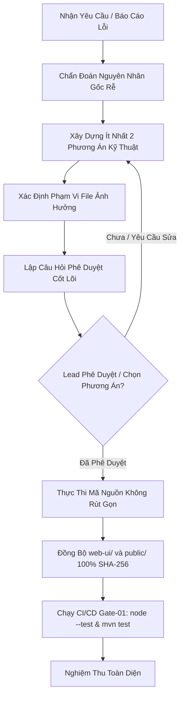
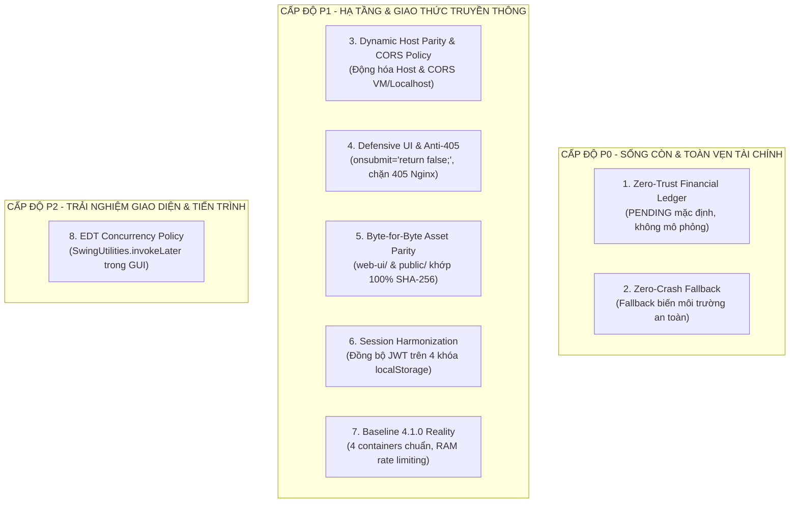
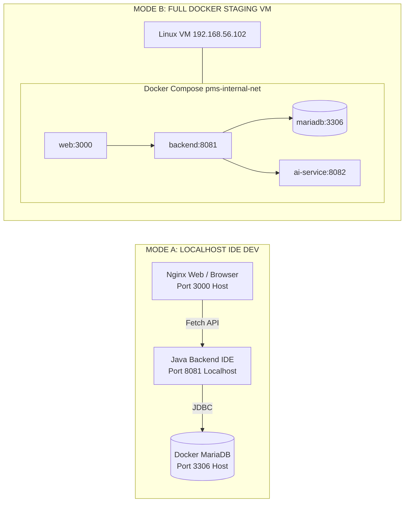
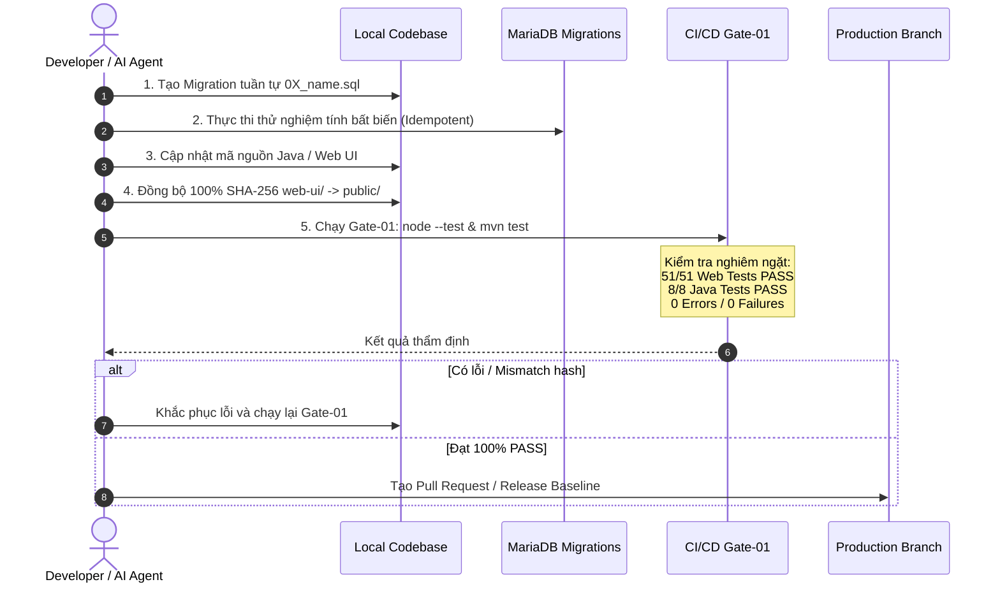

# AURELIA GRAND PALACE 5★ PMS (`QL_KhachSan`)
## ARCHITECTURAL INVARIANTS & HYBRID SPECIFICATION
### Standard 4.1.0-REALISTIC-BASELINE · Supreme Technical Reference (Single Source of Truth)

---

## MỤC LỤC HỆ THỐNG (TABLE OF CONTENTS)
1. [SECTION 1: CONSULT-FIRST PROTOCOL (GIAO THỨC TƯ VẤN & PHÊ DUYỆT TRƯỚC THI HÀNH)](#section-1-consult-first-protocol)
2. [SECTION 2: BỘ 8 NGUYÊN TẮC BẤT BIẾN KIẾN TRÚC (SET OF 8 ARCHITECTURAL INVARIANTS)](#section-2-set-of-8-architectural-invariants)
   - [2.1. Invariant 1 (P0): Zero-Trust Financial Ledger (Sổ Cái Bất Biến Không Tin Tưởng)](#21-invariant-1-p0-zero-trust-financial-ledger)
   - [2.2. Invariant 2 (P0): Zero-Crash Fallback (Dự Phòng Biến Môi Trường Không Đột Tử)](#22-invariant-2-p0-zero-crash-fallback)
   - [2.3. Invariant 3 (P1): Dynamic Host Parity & CORS Policy (Đồng Đẳng Host Động & Chính Sách CORS)](#23-invariant-3-p1-dynamic-host-parity--cors-policy)
   - [2.4. Invariant 4 (P1): Defensive UI & Anti-405 (Giao Diện Phòng Thủ & Chống Lỗi Nginx 405)](#24-invariant-4-p1-defensive-ui--anti-405)
   - [2.5. Invariant 5 (P1): Byte-for-Byte Asset Parity (Đồng Bộ Tuyệt Đối Tài Nguyên Web Tĩnh)](#25-invariant-5-p1-byte-for-byte-asset-parity)
   - [2.6. Invariant 6 (P1): Session Harmonization (Hòa Hợp Phiên Đăng Nhập 4 Khóa)](#26-invariant-6-p1-session-harmonization)
   - [2.7. Invariant 7 (P1): Baseline 4.1.0 Reality (Hạ Tầng 4 Container Tối Giản & In-Memory Limiting)](#27-invariant-7-p1-baseline-410-reality)
   - [2.8. Invariant 8 (P2): EDT Concurrency Policy (Điều Phối Luồng Giao Diện Swing EDT)](#28-invariant-8-p2-edt-concurrency-policy)
3. [SECTION 3: MÔ HÌNH PHÁT TRIỂN HYBRID (HYBRID DEVELOPMENT MODEL)](#section-3-hybrid-development-model)
   - [3.1. Mode A: Localhost IDE Development](#31-mode-a-localhost-ide-development)
   - [3.2. Mode B: Full Docker Staging VM](#32-mode-b-full-docker-staging-vm)
   - [3.3. Ma Trận So Sánh Kiến Trúc Hai Môi Trường](#33-ma-trận-so-sánh-kiến-trúc-hai-môi-trường)
4. [SECTION 4: 5 NGUYÊN TẮC VẬN HÀNH TRÁNH XUNG ĐỘT HẠ TẦNG](#section-4-5-operational-principles-to-avoid-conflicts)
   - [4.1. Quản lý tranh chấp Port 8081 (Backend Collision Control)](#41-quản-lý-tranh-chấp-port-8081)
   - [4.2. Cấp quyền truy cập MariaDB từ xa diện rộng (`'hotel_admin'@'%'`)](#42-cấp-quyền-truy-cập-mariadb-từ-xa-diện-rộng)
   - [4.3. Mở cổng tường lửa Linux UFW (Ubuntu VirtualBox VM)](#43-mở-cổng-tường-lửa-linux-ufw)
   - [4.4. Cơ chế tự động nạp cấu hình (.env Loader & Properties Fallback)](#44-cơ-chế-tự-động-nạp-cấu-hình)
   - [4.5. Bảo toàn dữ liệu sổ cái (Nghiêm cấm Down Volume)](#45-bảo-toàn-dữ-liệu-sổ-cái)
5. [SECTION 5: QUẢN TRỊ DỮ LIỆU & QUY TRÌNH CI/CD GATE-01](#section-5-data-management--cicd-gate-01)
   - [5.1. Quy tắc Migration-First & Tính Bất Biến (Idempotency)](#51-quy-tắc-migration-first--tính-bất-biến)
   - [5.2. Tiêu chuẩn Zero-Regression Gate-01](#52-tiêu-chuẩn-zero-regression-gate-01)
6. [SECTION 6: SỔ TAY LỆNH THAO TÁC NHANH (CLI CHEAT SHEET)](#section-6-cli-cheat-sheet)

---

## SECTION 1: CONSULT-FIRST PROTOCOL

### 1.1. Tuyên Ngôn & Nguyên Tắc Bắt Buộc (Mandatory Core Rule)
Giao thức **Consult-First Protocol** là điều kiện tiên quyết trong quản trị kỹ thuật của dự án Aurelia Grand Palace PMS. 

> [!CRITICAL]
> **QUY TẮC BẤT KHẢ XÂM PHẠM:**
> Khi nhận được bất kỳ báo cáo lỗi (bug report), yêu cầu điều chỉnh mã nguồn (refactoring) hoặc phát triển tính năng mới:
> 1. **TUYỆT ĐỐI KHÔNG ĐƯỢC** tự ý viết code, sửa đổi file, tạo migration hoặc chạy các lệnh terminal thay đổi hệ thống.
> 2. Phải lập tức phản hồi bằng **Báo cáo Thẩm định Kỹ thuật (Technical Appraisal Report)** theo đúng cấu trúc 4 phần chuẩn hóa dưới đây.
> 3. Chỉ được bắt đầu triển khai code và chạy lệnh thực thi **sau khi Lead Architect hoặc người phụ trách kỹ thuật đã xác nhận bằng văn bản hoặc phê duyệt lựa chọn cụ thể**.



### 1.2. Mẫu Phản Hồi Ban Đầu Chuẩn Hóa (Required 4-Point Response Format)

Mọi phản hồi ban đầu từ kỹ sư hoặc AI Agent phải tuân thủ nghiêm ngặt 4 mục sau:

#### Mục 1: Diagnosis (Chẩn đoán nguyên nhân gốc rễ)
- Trình bày ngắn gọn, chính xác bản chất kỹ thuật từ 2 đến 3 câu.
- Chỉ rõ lớp kiến trúc xảy ra sự cố (Database, Network, Java Backend Filter/Controller, Browser Session/DOM).
- Dẫn chứng vị trí file và dòng code hoặc ngoại lệ hệ thống gặp phải.

#### Mục 2: Options (Phương án đề xuất & Phân tích Đánh đổi)
- Đưa ra tối thiểu **2 phương án kỹ thuật khả thi** (Phương án A & Phương án B).
- Phân tích rõ ràng ưu điểm và nhược điểm của từng phương án trên cả hai môi trường:
  - *Môi trường Docker Container (Linux VM `192.168.56.102`)*
  - *Môi trường Local Machine Development (`localhost:8081` / NetBeans / IntelliJ)*

#### Mục 3: Scope of Impact (Phạm vi ảnh hưởng)
- Liệt kê danh sách chính xác các file dự kiến được thêm mới hoặc chỉnh sửa.
- Phân loại rõ ràng: SQL Migration, Docker/Infra, Java Backend, Client-side Assets (`web-ui/` và `web-ui/public/`).

#### Mục 4: Clarification (Các điểm kỹ thuật cần xác nhận)
- Liệt kê các câu hỏi trọng tâm cần Lead phê duyệt trước khi lập trình.
- Nêu rõ các giả định nghiệp vụ (business assumptions) hoặc rủi ro phụ thuộc (dependencies).

---

## SECTION 2: SET OF 8 ARCHITECTURAL INVARIANTS

Tất cả các đoạn mã nguồn và cấu hình được triển khai vào dự án phải thỏa mãn tuyệt đối bộ 8 nguyên tắc kiến trúc sau:



---

### 2.1. Invariant 1 (P0): Zero-Trust Financial Ledger
- **Yêu cầu cốt lõi:**
  1. Mọi bản ghi đặt phòng (`bookings`) khởi tạo từ phía client phải luôn có trạng thái mặc định: `status = 'PENDING'` và `paymentStatus = 'PENDING'`.
  2. Tuyệt đối nghiêm cấm client tự ý gửi hoặc sửa đổi trạng thái thành `CONFIRMED` hoặc `PAID`. Chỉ có máy chủ Backend PMS mới có quyền chuyển trạng thái booking thông qua hai cơ chế hợp lệ:
     - Nhận webhook ngân hàng hợp lệ có chữ ký số HMAC-SHA256 từ cổng VietQR (`/api/v1/webhooks/vietqr`).
     - Lễ tân/Thu ngân xác nhận thanh toán trực tiếp tại quầy qua màn hình POS Swing và tạo hóa đơn/phiếu thu đã ký duyệt.
  3. Tuyệt đối nghiêm cấm tạo mã đặt phòng giả định, dùng hàm `Math.random()`, tạo cờ `isSimulated: true`, hoặc ghi đè booking "rác" vào `localStorage` khi gặp sự cố mạng. Khi mất kết nối, hệ thống phải ném ngoại lệ rõ ràng (`ApiError`).

- **Minh họa Mã nguồn Client ([web-ui/js/api.js](file:///c:/NetBeansProjects/QL_KhachSan/web-ui/js/api.js)):**
```javascript
// TUÂN THỦ INVARIANT 1: Không tự tạo booking giả lập, ném ApiError khi lỗi
export async function createBooking(payload) {
  // Bắt buộc trạng thái gửi lên khởi điểm là PENDING
  const sanitizedPayload = {
    ...payload,
    status: 'PENDING',
    paymentStatus: 'PENDING',
    isSimulated: false // Nghiêm cấm cờ simulation
  };

  try {
    const result = await api.post('/bookings/public', sanitizedPayload);
    if (!result || !result.bookingCode) {
      throw new ApiError('Máy chủ không phản hồi mã đặt phòng hợp lệ.');
    }
    return result;
  } catch (err) {
    // Không fallback sang lưu trữ booking giả lập trong localStorage
    throw new ApiError(err.message || 'Không thể khởi tạo đặt phòng. Vui lòng liên hệ lễ tân.');
  }
}
```

- **Minh họa Mã nguồn Backend ([BookingController.java](file:///c:/NetBeansProjects/QL_KhachSan/src/quanlykhachsan/backend/booking/BookingController.java)):**
```java
// TUÂN THỦ INVARIANT 1: Cưỡng chế PENDING ở tầng xử lý nghiệp vụ máy chủ
public Booking createPendingBooking(BookingRequest req) throws SQLException {
    Booking booking = new Booking();
    booking.setBookingCode("AUR-" + System.currentTimeMillis() + "-" + (int)(Math.random() * 900 + 100));
    booking.setCustomerId(req.getCustomerId());
    booking.setRoomId(req.getRoomId());
    booking.setCheckInDate(req.getCheckInDate());
    booking.setCheckOutDate(req.getCheckOutDate());
    
    // BẮT BUỘC SỔ CÁI BẤT BIẾN: Trạng thái không thể bị client ghi đè
    booking.setStatus("PENDING");
    booking.setPaymentStatus("PENDING");
    
    bookingDAO.insert(booking);
    return booking;
}
```

---

### 2.2. Invariant 2 (P0): Zero-Crash Fallback
- **Yêu cầu cốt lõi:**
  1. Mọi phương thức truy xuất cấu hình bảo mật trong Java (như `HMAC_IDENTITY_KEY`, `JWT_SECRET`, `AES_VAULT_KEY`) phải luôn có cơ chế fallback an toàn qua `System.getenv().getOrDefault(...)` hoặc nạp từ file cấu hình nội bộ.
  2. Nghiêm cấm ném `IllegalStateException` làm crash server hoặc ngắt tiến trình khởi động khi chạy trên máy trạm lập trình (Localhost/IDE) hoặc môi trường kiểm thử chưa cấu hình đủ biến môi trường.
  3. Giá trị fallback phải đủ độ dài và bảo mật tối thiểu cho môi trường phát triển (VD: 32 bytes cho mã hóa AES/HMAC).

- **Minh họa Mã nguồn Backend ([SecurityUtil.java](file:///c:/NetBeansProjects/QL_KhachSan/src/quanlykhachsan/backend/utils/SecurityUtil.java) & [SecretConfiguration.java](file:///c:/NetBeansProjects/QL_KhachSan/src/quanlykhachsan/backend/utils/SecretConfiguration.java)):**
```java
public class SecurityUtil {
    // Fallback secret 32-byte an toàn dùng cho Local Dev & Test
    private static final String DEFAULT_DEV_HMAC_SECRET = 
        "aurelia_default_dev_hmac_secret_2026_fallback";

    public static String getHmacIdentityKey() {
        String key = System.getenv().getOrDefault("HMAC_IDENTITY_KEY", DEFAULT_DEV_HMAC_SECRET);
        if (key == null || key.isBlank()) {
            return DEFAULT_DEV_HMAC_SECRET;
        }
        return key;
    }
}
```

```java
public final class SecretConfiguration {
    public static String getJwtSecret() {
        return System.getenv().getOrDefault("JWT_SECRET", 
            "aurelia_pms_super_secret_jwt_key_2026_luxury_hotel_minimum_256_bits");
    }

    public static String getAesVaultKey() {
        return System.getenv().getOrDefault("AES_VAULT_KEY", 
            "YXVyZWxpYV9wbXNfYWVzXzI1Nl92YXVsdF9rZXlfMjAyNg=="); // Base64 32 bytes
    }
}
```

---

### 2.3. Invariant 3 (P1): Dynamic Host Parity & CORS Policy
- **Yêu cầu cốt lõi:**
  1. Frontend Client tuyệt đối không được fix cứng địa chỉ IP (`192.168.56.102`, `127.0.0.1`, `localhost`) hoặc fix cứng giao thức (`http://`). Tất cả URL API phải phân giải động theo ngữ cảnh trình duyệt (`window.location.hostname` và `window.location.protocol`).
  2. Backend [CorsFilter.java](file:///c:/NetBeansProjects/QL_KhachSan/src/quanlykhachsan/backend/utils/CorsFilter.java) phải chấp nhận động tất cả các Origin hợp lệ xuất phát từ `localhost:*`, `127.0.0.1:*`, và dải IP mạng ảo VirtualBox Host-Only `192.168.56.*` (kèm theo header `Access-Control-Allow-Credentials: true`). Khi không có header `Origin` (như kiểm thử nội bộ), phải fallback về `*` để đảm bảo 100% test compatibility.

- **Minh họa Phía Client ([web-ui/js/api.js](file:///c:/NetBeansProjects/QL_KhachSan/web-ui/js/api.js)):**
```javascript
export const getDynamicApiBaseUrl = () => {
  if (typeof window === 'undefined' || !window.location || !window.location.hostname) {
    return 'http://localhost:8081/api/v1'; 
  }
  const protocol = window.location.protocol === 'https:' ? 'https:' : 'http:';
  const hostname = window.location.hostname; 
  return `${protocol}//${hostname}:8081/api/v1`; 
};

export const API_BASE_URL = getDynamicApiBaseUrl();
```

- **Minh họa Phía Backend ([CorsFilter.java](file:///c:/NetBeansProjects/QL_KhachSan/src/quanlykhachsan/backend/utils/CorsFilter.java)):**
```java
public class CorsFilter extends Filter {
    public static final String ALLOWED_ORIGIN = "*";
    public static final String ALLOWED_METHODS = "GET, POST, PUT, DELETE, OPTIONS";
    public static final String ALLOWED_HEADERS = "Content-Type, Authorization, X-User-Role, Idempotency-Key, X-Signature, ngrok-skip-browser-warning";

    public static String resolveOrigin(HttpExchange exchange) {
        if (exchange == null) return ALLOWED_ORIGIN;
        String origin = exchange.getRequestHeaders().getFirst("Origin");
        if (origin != null && !origin.isBlank()) {
            origin = origin.trim();
            if (origin.matches("https?://(localhost|127\\.0\\.0\\.1)(:[0-9]+)?")
                    || origin.matches("https?://192\\.168\\.56\\.[0-9]+(:[0-9]+)?")) {
                return origin;
            }
        }
        return ALLOWED_ORIGIN;
    }

    @Override
    public void doFilter(HttpExchange exchange, Chain chain) throws IOException {
        String origin = resolveOrigin(exchange);
        exchange.getResponseHeaders().set("Access-Control-Allow-Origin", origin);
        if (!ALLOWED_ORIGIN.equals(origin)) {
            exchange.getResponseHeaders().set("Access-Control-Allow-Credentials", "true");
        }
        exchange.getResponseHeaders().set("Access-Control-Allow-Methods", ALLOWED_METHODS);
        exchange.getResponseHeaders().set("Access-Control-Allow-Headers", ALLOWED_HEADERS);
        exchange.getResponseHeaders().set("Access-Control-Max-Age", "86400");

        if ("OPTIONS".equalsIgnoreCase(exchange.getRequestMethod())) {
            exchange.sendResponseHeaders(204, -1);
            exchange.close();
            return;
        }
        chain.doFilter(exchange);
    }
}
```

---

### 2.4. Invariant 4 (P1): Defensive UI & Anti-405
- **Yêu cầu cốt lõi:**
  1. Tất cả các thẻ `<form>` trong [portal.html](file:///c:/NetBeansProjects/QL_KhachSan/web-ui/portal.html) và `index.html` phải luôn chứa thuộc tính `onsubmit="return false;"`.
  2. Mọi hàm xử lý sự kiện submit trong JavaScript phải đặt `e.preventDefault()` ngay tại dòng đầu tiên để ngăn chặn hoàn toàn hiện tượng trình duyệt gửi form POST đồng bộ trực tiếp lên web server tĩnh (gây lỗi `405 Not Allowed` trên Nginx).
  3. Tuyệt đối không dùng hàm `alert()` đồng bộ làm gián đoạn tiến trình render trang; toàn bộ thông báo trạng thái phải được hiển thị qua thông báo trực quan (`#auth-status` inline badge).
  4. Loại bỏ các nút đóng gây nhầm lẫn trên giao diện Member Portal và phòng thủ bằng CSS.

- **Minh họa HTML & CSS ([portal.html](file:///c:/NetBeansProjects/QL_KhachSan/web-ui/portal.html) & [portal.css](file:///c:/NetBeansProjects/QL_KhachSan/web-ui/portal.css)):**
```html
<!-- KHÔNG BAO GIỜ BỎ onsubmit="return false;" -->
<form id="login-form" class="auth-form" method="POST" onsubmit="return false;" autocomplete="on">
  <label for="login-username">Tên đăng nhập / Email</label>
  <input class="input input-md" id="login-username" name="username" required maxlength="100">
  
  <label for="login-password">Mật khẩu</label>
  <input class="input input-md" id="login-password" name="password" type="password" required maxlength="200">
  
  <button class="btn portal-primary w-full" type="submit" id="btn-login-submit">
    <span>Secure Login</span>
  </button>
</form>
```

```css
/* CSS Phòng thủ triệt tiêu nút đóng 'X' thừa thãi */
header a:has(i[data-lucide="x"]),
.auth-card button:has(i[data-lucide="x"]),
.auth-card a:has(i[data-lucide="x"]),
#btn-close-card,
.auth-card-close {
  display: none !important;
}
```

- **Minh họa JavaScript ([portal-app.js](file:///c:/NetBeansProjects/QL_KhachSan/web-ui/portal-app.js)):**
```javascript
export async function handleLoginSubmit(e) {
  if (e && typeof e.preventDefault === 'function') {
    e.preventDefault(); // Dòng đầu tiên bắt buộc
  }
  // Logic xử lý JSON API bất đồng bộ
}
```

---

### 2.5. Invariant 5 (P1): Byte-for-Byte Asset Parity
- **Yêu cầu cốt lõi:**
  1. Thư mục `web-ui/` và thư mục `web-ui/public/` phải luôn duy trì trạng thái giống nhau 100% từng byte dữ liệu (SHA-256 hash trùng khớp hoàn toàn trên tất cả các tệp).
  2. Bất kỳ thay đổi nào thực hiện trên `web-ui/` phải được sao chép ngay lập tức sang `web-ui/public/` trước khi chạy bộ test `node --test web-ui/tests/*.test.mjs`.

- **Bảng Danh Mục File Bắt Buộc Đồng Bộ:**
| STT | Đường Dẫn Nguồn (`web-ui/`) | Đường Dẫn Đích (`web-ui/public/`) | Tiêu Chí Kiểm Tra |
|:---:|:---|:---|:---:|
| 1 | `portal.html` | `public/portal.html` | SHA-256 Exact Match |
| 2 | `portal-app.js` | `public/portal-app.js` | SHA-256 Exact Match |
| 3 | `portal.css` | `public/portal.css` | SHA-256 Exact Match |
| 4 | `portal-customer.css` | `public/portal-customer.css` | SHA-256 Exact Match |
| 5 | `portal-theme.css` | `public/portal-theme.css` | SHA-256 Exact Match |
| 6 | `js/api.js` | `public/js/api.js` | SHA-256 Exact Match |
| 7 | `js/view-customer.js` | `public/js/view-customer.js` | SHA-256 Exact Match |
| 8 | `js/customer/tier-helper.js` | `public/js/customer/tier-helper.js` | SHA-256 Exact Match |
| 9 | `js/customer/dashboard.js` | `public/js/customer/dashboard.js` | SHA-256 Exact Match |
| 10 | `js/customer/bookings.js` | `public/js/customer/bookings.js` | SHA-256 Exact Match |
| 11 | `js/customer/profile.js` | `public/js/customer/profile.js` | SHA-256 Exact Match |
| 12 | `js/customer/security.js` | `public/js/customer/security.js` | SHA-256 Exact Match |

---

### 2.6. Invariant 6 (P1): Session Harmonization
- **Yêu cầu cốt lõi:**
  1. Khi người dùng đăng nhập hoặc đăng ký thành công (kể cả Local Auth, Google GIS hay Facebook Login), JWT token nhận về phải được lưu đồng thời và nhất quán trên **đủ 4 khóa `localStorage`**:
     - `customer_token`
     - `auth_token`
     - `token`
     - `hotel_auth_session` (chuỗi JSON chứa token, userId, username, fullName, role)
  2. Khi đăng xuất, phải xóa sạch toàn bộ 4 khóa này để đảm bảo không rò rỉ phiên.

- **Minh họa Triển Khai ([portal-app.js](file:///c:/NetBeansProjects/QL_KhachSan/web-ui/portal-app.js)):**
```javascript
export function completeLogin(result, defaultUsername) {
  const payload = result?.data || result || {};
  const token = payload.token || payload.access_token || payload.jwt || result?.token;
  const rawRole = payload.role || result?.role || 'CUSTOMER';
  const role = roleOf(rawRole) || 'CUSTOMER';

  if (!token) {
    throw new Error('Máy chủ không trả về quyền truy cập hợp lệ cho tài khoản này.');
  }

  if (typeof localStorage !== 'undefined') {
    // Lưu đồng thời trên 4 khóa bắt buộc
    localStorage.setItem('customer_token', token);
    localStorage.setItem('auth_token', token);
    localStorage.setItem('token', token);

    const user = {
      token: token,
      userId: payload.userId ?? payload.id ?? payload.user_id ?? 1,
      username: payload.username || defaultUsername || payload.email || 'member',
      fullName: payload.fullName || payload.full_name || payload.name || 'Quý Hội Viên',
      role: role === 'STAFF' ? String(rawRole).toUpperCase() : role
    };
    localStorage.setItem('hotel_auth_session', JSON.stringify(user));
    setAuthSession(user);
  }
}
```

---

### 2.7. Invariant 7 (P1): Baseline 4.1.0 Reality
- **Yêu cầu cốt lõi:**
  1. Toàn bộ hệ thống triển khai theo chuẩn tinh gọn **4 containers duy nhất**:
     - `mariadb:11.2-jammy` (Port `3306`)
     - `backend` Java 17 HTTPServer (Port `8081`)
     - `web` Nginx 1.25 Alpine (Port `3000` -> `80`)
     - `ai-service` Python FastAPI/Faiss (Port `8082`)
  2. Nghiêm cấm đưa vào các container phụ trợ phức tạp như Redis, Prometheus, Grafana, hay Jaeger.
  3. Cơ chế giới hạn tần suất gọi API (Rate Limiting) phải được thực hiện bằng bộ nhớ RAM nội bộ của tiến trình JVM (`IpRateLimiter.java` sử dụng `ConcurrentHashMap` và thuật toán Token Bucket).

- **Kiến Trúc Container ([docker-compose.yml](file:///c:/NetBeansProjects/QL_KhachSan/docker-compose.yml)):**
```yaml
services:
  mariadb:
    image: mariadb:11.2-jammy
    ports: ["3306:3306"]
    volumes:
      - ./database:/pms-database:ro
      - ./database/bootstrap/00-init.sh:/docker-entrypoint-initdb.d/00-init.sh:ro
      - mariadb_data:/var/lib/mysql

  backend:
    build: { context: ., dockerfile: Dockerfile }
    ports: ["8081:8081"]
    depends_on: { mariadb: { condition: service_healthy } }

  web:
    image: nginx:1.25-alpine
    ports: ["3000:80"]
    volumes:
      - ./web-ui:/usr/share/nginx/html:ro
      - ./nginx.conf:/etc/nginx/conf.d/default.conf:ro
    depends_on: { backend: { condition: service_healthy } }

  ai-service:
    build: { context: ./ai-service, dockerfile: Dockerfile }
    ports: ["8082:8082"]
```

---

### 2.8. Invariant 8 (P2): EDT Concurrency Policy
- **Yêu cầu cốt lõi:**
  1. Đối với ứng dụng Java Swing Client (Desktop App dành cho Lễ tân, Thu ngân, Quản lý): Mọi tác vụ gọi API mạng hoặc tính toán nặng phải được thực hiện trên luồng Worker (Background Thread) tách biệt.
  2. Toàn bộ thao tác cập nhật trạng thái các thành phần giao diện Swing (ví dụ: `setText()`, `setModel()`, `setVisible()`, `setEnabled()`, `JOptionPane.showMessageDialog()`) **BẮT BUỘC** phải được đưa trở lại luồng Event Dispatch Thread (EDT) thông qua `SwingUtilities.invokeLater()`.

- **Minh họa Triển Khai Swing Client:**
```java
// TUÂN THỦ INVARIANT 8: Điều phối luồng giao diện Swing an toàn
public void refreshRoomMapAsync() {
    // 1. Luồng chạy nền (Worker Thread) thực hiện gọi HTTP API
    Executors.newVirtualThreadPerTaskExecutor().submit(() -> {
        try {
            List<RoomDto> rooms = RoomApiClient.fetchAvailableRooms();
            
            // 2. Bắt buộc chuyển sang luồng EDT khi cập nhật giao diện Swing
            SwingUtilities.invokeLater(() -> {
                roomTableModel.setData(rooms);
                lblStatus.setText("Cập nhật sơ đồ phòng thành công (" + rooms.size() + " phòng)");
                btnCheckIn.setEnabled(true);
            });
        } catch (Exception ex) {
            SwingUtilities.invokeLater(() -> {
                JOptionPane.showMessageDialog(mainFrame, 
                    "Không thể tải dữ liệu phòng: " + ex.getMessage(), 
                    "Lỗi Mạng", JOptionPane.ERROR_MESSAGE);
                lblStatus.setText("Lỗi đồng bộ dữ liệu");
            });
        }
    });
}
```

---

## SECTION 3: HYBRID DEVELOPMENT MODEL

Hệ thống Aurelia PMS được thiết kế vận hành linh hoạt giữa hai chế độ hoạt động:



### 3.1. Mode A: Localhost IDE Development
- **Mục đích:** Dành cho lập trình viên cần lập trình, sửa lỗi nhanh, đặt breakpoint debug từng dòng code Java trên NetBeans, IntelliJ IDEA hoặc VS Code.
- **Cấu hình vận hành:**
  - Container `mariadb` (và tùy chọn `web`) được bật qua Docker: `docker compose up -d mariadb web`.
  - Cổng `3306` của MariaDB được map trực tiếp ra máy host (`127.0.0.1:3306`).
  - Ứng dụng Java Backend được chạy trực tiếp từ IDE hoặc qua lệnh `mvn exec:java` trên máy host, lắng nghe tại `localhost:8081`.
  - File [DatabaseConnection.java](file:///c:/NetBeansProjects/QL_KhachSan/src/quanlykhachsan/backend/utils/DatabaseConnection.java) tự động nhận diện `DB_HOST=localhost` (hoặc fallback qua `config.properties`) và kết nối thành công vào cơ sở dữ liệu.
  - Toàn bộ secret bảo mật tự động nạp fallback keys (Invariant 2).

### 3.2. Mode B: Full Docker Staging VM
- **Mục đích:** Dành cho kiểm thử tích hợp toàn diện (E2E Integration Testing), mô phỏng môi trường phát hành chuẩn, chạy trên máy ảo Linux VirtualBox/VMware (`192.168.56.102`).
- **Cấu hình vận hành:**
  - Tất cả 4 container (`mariadb`, `backend`, `web`, `ai-service`) được khởi chạy đồng bộ: `docker compose up -d --build`.
  - Mạng nội bộ `pms-internal-net` cô lập các service, giao tiếp nội bộ qua tên service DNS (`mariadb:3306`, `ai-service:8082`).
  - Trình duyệt truy cập Cổng thành viên qua `http://192.168.56.102:3000/portal.html`.
  - Frontend tự động phát hiện hostname `192.168.56.102` và gọi API tương ứng tới `http://192.168.56.102:8081/api/v1` (Invariant 3).

### 3.3. Ma Trận So Sánh Kiến Trúc Hai Môi Trường

| Đặc Điểm Kiến Trúc | Mode A: Localhost IDE Dev | Mode B: Full Docker Staging VM |
|:---|:---|:---|
| **Vị trí chạy Backend Java** | Tiến trình JVM trên máy Host (NetBeans/IntelliJ) | Container Docker `backend` trên Linux VM |
| **Địa chỉ API Endpoint** | `http://localhost:8081/api/v1` | `http://192.168.56.102:8081/api/v1` |
| **Cơ sở dữ liệu MariaDB** | Container Docker map port `3306:3306` | Container Docker nội bộ `pms-internal-net` |
| **Nạp Biến Môi Trường** | Auto Fallback an toàn + `.env` + `config.properties` | Đọc trực tiếp từ file `.env` / `docker-compose.yml` |
| **Khả năng Debug Code** | Hỗ trợ Step-by-Step Breakpoint tức thì | Xem log container qua `docker compose logs -f` |
| **Tải Static Web UI** | Trình duyệt mở trực tiếp file hoặc Nginx container | Nginx container phục vụ qua cổng `3000` |
| **CORS Origin Header** | `http://localhost:*`, `http://127.0.0.1:*` | `http://192.168.56.*` |

---

## SECTION 4: 5 OPERATIONAL PRINCIPLES TO AVOID INFRASTRUCTURE CONFLICTS

Để vận hành mô hình Hybrid không xảy ra xung đột tài nguyên giữa Host và VM, bắt buộc tuân thủ 5 nguyên tắc sau:

### 4.1. Quản lý tranh chấp Port 8081 (Backend Collision Control)
- **Vấn đề:** Khi container `backend` trong Docker VM đang chạy và chiếm dụng cổng `8081`, nếu lập trình viên khởi động Backend từ IDE trên máy host trỏ cùng port hoặc debug trên VM, hệ thống sẽ gặp lỗi nghiêm trọng `java.net.BindException: Address already in use`.
- **Nguyên tắc xử lý:**
  - Trước khi khởi động Backend từ IDE: Bắt buộc dừng container backend bằng lệnh:
    ```bash
    docker compose stop backend
    ```
  - Khi hoàn tất debug và muốn bàn giao chạy thử nghiệm toàn bộ container:
    ```bash
    docker compose start backend
    ```

### 4.2. Cấp quyền truy cập MariaDB từ xa diện rộng (`'hotel_admin'@'%'`)
- **Vấn đề:** Mặc định user MariaDB tạo cho container nội bộ thường chỉ chấp nhận kết nối từ `localhost` hoặc subnet Docker, dẫn đến việc ứng dụng chạy từ IDE máy host bị từ chối truy cập (`Access denied for user`).
- **Lưu ý Vòng đời Container MariaDB:** Thư mục `/docker-entrypoint-initdb.d/` chỉ tự động nạp script khởi tạo khi volume dữ liệu hoàn toàn mới và rỗng (`DATADIR_IS_EMPTY=true`). Nếu đã tồn tại volume `mariadb_data` từ trước, MariaDB sẽ bỏ qua toàn bộ script init để bảo vệ dữ liệu.
- **Nguyên tắc xử lý & Lệnh Hot-Apply:** User cơ sở dữ liệu `hotel_admin` phải được cấp quyền trên wildcard `%`. Đối với container đang chạy có sẵn dữ liệu, thực hiện nạp quyền trực tiếp không cần xóa volume:
  ```bash
  # Lệnh One-liner Hot-Apply quyền từ xa cho MariaDB container đang hoạt động:
  docker exec -i aurelia-mariadb mariadb -uroot -photel_root_secret_2026 < database/grant_remote_access.sql
  ```
  Nội dung script idempotent chuẩn hóa ([grant_remote_access.sql](file:///c:/NetBeansProjects/QL_KhachSan/database/grant_remote_access.sql)):
  ```sql
  USE hotel_prod_db;
  CREATE USER IF NOT EXISTS 'hotel_admin'@'%' IDENTIFIED BY 'hotel_secret_pass';
  ALTER USER 'hotel_admin'@'%' IDENTIFIED BY 'hotel_secret_pass';
  GRANT ALL PRIVILEGES ON hotel_prod_db.* TO 'hotel_admin'@'%';
  GRANT ALL PRIVILEGES ON `hotel_prod_db`.* TO 'hotel_admin'@'%';
  CREATE USER IF NOT EXISTS 'hotel_admin'@'localhost' IDENTIFIED BY 'hotel_secret_pass';
  GRANT ALL PRIVILEGES ON hotel_prod_db.* TO 'hotel_admin'@'localhost';
  FLUSH PRIVILEGES;
  SELECT User, Host FROM mysql.user WHERE User = 'hotel_admin';
  ```

### 4.3. Mở cổng tường lửa Linux UFW (Ubuntu VirtualBox VM)
- **Vấn đề:** Tường lửa mặc định `ufw` trên Linux VM chặn các kết nối vào từ Host-Only Adapter (`192.168.56.1`).
- **Nguyên tắc xử lý:** Mở đầy đủ các cổng dịch vụ cần thiết trên Linux VM:
  ```bash
  sudo ufw allow 3306/tcp comment 'MariaDB Remote Port'
  sudo ufw allow 8081/tcp comment 'Java PMS Backend API Port'
  sudo ufw allow 3000/tcp comment 'Nginx Member Portal Web Port'
  sudo ufw allow 8082/tcp comment 'AI Microservice Port'
  sudo ufw reload
  sudo ufw status verbose
  ```

### 4.4. Cơ chế tự động nạp cấu hình (.env Loader & Properties Fallback)
- **Vấn đề:** Khi chạy từ NetBeans/IntelliJ, các biến môi trường cấu hình trong `docker-compose.yml` không tự động truyền vào JVM của máy host.
- **Nguyên tắc xử lý:** Lớp [DatabaseConnection.java](file:///c:/NetBeansProjects/QL_KhachSan/src/quanlykhachsan/backend/utils/DatabaseConnection.java) và [SecretConfiguration.java](file:///c:/NetBeansProjects/QL_KhachSan/src/quanlykhachsan/backend/utils/SecretConfiguration.java) triển khai thuật toán nạp cấu hình 3 bậc:
  1. Kiểm tra biến môi trường hệ thống (`System.getenv(key)`).
  2. Nếu rỗng, nạp từ file `config.properties` hoặc `.env` nằm tại thư mục gốc dự án.
  3. Nếu vẫn không có, kích hoạt giá trị Fallback an toàn (Invariant 2).

### 4.5. Bảo toàn dữ liệu sổ cái (Nghiêm cấm Down Volume)
- **Vấn đề:** Lệnh `docker compose down -v` sẽ xóa vĩnh viễn volume `mariadb_data`, phá hủy toàn bộ dữ liệu lịch sử đặt phòng, thanh toán và cấu hình phòng đã tạo.
- **Nguyên tắc xử lý:**
  - Nghiêm cấm tuyệt đối sử dụng flag `-v` trong các thao tác bảo trì hàng ngày.
  - Khi cần dừng hệ thống, chỉ dùng:
    ```bash
    docker compose down
    ```
  - Chỉ xóa volume khi có chỉ thị trực tiếp từ Lead Architect để thực hiện Hard Reset môi trường:
    ```bash
    # CHỈ DÙNG KHI CÓ PHÊ DUYỆT CỦA LEAD:
    docker compose down -v
    ```

---

## SECTION 5: DATA MANAGEMENT & CI/CD GATE-01 PROCEDURES



### 5.1. Quy tắc Migration-First & Tính Bất Biến (Idempotency)
1. **Quy tắc tạo file migration:**
   - Mọi thay đổi bảng, cột, chỉ mục (Index) hoặc dữ liệu tham chiếu phải được tạo thành file SQL độc lập nằm trong thư mục `database/migrations/`.
   - Quy tắc đặt tên file tuần tự theo tiền tố số: `01_init.sql`, `02_tier_pricing.sql`, `03_guest_auth.sql`, `04_social_auth.sql`, `05_next_feature.sql`.
2. **Tính bất biến (Idempotent Standard):**
   - File SQL phải thực thi được nhiều lần mà không gây ra lỗi dừng tiến trình (ví dụ: `Duplicate column name` hoặc `Table already exists`).
   - Sử dụng cú pháp `ADD COLUMN IF NOT EXISTS`, `CREATE INDEX IF NOT EXISTS`, hoặc kiểm tra động qua bảng `INFORMATION_SCHEMA`:
     ```sql
     -- Ví dụ mẫu kiểm tra thêm cột bất biến:
     ALTER TABLE customers
       ADD COLUMN IF NOT EXISTS auth_provider VARCHAR(20) NOT NULL DEFAULT 'LOCAL',
       ADD COLUMN IF NOT EXISTS provider_id VARCHAR(120) NULL;

     -- Ví dụ mẫu thêm Index an toàn:
     SET @dbname = DATABASE();
     SET @tablename = "users";
     SET @indexname = "uq_users_email";
     SET @preparedStatement = (SELECT IF(
       (SELECT COUNT(*) FROM INFORMATION_SCHEMA.STATISTICS
        WHERE table_schema = @dbname AND table_name = @tablename AND index_name = @indexname) > 0,
       "SELECT 1",
       "CREATE UNIQUE INDEX uq_users_email ON users(email)"
     ));
     PREPARE alterIfNotExists FROM @preparedStatement;
     EXECUTE alterIfNotExists;
     DEALLOCATE PREPARE alterIfNotExists;
     ```

### 5.2. Tiêu chuẩn Zero-Regression Gate-01
Trước khi bất kỳ commit nào được hợp nhất (merge) hoặc bàn giao, hệ thống phải vượt qua cổng kiểm định **Gate-01**:

| Tiêu Chí Kiểm Tra Gate-01 | Lệnh Thực Thi | Yêu Cầu Tối Thiểu | Trạng Thái Bắt Buộc |
|:---|:---|:---:|:---:|
| **Web Test Runner** | `node --test web-ui/tests/*.test.mjs` | 51/51 test cases | **100% PASS (0 Fails)** |
| **Java Unit Tests** | `mvn test` | Toàn bộ suite backend | **BUILD SUCCESS (0 Failures, 0 Errors)** |
| **Java Compile Check** | `mvn test-compile` | 319 source + 90 test classes | **BUILD SUCCESS** |
| **Asset Parity Verification** | So sánh SHA-256 12 core assets | Hash khớp từng byte | **100% MATCH** |

---

## SECTION 6: SỔ TAY LỆNH THAO TÁC NHANH (CLI CHEAT SHEET)

Dưới đây là các lệnh one-liner chuẩn hóa phục vụ vận hành hàng ngày:

### 6.1. Lệnh khởi chạy Mode A (Localhost IDE Dev)
Chỉ bật database MariaDB và web tĩnh trên Docker, giải phóng port 8081 để debug trên IDE:
```bash
docker compose up -d mariadb web && docker compose stop backend
```

### 6.2. Lệnh khởi chạy Mode B (Full Docker VM Staging)
Biên dịch lại và chạy toàn bộ cụm 4 containers trên máy ảo:
```bash
docker compose up -d --build && docker compose ps
```

### 6.3. Lệnh đồng bộ Asset từ `web-ui/` sang `web-ui/public/`

#### Dành cho môi trường Windows PowerShell:
```powershell
Copy-Item -Path "web-ui\portal.html" -Destination "web-ui\public\portal.html" -Force; Copy-Item -Path "web-ui\portal-app.js" -Destination "web-ui\public\portal-app.js" -Force; Copy-Item -Path "web-ui\portal.css" -Destination "web-ui\public\portal.css" -Force; Copy-Item -Path "web-ui\js\api.js" -Destination "web-ui\public\js\api.js" -Force; Copy-Item -Path "web-ui\js\api.js" -Destination "web-ui\api.js" -Force; Write-Host "Đồng bộ tài nguyên Web hoàn tất 100%." -ForegroundColor Green
```

#### Dành cho môi trường Linux / macOS / Bash:
```bash
cp web-ui/portal.html web-ui/public/portal.html && cp web-ui/portal-app.js web-ui/public/portal-app.js && cp web-ui/portal.css web-ui/public/portal.css && cp web-ui/js/api.js web-ui/public/js/api.js && cp web-ui/js/api.js web-ui/api.js && echo "Đồng bộ tài nguyên Web hoàn tất 100%."
```

### 6.4. Lệnh kiểm tra tính toàn vẹn SHA-256 Hash giữa hai thư mục Web
```powershell
# Chạy trên Windows PowerShell:
$files = @("portal.html", "portal-app.js", "portal.css", "js/api.js")
foreach ($f in $files) {
    $h1 = (Get-FileHash "web-ui\$f" -Algorithm SHA256).Hash
    $h2 = (Get-FileHash "web-ui\public\$f" -Algorithm SHA256).Hash
    Write-Host "$f : Match = $($h1 -eq $h2) ($h1)"
}
```

### 6.5. Lệnh thực thi toàn bộ quy trình kiểm thử tự động Gate-01
```powershell
# Chạy đồng bộ assets và kiểm thử toàn bộ Web & Java backend:
Copy-Item -Path "web-ui\portal.html" -Destination "web-ui\public\portal.html" -Force; Copy-Item -Path "web-ui\portal-app.js" -Destination "web-ui\public\portal-app.js" -Force; Copy-Item -Path "web-ui\portal.css" -Destination "web-ui\public\portal.css" -Force; Copy-Item -Path "web-ui\js\api.js" -Destination "web-ui\public\js\api.js" -Force; Copy-Item -Path "web-ui\js\api.js" -Destination "web-ui\api.js" -Force; node --test web-ui/tests/*.test.mjs; mvn test "-Dtest=JwtFilterTest,CorsAndStaticServingTest,PromptGuardrailFilterTest"
```

### 6.6. Lệnh kiểm tra kết nối Database & Telemetry Pool
```bash
# Kiểm tra ping trực tiếp vào container MariaDB từ máy host:
mariadb -h 127.0.0.1 -P 3306 -u hotel_admin -photel_secret_pass -e "SELECT @@version, DATABASE();"

# Kiểm tra trạng thái sức khỏe service backend:
curl -i http://localhost:8081/api/v1/health
# Hoặc trên VM:
curl -i http://192.168.56.102:8081/api/v1/health
```

### 6.7. Lệnh Hot-Apply cấp quyền MariaDB từ xa cho Volume cũ (Không xóa Volume)
Khi container MariaDB đã có dữ liệu từ trước và không chạy lại `/docker-entrypoint-initdb.d/`:
```bash
# Thực thi nạp quyền wildcard '%' trực tiếp vào container đang chạy:
docker exec -i aurelia-mariadb mariadb -uroot -photel_root_secret_2026 < database/grant_remote_access.sql

# Kiểm tra xác nhận danh sách user và host:
docker exec -i aurelia-mariadb mariadb -uroot -photel_root_secret_2026 -e "SELECT User, Host FROM mysql.user WHERE User = 'hotel_admin';"
```

---
*Tài liệu này là Chuẩn Kỹ Thuật Bất Biến (Single Source of Truth) của Aurelia Grand Palace PMS. Mọi kỹ sư phần mềm và AI Agent tham gia dự án phải tuân thủ nghiêm ngặt các quy tắc trên.*
