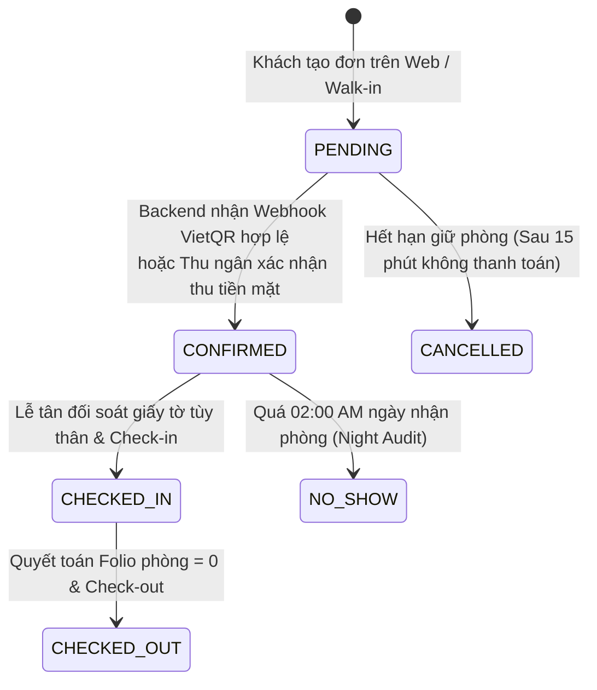
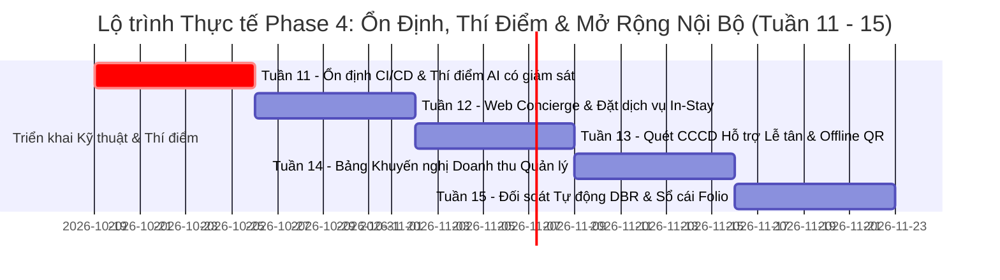

# ĐƯỜNG CƠ SỞ TRIỂN KHAI PHASE 4 VÀ VẬN HÀNH DÀI HẠN (PHASE 4 & BEYOND BASELINE)
## Aurelia Grand Palace 5★ PMS (Property Management System)

Implementation evidence (2026-10-20): [Phase 4 report](PHASE_4_REPORT.md) and
[release verification](PHASE_4_VERIFICATION.md). Status claims below describe the
historical baseline; in particular, deployed dual-environment operation must be
verified independently and is not certified by this document.

**Tài liệu:** Production Roadmap, Realistic Operational Baseline & Phase 4 Engineering Governance  
**Đường dẫn tài liệu:** `docs/PHASE_4_AND_BEYOND_BASELINE.md`  
**Phiên bản:** `4.1.0-REALISTIC-BASELINE` *(Thay thế toàn diện phiên bản 4.0.0-PROD-BASELINE)*  
**Chủ biên:** Chief Infrastructure Auditor & Principal Enterprise Architect  
**Nguyên tắc chỉ đạo:** **100% Reality-Aligned & Zero-Vaporware** (Bám sát mã nguồn thực thi, loại bỏ triệt để các tuyên bố phi thực tế)

---

## 1. MỐC GO-LIVE TUẦN 10: ĐƯỜNG CƠ SỞ HẠ TẦNG THỰC TẾ

Vào cuối Tuần 10, hệ thống Aurelia Grand Palace PMS chính thức chuyển đổi sang môi trường Production trên cơ sở cấu hình kiểm soát chặt chẽ, bảo toàn tính toàn vẹn dữ liệu tài chính và phản ánh chính xác cấu trúc hạ tầng đang hoạt động.

### 1.1. Cấu Trúc 4 Container Microservices Thực Tế
Hệ thống vận hành trên nền tảng Docker Compose Production ([docker-compose.prod.yml](file:///c:/NetBeansProjects/QL_KhachSan/docker-compose.prod.yml)) gồm đúng **4 dịch vụ biệt lập** thuộc mạng nội bộ bảo mật `pms_internal`:

1. **`mariadb` (Port 3306):**
   - **Hình ảnh & Phiên bản:** MariaDB 11.2 Jammy Hardened Container.
   - **Dữ liệu & Khởi tạo:** Lưu trữ dữ liệu giao dịch khách sạn, folios, tài khoản người dùng, phân quyền vai trò, lịch sử đặt phòng và điểm thưởng hội viên.
   - **Quy định nạp Schema toàn vẹn:** Khởi động bắt buộc phải thực thi đồng thời cả schema nền tảng ([database/hotel.sql](file:///c:/NetBeansProjects/QL_KhachSan/database/hotel.sql)) và toàn bộ các tệp di chuyển dữ liệu tuần tự trong [database/migrations/](file:///c:/NetBeansProjects/QL_KhachSan/database/migrations/) (bao gồm `guest_identity_vault`, `service_orders`, `customer_notifications`, `ai_interactions`), triệt tiêu hoàn toàn rủi ro thiếu bảng khi tạo mới cụm container.

2. **`backend` (Port 8081):**
   - **Môi trường thực thi:** Pure Java Core 17 (`com.sun.net.httpserver.HttpServer`), cấu hình Container Read-Only, `no-new-privileges`, `cap_drop: [ALL]`.
   - **Nhiệm vụ cốt lõi:** Điều phối toàn bộ REST API nghiệp vụ khách sạn, kiểm soát khóa lạc quan (`optimistic locking`), xác thực phân quyền qua JWT (`JwtFilter`), mã hóa mật khẩu BCrypt, sinh mã và tiếp nhận Webhook ngân hàng VietQR.
   - **Kiểm soát Tần suất Truy cập (Rate Limiting):** Sử dụng bộ lọc [IpRateLimiter.java](file:///c:/NetBeansProjects/QL_KhachSan/src/quanlykhachsan/backend/utils/IpRateLimiter.java) bằng bộ nhớ RAM cục bộ trong JVM Process (không dùng Redis bên ngoài).

3. **`web` / `nginx` (Port 3000 / 80 / 443 Nginx):**
   - **Máy chủ Web & Reverse Proxy:** Nginx 1.25 Alpine, phục vụ giao diện tĩnh và đóng vai trò Reverse Proxy an toàn chuyển tiếp các yêu cầu `/api/v1/` về `backend:8081`.
   - **Chuẩn hóa Môi trường Kép (Zero-Hardcoded Host):** Tự động phát hiện và tương thích 100% giữa môi trường phát triển cục bộ (`http://localhost:3000`) và máy ảo Linux VM/Staging (`http://192.168.56.102:3000`).
   - **Phòng vệ Giao diện:** Thiết lập thuộc tính tĩnh `onsubmit="return false;"` trên toàn bộ các thẻ `<form>` xác thực tại [portal.html](file:///c:/NetBeansProjects/QL_KhachSan/web-ui/portal.html) để ngăn chặn trình duyệt gửi yêu cầu POST thô lên máy chủ tĩnh gây lỗi `405 Not Allowed` khi mạng chập chờn.

4. **`ai-service` (Port 8082 mTLS):**
   - **Công nghệ & Thư viện:** Python 3.11 FastAPI chuyên biệt, giới hạn tài nguyên nghiêm ngặt (tối đa 1.5 GB RAM, 2 CPU workers).
   - **Công cụ Tìm kiếm Tri thức RAG:** Sử dụng chỉ mục vector phẳng cục bộ bằng thư viện **`faiss`** (đọc trực tiếp file `hotel_sops.index` và `chunks.json`), mô hình embedding cục bộ `all-MiniLM-L6-v2` (tuyệt đối không sử dụng `pgvector` hay gọi API bên thứ ba).
   - **Bảo mật Kênh Truyền thông:** Giao tiếp nội bộ với Java Core bắt buộc qua giao thức **mTLS trên TLS 1.3** với kho chứng chỉ PKCS12 (`AI_TLS_KEYSTORE_FILE`, `AI_TLS_TRUSTSTORE_FILE`), đảm bảo kênh AI hoàn toàn biệt lập và không lộ ra ngoài Internet.

> [!NOTE]
> **Đính chính Quy hoạch Hạ tầng:** Các dịch vụ `redis` (Port 6379) và `monitoring` (Prometheus 9090 / Grafana 3001) trong các dự thảo trước đây chính thức được đưa vào danh mục **"Lộ trình Mở rộng Quy mô Dài hạn (Scale-out Phase sau Tuần 16+)"** khi hệ thống đạt ngưỡng tải > 1.000 CCU đồng thời. Ở giai đoạn Go-Live hiện tại, hệ thống tập trung tối đa vào tính ổn định của 4 container cốt lõi nêu trên.

---

### 1.2. Nguyên Tắc Toàn Vẹn Tài Chính & Máy Trạng Thái Đặt Phòng (Zero-Trust Financial Ledger)

Để loại trừ hoàn toàn các sự cố sai lệch sổ cái kế toán và ngăn chặn hiện tượng "đơn đặt phòng ma", hệ thống thiết lập nguyên tắc kiểm soát dữ liệu tài chính cấp P0:

#### 1. Cấm Tuyệt Đối Cơ Chế Client Simulation & Fake Booking
- **Quy định Kỹ thuật:** Mã nguồn JavaScript trên Frontend ([web-ui/js/api.js](file:///c:/NetBeansProjects/QL_KhachSan/web-ui/js/api.js)) nghiêm cấm hành vi tự ý bắt nuốt lỗi kết nối mạng để tự sinh mã đặt phòng ngẫu nhiên (chẳng hạn `202600 + Math.random()`), cấm tự gán cờ `isSimulated: true` và cấm lưu trữ các đơn đặt phòng ảo này vào `localStorage`.
- **Xử lý Sự cố Máy chủ:** Khi kết nối Backend bị gián đoạn hoặc gặp lỗi cơ sở dữ liệu, Frontend bắt buộc phải hiển thị thông báo lỗi minh bạch: *"Hệ thống máy chủ đang bận xử lý hoặc gián đoạn kết nối. Giao dịch chưa được ghi nhận vào sổ cái PMS, quý khách vui lòng thử lại hoặc liên hệ Lễ tân."*

#### 2. Máy Trạng Thái Đặt Phòng Chuẩn (Booking State Machine)

- **Quyền Phát Hành Trạng Thái:** Duy nhất **Backend PMS** mới có thẩm quyền chuyển trạng thái đặt phòng thành `CONFIRMED` và trạng thái thanh toán thành `PAID` sau khi:
  1. Giao dịch Webhook ngân hàng khớp mã số tài khoản định danh, số tiền và nội dung thanh toán (`BankWebhookController.java`).
  2. Hoặc Nhân viên lễ tân lập phiếu thu tiền mặt / quẹt thẻ POS trực tiếp qua Desktop Swing và ghi nhận giao dịch thành công vào Folio phòng.
- **Tính Bất Biến của Sổ Cái:** Frontend ở vai trò chỉ đọc (Read-Only Presenter); mọi dữ liệu trạng thái phòng, nợ Folio và thanh toán hiển thị trên Web Portal phải được phản ánh 100% từ kết quả truy vấn cơ sở dữ liệu MariaDB thông qua REST API có xác thực.

---

### 1.3. Trạng Thái An Toàn Khởi Đầu (Go-Live Safe Mode)
- **Virtual Concierge (AI Copilot):** Hoạt động ở chế độ **Giám sát có chuyển tiếp (Supervised Escalation Mode)** với cờ an toàn `AI_GUEST_ENABLED=false` tại [docker-compose.prod.yml:36](file:///c:/NetBeansProjects/QL_KhachSan/docker-compose.prod.yml#L36). Toàn bộ yêu cầu/câu hỏi phức tạp từ khách hàng trên Portal sẽ được ghi nhận thành Ticket điện tử nội bộ ([VirtualConciergeController.java:95](file:///c:/NetBeansProjects/QL_KhachSan/src/quanlykhachsan/backend/ai/VirtualConciergeController.java#L95)) để nhân viên bộ phận Chăm sóc khách hàng hoặc Tiền sảnh hỗ trợ trực tiếp.
- **Vận Hành Tiền Sảnh (PMS Operations):** Nhân viên lễ tân sử dụng ứng dụng Desktop Java Swing FlatLaf Dark Luxury để thực hiện thủ tục Check-in, Check-out, đổi phòng, nạp dịch vụ phòng vào Folio và in hóa đơn VAT chuẩn Thông tư 78.

---

## 2. LỘ TRÌNH THỰC TẾ PHASE 4: STABILIZATION, PILOT & INTERNAL ROLLOUT (TUẦN 11 - 15)

Lộ trình triển khai Phase 4 được tái thiết kế bám sát năng lực thực tế của mã nguồn hiện có, tập trung vào việc ổn định kiểm thử, tăng cường an toàn dữ liệu và tối ưu hóa hiệu suất vận hành:

---

### Tuần 11: Ổn Định Bộ Kiểm Thử CI/CD & Thử Nghiệm AI Concierge Có Giám Sát
- **Mục tiêu Trọng tâm:**
  - Vá triệt để 5 lỗi kiểm thử Java (`CorsFilterTest`, `ApiClientTest`, `DynamicPricingLoadTest`, `CorsAndStaticServingTest`), đưa toàn bộ test suite `mvn test` về trạng thái **100% BUILD SUCCESS (0 Failures, 0 Errors)**.
  - Chuẩn hóa cấu hình mount CSDL trong [docker-compose.yml](file:///c:/NetBeansProjects/QL_KhachSan/docker-compose.yml), đảm bảo tự động chạy đầy đủ các file migration khi khởi tạo container MariaDB sạch.
  - Thử nghiệm AI Concierge ở quy mô giới hạn (20 - 50 khách thân thiết) tại chế độ Supervised Escalation Mode.
- **Tiêu chuẩn Kỹ thuật:**
  - Bộ lọc Prompt Guardrail ngăn chặn 100% các cuộc tấn công tiêm nhiễm câu lệnh (Prompt Injection) và rò rỉ dữ liệu nhạy cảm.
  - Ngân sách hội thoại (`checkChatBudget`) và giới hạn tần suất truy cập vận hành chính xác, không gây nghẽn tiến trình JVM.
- **Tiêu chí Go/No-Go:** Tỷ lệ build CI/CD xanh 100%; không phát sinh ngoại lệ chưa kiểm soát (`500 Internal Server Error`) trong luồng tiếp nhận hội thoại.

---

### Tuần 12: Hoàn Thiện Web Concierge & Tự Phục Vụ Đặt Dịch Vụ Phòng (In-Stay Orders)
- **Mục tiêu Trọng tâm:**
  - Triển khai tính năng đặt dịch vụ F&B, Spa, và buồng phòng tự phục vụ trên Member Portal ([portal.html](file:///c:/NetBeansProjects/QL_KhachSan/web-ui/portal.html)).
  - Kết nối luồng dữ liệu tự động giữa bảng `service_orders` và Folio giao dịch của phòng tương ứng, áp dụng mã voucher hợp lệ nếu có.
  - Đồng bộ chuông cảnh báo âm thanh và pop-up thời gian thực tới ứng dụng Desktop của Lễ tân thông qua tiến trình nền `ServiceOrderAlertWorker`.
- **Tiêu chuẩn Kỹ thuật:**
  - Sử dụng khóa bi quan/lạc quan chặt chẽ khi cộng dồn chi phí dịch vụ vào `folios`, không để xảy ra tranh chấp số dư (`race condition`).
  - Giao dịch đặt món/spa ghi nhận đầy đủ `room_id`, `customer_id`, và `folio_transaction_id`.
- **Tiêu chí Go/No-Go:** 100% đơn đặt dịch vụ được phản hồi và thông báo tới màn hình Lễ tân trong vòng < 3 giây; không có sai lệch số tiền trên hóa đơn tổng.

---

### Tuần 13: Hỗ Trợ Quét CCCD/Hộ Chiếu Tại Quầy & Mã QR Offline-First
- **Mục tiêu Trọng tâm:**
  - Kích hoạt giao diện hỗ trợ nhân viên Lễ tân quét nhanh thông tin CCCD gắn chip / Hộ chiếu thông qua webcam quầy tiếp đón ([AiCheckinController.java](file:///c:/NetBeansProjects/QL_KhachSan/src/quanlykhachsan/backend/ai/AiCheckinController.java)), giảm thời gian nhập liệu thủ công từ 3 phút xuống dưới 45 giây/khách.
  - Thay thế toàn bộ việc sinh mã Express QR Pass từ các API đám mây công cộng bên ngoài (`api.qrserver.com`) sang thư viện sinh mã QR SVG nội bộ (Offline-First), đảm bảo hoạt động độc lập ngay cả trong môi trường mạng cách ly (Air-gapped) hoặc khi máy chủ mất kết nối Internet.
  - Mã hóa an toàn thông tin định danh vào bảng `guest_identity_vault` theo tiêu chuẩn AES-256 GCM và băm HMAC.
- **Đính chính Phạm vi:** Nghiêm cấm ghi nhận tính năng "Kiosk tự động nhả thẻ phòng vật lý dưới 60s" do hệ thống chưa trang bị thiết bị phần cứng mã hóa và cấp thẻ từ (RFID Card Dispenser). Thủ tục giao thẻ phòng vật lý vẫn do Nhân viên Lễ tân trao tận tay khách hàng sau khi xác thực giấy tờ.
- **Tiêu chí Go/No-Go:** Độ chính xác nhận diện ký tự CCCD đạt > 98.5%; mã QR check-in tạo và quét thành công 100% trong môi trường mạng nội bộ hoàn toàn ngắt Internet.

---

### Tuần 14: Bảng Điều Khiển Khuyến Nghị Doanh Thu Nội Bộ (Internal Yield Recommendation)
- **Mục tiêu Trọng tâm:**
  - Triển khai công cụ hỗ trợ ra quyết định giá phòng cho Ban Giám đốc và Bộ phận Quản trị Doanh thu (Revenue Manager) thông qua endpoint `/api/v1/revenue/forecast` ([YieldRecommendationController.java](file:///c:/NetBeansProjects/QL_KhachSan/src/quanlykhachsan/backend/report/YieldRecommendationController.java)).
  - Phân tích dữ liệu lịch sử lấp đầy phòng, tính toán chỉ số RevPAR, ADR và gợi ý hệ số nhân giá (`multiplier`) tối ưu theo mùa vụ và ngày lễ.
- **Phân định Ranh giới Phân quyền (Security Boundary):**
  - Endpoint `/api/v1/revenue/forecast` được khóa chặt ở tầng bảo mật quản trị (bắt buộc JWT vai trò `admin`, `manager`, `gm`, `revenue_manager`).
  - Cắt bỏ hoàn toàn việc công bố tính năng "Định giá động tự động cho khách vãng lai trên `index.html`" để tránh lỗi bảo mật `403 Forbidden` và ngăn chặn tình trạng nhảy giá bất thường khi chưa có sự phê duyệt bằng tay từ Giám đốc khối kinh doanh (`RateApprovalService`).
- **Tiêu chí Go/No-Go:** Khuyến nghị giá phản ánh đúng dữ liệu lấp đầy phòng trong cơ sở dữ liệu; quy trình duyệt áp dụng biểu giá mới (`/api/v1/revenue/apply-rates`) ghi vết kiểm toán (Audit Trail) đầy đủ người phê duyệt và thời gian hiệu lực.

---

### Tuần 15: Kiểm Toán Toàn Vẹn Sổ Cái & Báo Cáo Tài Chính Hợp Nhất (Revenue & Folio Audit)
- **Mục tiêu Trọng tâm:**
  - Hoàn thiện mô-đun Báo cáo Kinh doanh Hàng ngày (Daily Business Report - DBR) tại [FinancialReportController.java](file:///c:/NetBeansProjects/QL_KhachSan/src/quanlykhachsan/backend/report/FinancialReportController.java).
  - Tự động hóa tiến trình đối soát chéo 3 chiều giữa:
    1. Tổng số dư ghi có/ghi nợ trên hệ thống Folio phòng.
    2. Dòng tiền thực tế nhận được qua Webhook VietQR của Ngân hàng.
    3. Nhật ký thu tiền mặt / quẹt thẻ POS được thủ quỹ Lễ tân chốt sổ cuối ca.
- **Tiêu chí Go/No-Go:** Chênh lệch sổ cái kế toán bằng 0 (Zero Variance); 100% hóa đơn điện tử xuất ra có chữ ký số và mã tra cứu hợp lệ chuẩn Thông tư 78.

---

## 3. TIÊU CHÍ GO/NO-GO VÀ ĐIỀU KIỆN XUẤT XƯỞNG (RELEASE GATES)

Hệ thống chỉ được phép chuyển từ giai đoạn Thử nghiệm nội bộ (Phase 4) sang vận hành thương mại quy mô đầy đủ khi vượt qua toàn bộ 4 Cổng Kiểm soát Kỹ thuật (Release Gates) sau:

| Mã Cổng | Tên Cổng Kiểm Soát | Điều Kiện Đạt Chuẩn Tiên Quyết (Pass Criteria) | Trạng Thái Hiện Tại |
| :---: | :--- | :--- | :---: |
| **GATE-01** | **Toàn Vẹn Kiểm Thử CI/CD** | `mvn test` đạt **0 Failures, 0 Errors** trên toàn bộ 190+ test cases. Không dùng cơ chế nuốt lỗi timeout cơ sở dữ liệu. | ⚠️ **Đang xử lý** *(5 failures cần vá)* |
| **GATE-02** | **Toàn Vẹn Khởi Tạo Dữ Liệu** | Container MariaDB khởi động sạch nạp thành công 100% `hotel.sql` và các bảng trong `migrations/*.sql` mà không cần can thiệp thủ công. | ⚠️ **Cần chuẩn hóa compose** |
| **GATE-03** | **Loại Bỏ Hoàn Toàn Mã Giả Lập** | Quét sạch 100% mã nguồn JavaScript tạo booking ảo (`isSimulated`) và gán cứng `PAID`. Trạng thái đơn phòng phản ánh trung thực từ Backend. | ⚠️ **Cần refactor api.js** |
| **GATE-04** | **Chuẩn Hóa Môi Trường Kép** | Vận hành thông suốt trên cả môi trường Localhost (`localhost:3000`) và Mạng ảo Linux VM (`192.168.56.102:3000`) không lỗi kết nối. | ✅ **Đã hoàn thành** |

---

## 4. LỊCH TRÌNH VẬN HÀNH THƯỜNG QUY DÀI HẠN (TUẦN 16+)

Để bảo toàn dịch vụ khách sạn 5 sao ổn định và an toàn thông tin, hệ thống duy trì lịch trình vận hành định kỳ:

| Chu kỳ | Nhiệm vụ Vận hành Chi tiết | Trách nhiệm |
| :--- | :--- | :--- |
| **Hàng ngày (Daily)** *(02:00 AM)* | **Khóa sổ đêm tự động (Night Audit & DBR):** • Đóng băng dữ liệu giao dịch trong 3 phút để chốt sổ kế toán ngày. • Đối soát số dư Folio, tính toán doanh thu thực tế, chỉ số ADR, RevPAR. • Tự động xử lý trạng thái phòng vắng mặt quá giờ nhận phòng (No-Show Engine). | Hệ thống PMS tự động + Kế toán đêm |
| **Hàng tuần (Weekly)** *(Chủ nhật)* | **Kiểm toán Nhật ký AI & Sao lưu Cơ sở dữ liệu:** • Rà soát log hội thoại AI trong bảng `ai_interactions`, đánh giá các câu hỏi bị Escalated sang nhân viên. • Kiểm tra các cảnh báo tiêm nhiễm câu lệnh hoặc từ chối phục vụ. • Thực hiện sao lưu nguội (Cold Backup) toàn bộ cơ sở dữ liệu MariaDB ra ổ cứng lưu trữ an toàn. | AI Engineer + DevOps Lead |
| **Hàng tháng (Monthly)** *(Ngày 01)* | **Xoay vòng Khóa bảo mật & Kiểm toán Lỗ hổng:** • Xoay vòng khóa ký JWT (`JWT_SECRET`) và khóa bí mật Webhook ngân hàng. • Quét tự động lỗ hổng REST APIs bằng công cụ an ninh mạng OWASP ZAP. • Cập nhật các bản vá bảo mật cho Nginx và MariaDB container OS. | Security Officer + Lead Auditor |
| **Hàng quý (Quarterly)** *(Cuối quý)* | **Kiểm thử Chịu tải Thực tế & Diễn tập Phục hồi Thảm họa (DR):** • Kiểm thử chịu tải thực tế với kịch bản đặt phòng và đồng thời quét thẻ Lễ tân (p95 < 250ms). • Diễn tập khôi phục hệ thống từ bản sao lưu dữ liệu trong kịch bản máy chủ sập hoàn toàn (Mục tiêu: RPO < 5 phút, RTO < 20 phút). | Toàn thể đội ngũ Kỹ thuật PMS |

---

## 5. LỘ TRÌNH MỞ RỘNG QUY MÔ DÀI HẠN (SCALE-OUT PHASE - POST-WEEK 16)

Các thành phần kỹ thuật nâng cao chỉ được xem xét đầu tư và tích hợp sau khi hệ thống cốt lõi đã vận hành thương mại ổn định tối thiểu 1 tháng và vượt qua toàn bộ 4 Cổng Kiểm soát Kỹ thuật:

1. **Tích hợp Bộ nhớ đệm Phân tán Redis (Port 6379):**
   - **Mục tiêu:** Giảm tải cho MariaDB khi lưu lượng khách truy cập trang chủ tìm kiếm phòng vượt quá 1.000 yêu cầu/phút.
   - **Kỹ thuật triển khai:** Thêm container `redis:7-alpine`, cấu hình Redis Cache cho dữ liệu danh mục phòng trống, quản lý phân tán Rate Limiting IP đa máy chủ và chia sẻ phiên đăng nhập phân tán.

2. **Cụm Giám sát Hiệu năng Thời gian Thực Prometheus & Grafana (Port 9090 / 3001):**
   - **Mục tiêu:** Giám sát liên tục các thông số JVM (Heap memory, Thread pool, Garbage Collection), số kết nối hoạt động trong HikariCP Pool, và lưu lượng HTTP trên Nginx.
   - **Kỹ thuật triển khai:** Tích hợp Prometheus JMX Exporter vào Java Backend, xây dựng Grafana Dashboards chuyên dụng với các ngưỡng cảnh báo tự động gửi về Telegram/Slack của đội ngũ DevOps.

3. **Tích hợp Thiết bị Phần cứng Mã hóa & Nhả Thẻ Phòng Tự động (Hardware RFID Dispenser Kiosk):**
   - **Mục tiêu:** Hiện thực hóa quy trình Check-in không tiếp xúc tự động 100% tại Kiosk tiền sảnh.
   - **Kỹ thuật triển khai:** Ký kết hợp đồng thiết bị với nhà cung cấp phần cứng khóa từ khách sạn (Assa Abloy / Dormakaba / Salto), tích hợp SDK giao tiếp nối tiếp RS-232/USB qua driver Java chuyên dụng để mã hóa thẻ từ và điều khiển bộ nhả thẻ tự động.
