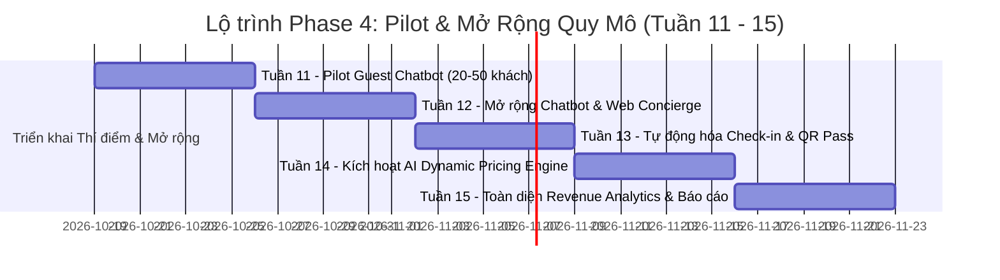

# ĐƯỜNG CƠ SỞ TRIỂN KHAI PHASE 4 VÀ VẬN HÀNH DÀI HẠN (PHASE 4 & BEYOND BASELINE)
## Aurelia Grand Palace 5★ PMS (Property Management System)

**Tài liệu:** Production Roadmap, Week 10 Go-Live & Operational Lifecycle  
**Đường dẫn tài liệu:** `docs/PHASE_4_AND_BEYOND_BASELINE.md`  
**Phiên bản:** 4.0.0-PROD-BASELINE  
**Chủ biên:** Chief Infrastructure Auditor & Principal Enterprise Architect  

---

## 1. MỐC GO-LIVE TUẦN 10: TRIỂN KHAI PRODUCTION ĐẦU TIÊN
Vào cuối Tuần 10, hệ thống Aurelia Grand Palace PMS chính thức cắt chuyển sang môi trường Production thực tế.

### 1.1. Cấu Trúc 6 Container Microservices
Hệ thống vận hành trên nền tảng Docker Compose Production ([docker-compose.prod.yml](file:///c:/NetBeansProjects/QL_KhachSan/docker-compose.prod.yml)) gồm 6 dịch vụ biệt lập:
1. **`mariadb` (Port 3306):** Cơ sở dữ liệu MariaDB 11.2 Jammy lưu trữ toàn bộ dữ liệu giao dịch khách sạn, folios, tài khoản, lịch sử đặt phòng và hạng thành viên.
2. **`backend` (Port 8081):** Máy chủ Java Core 17 HTTPServer xử lý toàn bộ REST APIs, khóa lạc quan, kiểm soát bảo mật JWT, mã hóa BCrypt và tích hợp VietQR.
3. **`web` (Port 3000 / 443 Nginx):** Nginx 1.25 Alpine reverse proxy, phục vụ trang chủ khách hàng ([index.html](file:///c:/NetBeansProjects/QL_KhachSan/web-ui/index.html)), cổng thành viên ([portal.html](file:///c:/NetBeansProjects/QL_KhachSan/web-ui/portal.html)), kiểm soát cache (`Cache-Control: no-cache, must-revalidate`).
4. **`ai-service` (Port 8000):** Dịch vụ Python FastAPI / pgvector hỗ trợ OCR giấy tờ tùy thân, nhận diện khuôn mặt và Virtual Concierge Copilot.
5. **`redis` (Port 6379):** Bộ nhớ đệm tốc độ cao (In-memory caching), quản lý rate-limiting IP và lưu trữ trạng thái phiên người dùng phân tán.
6. **`monitoring` (Port 9090 / 3001):** Cụm giám sát hiệu năng thời gian thực với Prometheus (thu thập metrics JVM, HikariCP pool, Nginx req/s) và Grafana Dashboard trực quan.

### 1.2. Trạng Thái Hoạt Động Khởi Đầu (Go-Live Safe Mode)
- **Guest Chatbot:** Được cấu hình ở chế độ **READ-ONLY (Chỉ đọc & Tra cứu thông tin)**; chưa tự động can thiệp sửa đổi dữ liệu phòng hay tạo hóa đơn.
- **Vận hành Tiền sảnh (PMS Operations):** Nhân viên lễ tân sử dụng ứng dụng Desktop Java Swing FlatLaf Dark Luxury để thực hiện thủ tục Check-in, Check-out, đổi phòng và thu tiền thủ công kết hợp xác thực mã VietQR.

---

## 2. LỘ TRÌNH CHI TIẾT PHASE 4: PILOT & SCALE (TUẦN 11 ĐẾN TUẦN 15)

### Tuần 11: Thử Nghiệm Thí Điểm Guest Chatbot (Controlled Pilot)
- **Quy mô:** Thử nghiệm giới hạn từ 20 đến 50 khách hàng VIP thân thiết có đặt phòng trước.
- **Mục tiêu:** Kiểm tra phản hồi thực tế của AI Virtual Concierge đối với các câu hỏi về tiện ích khách sạn, thực đơn nhà hàng, quy định nhận phòng.
- **Tiêu chí Go/No-Go:** Tỷ lệ phản hồi đúng > 98%, không xảy ra ảo giác AI (hallucination), thời gian phản hồi dưới 1.5 giây.

### Tuần 12: Mở Rộng Chatbot & Tích Hợp Web Concierge Toàn Diện
- **Quy mô:** Mở rộng cho 100% khách lưu trú tại khách sạn truy cập Web Concierge trên Portal.
- **Mục tiêu:** Tiếp nhận và chuyển tiếp tự động các yêu cầu giặt ủi, spa, minibar tới bộ phận buồng phòng và F&B qua socket nội bộ.
- **Tiêu chí Go/No-Go:** Tỷ lệ giao việc đúng phòng 100%, không mất mát yêu cầu dịch vụ.

### Tuần 13: Tự Động Hóa Check-in Qua Express QR Pass & AI ID-OCR
- **Quy mô:** Quầy tiếp đón ưu tiên (Priority Lane) tại sảnh khách sạn.
- **Mục tiêu:** Khách xuất trình Express Check-in QR Pass trên điện thoại, camera quầy quét mã và đối soát giấy tờ tùy thân qua AI OCR để cấp thẻ phòng trong vòng dưới 60 giây.
- **Tiêu chí Go/No-Go:** Độ chính xác khớp giấy tờ CCCD/Hộ chiếu đạt 99.5%, thời gian hoàn tất thủ tục < 1 phút/khách.

### Tuần 14: Kích Hoạt Hệ Thống Định Giá Động (Dynamic Pricing Engine)
- **Quy mô:** Áp dụng định giá theo tỷ lệ lấp đầy phòng cho toàn bộ 4 hạng phòng trên trang chủ [index.html](file:///c:/NetBeansProjects/QL_KhachSan/web-ui/index.html).
- **Mục tiêu:** Thuật toán Yield Management tự động đề xuất tăng/giảm đơn giá phòng theo khung giờ và tình trạng phòng trống thực tế (`/api/v1/revenue/forecast`).
- **Tiêu chí Go/No-Go:** Doanh thu RevPAR tăng trưởng tối thiểu 8% so với phương pháp giá cứng cũ.

### Tuần 15: Tích Hợp Báo Cáo Phân Tích Doanh Thu Toàn Diện (Revenue Analytics)
- **Quy mô:** Toàn bộ ban giám đốc và bộ phận tài chính.
- **Mục tiêu:** Bảng điều khiển tài chính thời gian thực, tổng hợp dòng tiền VietQR, phân tích chi tiêu khách hàng theo từng phân hạng thẻ (Member, Silver, Gold, VIP), thống kê hiệu suất minibar/dịch vụ phụ trợ.
- **Tiêu chí Go/No-Go:** Báo cáo đối soát doanh thu tự động khớp 100% với sao kê ngân hàng và sổ cái kế toán.

---

## 3. LỊCH TRÌNH VẬN HÀNH THƯỜNG QUY DÀI HẠN (TUẦN 16+)

Để đảm bảo chất lượng dịch vụ 5 sao chuẩn quốc tế và an toàn thông tin tuyệt đối, hệ thống duy trì lịch trình vận hành định kỳ như sau:

| Chu kỳ | Nhiệm vụ Vận hành Chi tiết | Trách nhiệm |
| :--- | :--- | :--- |
| **Hàng ngày (Daily)** *(02:00 AM)* | **Khóa sổ đêm tự động (Night Audit & DBR):** • Tự động đóng băng dữ liệu giao dịch trong 3 phút để chốt doanh thu ngày. • Sinh báo cáo Daily Business Report (DBR), tính toán ADR, RevPAR, tỷ lệ lấp đầy. • Tự động xử lý trạng thái phòng vắng mặt (No-Show Engine). | Hệ thống tự động + Kế toán đêm |
| **Hàng tuần (Weekly)** *(Chủ nhật)* | **Đánh giá nhật ký AI & Tối ưu hóa mô hình:** • Kiểm tra log hội thoại của AI Concierge, lọc các câu hỏi chưa trả lời được. • Rà soát các cảnh báo Prompt Injection hoặc từ chối phục vụ. • Sao lưu nguội cơ sở dữ liệu (Cold Backup) MariaDB ra lưu trữ đám mây an toàn. | AI Engineer + DevOps Lead |
| **Hàng tháng (Monthly)** *(Ngày 01)* | **Xoay vòng khóa bảo mật & Quét lỗ hổng OWASP ZAP:** • Xoay vòng khóa bí mật JWT (`JWT_SECRET`) và khóa ký mã hóa Webhook ngân hàng. • Quét tự động lỗ hổng an ninh mạng toàn diện bằng OWASP ZAP đối với toàn bộ các REST APIs. • Rà soát và cập nhật bản vá bảo mật Docker container OS. | Security Officer + Chief Auditor |
| **Hàng quý (Quarterly)** *(Cuối quý)* | **Kiểm thử tải cao độ & Diễn tập phục hồi thảm họa (DR Drill):** • Kiểm thử chịu tải 500 CCU đồng thời với Apache JMeter (đảm bảo p95 < 200ms). • Diễn tập khôi phục toàn bộ hệ thống từ bản sao lưu dữ liệu trong kịch bản máy chủ chính ngừng hoạt động (RPO < 5 phút, RTO < 15 phút). | Toàn thể đội ngũ Kỹ thuật PMS |
