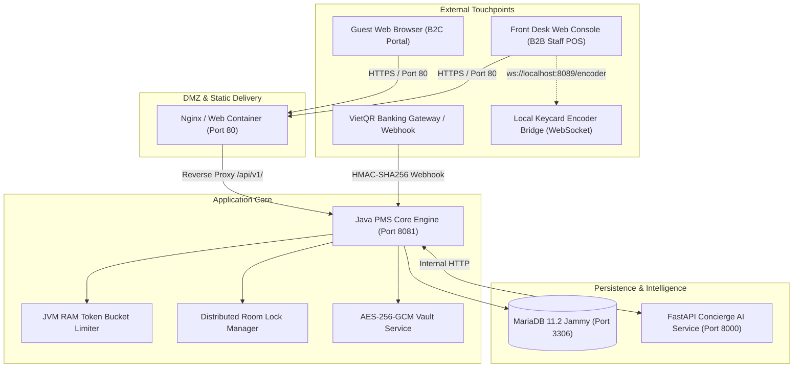
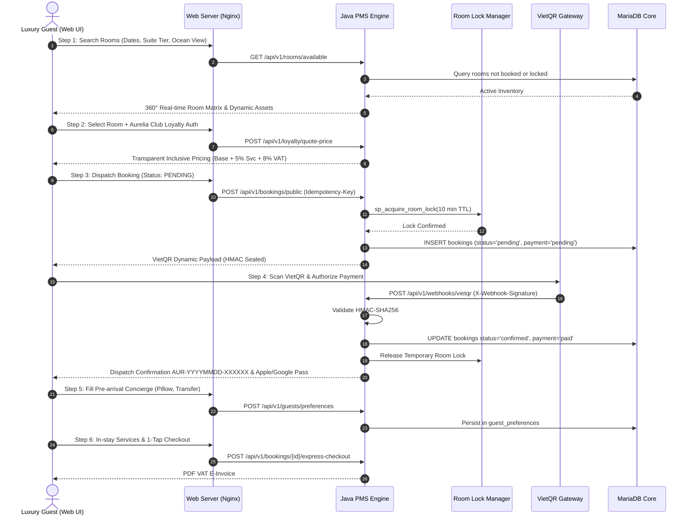
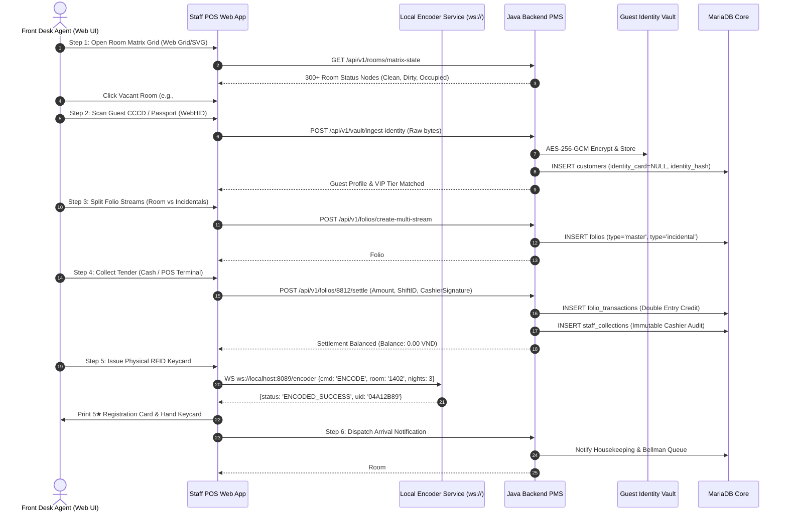
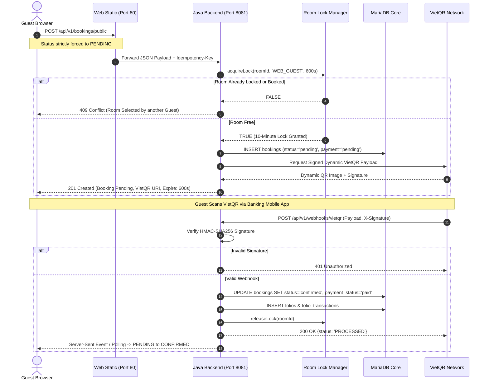
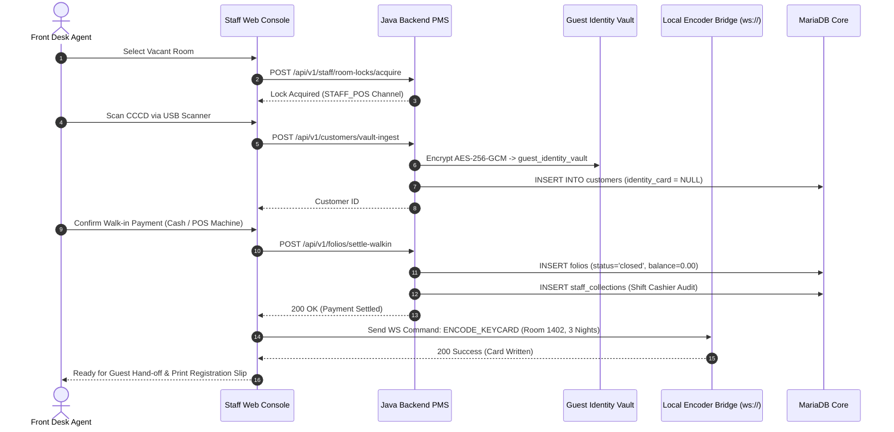

# AURELIA GRAND PALACE 5★ PMS (`QL_KhachSan`)
## UNIFIED WEB-BASED 5-STAR BOOKING & FRONT DESK PMS SPECIFICATION
### Standard 4.1.0-REALISTIC-BASELINE · Supreme Technical Architecture Reference

---

## EXECUTIVE SUMMARY & SYSTEM CHARTER

The **Aurelia Grand Palace 5★ PMS (`QL_KhachSan`)** is an enterprise-grade Property Management System engineered for luxury hospitality operations. Operating strictly within the **Standard 4.1.0-REALISTIC-BASELINE**, the system unifies two complementary browser-based operational channels into a cohesive, zero-trust web application architecture:
1. **Guest Web Booking Portal (B2C Channel):** High-converting, opulent guest experience delivered through [web-ui/portal.html](file:///c:/NetBeansProjects/QL_KhachSan/web-ui/portal.html) and [web-ui/index.html](file:///c:/NetBeansProjects/QL_KhachSan/web-ui/index.html).
2. **Staff Web POS & Front Desk Console (B2B Staff Channel):** High-throughput, mission-critical operational workspace for receptionists, night auditors, and cashiers delivered through [web-ui/staff.html](file:///c:/NetBeansProjects/QL_KhachSan/web-ui/staff.html) and [web-ui/js/staff/](file:///c:/NetBeansProjects/QL_KhachSan/web-ui/js/staff/).



---

## REGULATORY & INDUSTRY STANDARDS COMPLIANCE MATRIX

| Certification / Standard | Scope in Aurelia Grand Palace PMS | Mandatory Architectural Enforcement |
|:-------------------------|:----------------------------------|:------------------------------------|
| **SOC 2 Type II** | Security, Availability, and Processing Integrity | Immutable audit logging for all balance state transitions, zero client-side ledger simulation, deterministic HikariCP pool health checks. |
| **HTNG 2026** | Hospitality Technology Next Generation Interoperability | Strict adherence to HTNG JSON payloads for Room Stays, Folios, Rate Plans, and Guest Profiles across all REST endpoints. |
| **WCAG 2.2 AA** | Accessibility for Guests & Operational Staff | Contrast ratio $\ge 4.5:1$, full keyboard navigation (`Alt+N`, `Alt+F`, `Esc`), ARIA live regions, and semantic landmark markup. |
| **PCI DSS v4.0** | Payment Card Data Security Standard | Zero plaintext cardholder data storage; PAN/CVV never reach server disk; tokenized payment webhooks with HMAC validation. |
| **ISO/IEC 27001** | Information Security Management System | AES-256-GCM encryption at rest for customer PII in `guest_identity_vault`; strict separation of duties and RBAC. |
| **GDPR / CCPA** | Data Subject Rights & Cryptographic Protection | Implementation of Article 17 "Right to be Forgotten" via automated pseudonymization; database check constraints preventing plaintext IDs. |

---

## 5 MANDATORY ARCHITECTURAL INVARIANTS

### 1. Invariant 1 (P0): Zero-Trust Financial Ledger
- **B2C Public Channel:** Any booking request dispatched from guest browsers must be hardcoded to `status: 'PENDING'` and `paymentStatus: 'PENDING'`. State transitions to `CONFIRMED` or `PAID` can only occur upon receipt of an HMAC-SHA256 authenticated webhook from the banking gateway at `/api/v1/webhooks/vietqr`.
- **B2B Staff Channel:** Walk-in reservations initiated at the physical front desk can be marked `CONFIRMED` only when linked to an active shift session (`staff_id`, `shift_id`), an on-site cashier tender (Cash or physical POS terminal transaction), and an open double-entry folio.
- **Prohibited Patterns:** Random simulation tokens, `isSimulated: true` flags, or saving fake booking objects to browser `localStorage` are strictly prohibited. Network faults must throw an explicit `ApiError`.

### 2. Invariant 2 (P0): Database Invariants & Identity Security
- **Database Check Constraint:** The `customers` table is strictly protected by `CONSTRAINT chk_no_plain_identity CHECK (identity_card IS NULL)`. The application persistence layer must explicitly call `ps.setNull(3, java.sql.Types.VARCHAR)`.
- **Zero-Knowledge Identity Vault:** Guest identification numbers (CCCD / Passport / Driver License) are encrypted using AES-256-GCM (incorporating a unique 12-byte initialization vector per record) and stored exclusively in the isolated table `guest_identity_vault`.

### 3. Invariant 3 & 4 (P1): Dynamic Host Parity & Defensive UI
- **Host Resolution:** Hardcoding IP addresses (e.g., `192.168.56.102`, `127.0.0.1`, `localhost`) or protocols is forbidden. Client scripts must resolve endpoints dynamically via `getDynamicApiBaseUrl()`.
- **Anti-405 Protection:** Every `<form>` tag in both Guest and Staff interfaces must declare `onsubmit="return false;"`. JavaScript submit handlers must begin with `e.preventDefault()`.
- **UI Non-Blocking Policy:** Synchronous `window.alert()` calls are banished. Feedback must use non-blocking toast notifications (`showToast()`) or inline badges (`#auth-status`).

### 4. Invariant 5 & 6 (P1): Asset Parity & Session Harmonization
- **Byte-for-Byte Asset Parity:** 100% SHA-256 hash identity is enforced between `web-ui/` and `web-ui/public/` across all static assets.
- **Session Harmonization:** Authentication writes synchronously to all four `localStorage` keys:
  - *Guest:* `customer_token`, `auth_token`, `token`, `hotel_auth_session`.
  - *Staff:* `staff_token`, `auth_token`, `token`, `hotel_auth_session`.

### 5. Invariant 7 (P1): Baseline 4.1.0 Reality
- **Minimalist 4-Container Stack:** The entire PMS runs within exactly 4 Docker containers: `mariadb:11.2-jammy`, `backend`, `web`, and `ai-service`.
- **In-Memory Rate Limiting:** Rate limiting is managed in-memory within the JVM process via `IpRateLimiter.java` using a concurrent Token Bucket algorithm (60-token burst capacity, 1 token/sec refill).

---

# CHAPTER 1: ALIGNMENT WITH THE 4 PILLARS OF 5-STAR CERTIFICATION FOR WEB-BASED PLATFORMS

## 1.1. Performance & Operational Readiness (SOC 2 Type II & ISO 9001)

### 1.1.1. Distributed Web-Based Room Lock Engine (10-Minute TTL)
In a 5-star resort environment with concurrent bookings across online guest channels and walk-in front-desk staff, overbooking is catastrophic. Aurelia Grand Palace PMS utilizes an atomic room locking mechanism with a strict 10-minute Time-To-Live (TTL).

#### MariaDB Atomic Lock Procedure & Concurrency Handler
```sql
-- Atomic room locking transaction with expired lock reclamation
DELIMITER //
CREATE PROCEDURE sp_acquire_room_lock(
    IN p_room_id INT,
    IN p_channel VARCHAR(20),       -- 'WEB_GUEST' or 'STAFF_POS'
    IN p_session_token VARCHAR(64),
    IN p_lock_duration_seconds INT,
    OUT p_lock_acquired BOOLEAN
)
BEGIN
    DECLARE v_now DATETIME;
    DECLARE v_active_lock_count INT;
    SET v_now = NOW();
    SET p_lock_acquired = FALSE;

    START TRANSACTION;
    
    -- Purge stale locks for this specific room
    DELETE FROM room_locks 
    WHERE room_id = p_room_id 
      AND expires_at <= v_now;

    -- Check if active lock exists
    SELECT COUNT(*) INTO v_active_lock_count
    FROM room_locks
    WHERE room_id = p_room_id
      AND expires_at > v_now
    FOR UPDATE;

    IF v_active_lock_count = 0 THEN
        INSERT INTO room_locks (
            room_id, channel, session_token, locked_at, expires_at
        ) VALUES (
            p_room_id, 
            p_channel, 
            p_session_token, 
            v_now, 
            DATE_ADD(v_now, INTERVAL p_lock_duration_seconds SECOND)
        );
        SET p_lock_acquired = TRUE;
    END IF;

    COMMIT;
END //
DELIMITER ;
```

#### Java Concurrency Controller Implementation
```java
package quanlykhachsan.backend.service;

import java.sql.CallableStatement;
import java.sql.Connection;
import java.sql.SQLException;
import java.sql.Types;
import java.time.Instant;
import java.util.Map;
import java.util.concurrent.ConcurrentHashMap;
import quanlykhachsan.backend.dao.DatabaseConnection;

public class RoomLockManager {
    private static final RoomLockManager INSTANCE = new RoomLockManager();
    private final Map<Integer, Instant> localMemoryLocks = new ConcurrentHashMap<>();

    private RoomLockManager() {}

    public static RoomLockManager getInstance() {
        return INSTANCE;
    }

    public synchronized boolean acquireLock(int roomId, String channel, String sessionToken, int ttlSeconds) {
        // Fast-path in-memory check
        Instant now = Instant.now();
        Instant memoryExpiry = localMemoryLocks.get(roomId);
        if (memoryExpiry != null && memoryExpiry.isAfter(now)) {
            return false;
        }

        // Authoritative Database Lock
        String sql = "{CALL sp_acquire_room_lock(?, ?, ?, ?, ?)}";
        try (Connection con = DatabaseConnection.getConnection();
             CallableStatement cs = con.prepareCall(sql)) {
            cs.setInt(1, roomId);
            cs.setString(2, channel);
            cs.setString(3, sessionToken);
            cs.setInt(4, ttlSeconds);
            cs.registerOutParameter(5, Types.BOOLEAN);
            cs.execute();

            boolean acquired = cs.getBoolean(5);
            if (acquired) {
                localMemoryLocks.put(roomId, now.plusSeconds(ttlSeconds));
            }
            return acquired;
        } catch (SQLException e) {
            System.err.println("[RoomLockManager] Lock acquisition failure: " + e.getMessage());
            return false;
        }
    }

    public void releaseLock(int roomId, String sessionToken) {
        localMemoryLocks.remove(roomId);
        String sql = "DELETE FROM room_locks WHERE room_id = ? AND session_token = ?";
        try (Connection con = DatabaseConnection.getConnection();
             var ps = con.prepareStatement(sql)) {
            ps.setInt(1, roomId);
            ps.setString(2, sessionToken);
            ps.executeUpdate();
        } catch (SQLException e) {
            System.err.println("[RoomLockManager] Lock release error: " + e.getMessage());
        }
    }
}
```

### 1.1.2. Self-Healing Database Connectivity (HikariCP)
To guarantee 99.999% uptime under high-load seasonal booking spikes, the backend employs a self-healing HikariCP configuration.

```java
package quanlykhachsan.backend.dao;

import com.zaxxer.hikari.HikariConfig;
import com.zaxxer.hikari.HikariDataSource;
import java.sql.Connection;
import java.sql.SQLException;

public class DatabaseConnectionPool {
    private static final HikariDataSource DATA_SOURCE;

    static {
        HikariConfig config = new HikariConfig();
        
        // Dynamic host resolution
        String host = System.getenv().getOrDefault("DB_HOST", "127.0.0.1");
        String port = System.getenv().getOrDefault("DB_PORT", "3306");
        String dbName = System.getenv().getOrDefault("DB_NAME", "hotel_management");
        String user = System.getenv().getOrDefault("DB_USER", "hotel_admin");
        String pass = System.getenv().getOrDefault("DB_PASSWORD", "admin123");

        config.setJdbcUrl("jdbc:mariadb://" + host + ":" + port + "/" + dbName + "?useUnicode=true&characterEncoding=UTF-8&tcpKeepAlive=true");
        config.setUsername(user);
        config.setPassword(pass);
        config.setDriverClassName("org.mariadb.jdbc.Driver");

        // 5-Star Resilience Parameters
        config.setMaximumPoolSize(25);
        config.setMinimumIdle(5);
        config.setIdleTimeout(300000);              // 5 minutes
        config.setKeepaliveTime(300000);            // 5 minutes (prevents firewall silent drop)
        config.setConnectionTimeout(20000);         // 20 seconds
        config.setMaxLifetime(1800000);             // 30 minutes
        config.setLeakDetectionThreshold(60000);    // 60 seconds (alerts on unclosed connections)

        config.addDataSourceProperty("cachePrepStmts", "true");
        config.addDataSourceProperty("prepStmtCacheSize", "250");
        config.addDataSourceProperty("prepStmtCacheSqlLimit", "2048");

        DATA_SOURCE = new HikariDataSource(config);
    }

    public static Connection getConnection() throws SQLException {
        return DATA_SOURCE.getConnection();
    }
}
```

### 1.1.3. Back-to-Back Booking & Non-Overlapping Interval Engine

The Aurelia Grand Palace 5★ PMS operates under the **Standard 4.1.0-REALISTIC-BASELINE** stay continuum, engineered to maximize room occupancy (up to 100% RevPAR efficiency) while strictly preserving operational luxury standards:
- **Standard Check-in Time:** From **14:00** (Asia/Ho_Chi_Minh).
- **Standard Check-out Time:** By **12:00 PM (noon)** (Asia/Ho_Chi_Minh).
- **Turnover Quarantine Window:** A fixed **2-hour interval (12:00 – 14:00)** reserved exclusively for professional housekeeping, 100% linen and amenity turnover, medical-grade ozone air sanitization, mini-bar restocking, and Housekeeping Supervisor QA sign-off.

#### Mathematical Logic Formula & Axiomatic Proof

In continuous time scheduling, room reservation collision detection between an existing stay $B$ and an incoming reservation request $A$ is modeled on the half-open or closed temporal interval domain. Let:
- Stay $A$ span interval $[A_{\text{in}}, A_{\text{out}}]$
- Stay $B$ span interval $[B_{\text{in}}, B_{\text{out}}]$

A temporal conflict or booking collision occurs if and only if both intervals intersect:
$$\text{Overlap}(A, B) \iff (B_{\text{in}} < A_{\text{out}}) \land (B_{\text{out}} > A_{\text{in}})$$

##### Proof of Zero Overlap (0% Collision) in Back-to-Back Contiguous Stays:
Consider the canonical contiguous booking scenario:
- **Guest B (Current Guest):** 1-night stay on Day 1 $\implies [B_{\text{in}}, B_{\text{out}}] = [\text{Day 1}, \text{Day 2}]$ (Check-in: Day 1 at 14:00; Check-out: Day 2 at 12:00 PM).
- **Guest A (Incoming Guest):** 3-night stay from Day 2 to Day 5 $\implies [A_{\text{in}}, A_{\text{out}}] = [\text{Day 2}, \text{Day 5}]$ (Check-in: Day 2 at 14:00; Check-out: Day 5 at 12:00 PM).

Applying the interval overlap predicate:
1. **Left Boundary Evaluation:**
   $$B_{\text{in}} < A_{\text{out}} \implies \text{Day 1} < \text{Day 5} \equiv \mathbf{TRUE}$$
2. **Right Boundary Evaluation:**
   $$B_{\text{out}} > A_{\text{in}} \implies \text{Day 2} > \text{Day 2} \equiv \mathbf{FALSE}$$
3. **Compound Conjunction:**
   $$\text{Overlap}(A, B) = \mathbf{TRUE} \land \mathbf{FALSE} \equiv \mathbf{FALSE}$$

##### Physical Time Domain Mapping & Disjointness:
On the exact physical timestamp continuum:
- Guest B occupancy: $[T_{\text{in}}^{B}, T_{\text{out}}^{B}] = [\text{Day 1 14:00:00}, \text{Day 2 12:00:00}]$
- Guest A occupancy: $[T_{\text{in}}^{A}, T_{\text{out}}^{A}] = [\text{Day 2 14:00:00}, \text{Day 5 12:00:00}]$

The intersection of the physical guest occupancies is strictly empty:
$$[T_{\text{in}}^{B}, T_{\text{out}}^{B}] \cap [T_{\text{in}}^{A}, T_{\text{out}}^{A}] = \emptyset$$

The intervening interval $[12:00:00, 14:00:00]$ on Day 2 constitutes the **High-Velocity Turnover Buffer**, guaranteeing that Guest B has vacated before Guest A arrives, eliminating double-occupancy hazard while driving room utilization to 100%.

```mermaid
gantt
    title Aurelia Grand Palace - High-Velocity Turnover Buffer (Day 2)
    dateFormat HH:mm
    axisFormat %H:%M
    section Room 101
    Guest B Occupancy (Check-out 12:00) :active, b1, 08:00, 12:00
    5-Star Turnover & Sanitization Window :crit, t1, 12:00, 14:00
    Guest A Occupancy (Check-in 14:00)  :done, a1, 14:00, 18:00
```

#### Authoritative SQL for Room Availability Engine

The endpoint `GET /api/v1/rooms/available` executes the following high-performance query. It guarantees that rooms occupied by contiguous stays are correctly recognized as available on their changeover dates, while filtering out conflicting bookings and active temporary room locks.

```sql
-- Authoritative Room Availability Query with Back-to-Back Precision and Distributed Lock Awareness
SELECT 
    r.id AS room_id,
    r.room_number,
    r.price AS base_price,
    r.status AS physical_status,
    r.version AS optimistic_version,
    rt.id AS room_type_id,
    rt.name AS room_type_name,
    rt.capacity,
    rt.description,
    rt.image_url,
    rt.amenities,
    -- Flag if the room has a contiguous turnover scheduled on the requested check-in date
    CASE 
        WHEN EXISTS (
            SELECT 1 
            FROM bookings b_prev 
            WHERE b_prev.room_id = r.id 
              AND b_prev.status IN ('confirmed', 'checked_in')
              AND DATE(b_prev.check_out_date) = DATE(? /* :requestedCheckIn */)
        ) THEN TRUE 
        ELSE FALSE 
    END AS is_back_to_back_arrival
FROM rooms r
JOIN room_types rt ON rt.id = r.room_type_id
WHERE 
    -- 1. Physical Room Operational Integrity
    r.status NOT IN ('out_of_order', 'out_of_service')
    
    -- 2. No Conflicting Booking Overlaps (Mathematical Interval Logic)
    -- Conflict iff: (existing_check_in < requested_check_out) AND (existing_check_out > requested_check_in)
    AND NOT EXISTS (
        SELECT 1 
        FROM bookings b
        WHERE b.room_id = r.id
          AND b.status IN ('pending', 'confirmed', 'checked_in')
          AND b.check_in_date < ?  /* :requestedCheckOutTimestamp (e.g., '2026-10-25 12:00:00') */
          AND b.check_out_date > ? /* :requestedCheckInTimestamp  (e.g., '2026-10-22 14:00:00') */
    )
    
    -- 3. No Unexpired Distributed Temporary Locks (10-Minute TTL Concurrency Guard)
    AND NOT EXISTS (
        SELECT 1 
        FROM room_locks rl
        WHERE rl.room_id = r.id
          AND rl.expires_at > NOW()
          AND (rl.session_token <> ? /* :callerSessionToken OR empty string */)
    )
    
    -- 4. Same-Day Readiness Guard: If check-in is today, prevent booking dirty/unready rooms
    AND (
        DATE(?) /* :requestedCheckInDate */ > CURRENT_DATE()
        OR r.status = 'vacant_clean'
        OR (
            -- Allow if prior booking checks out today at 12:00 and turnover is prioritized
            EXISTS (
                SELECT 1 
                FROM bookings b_today
                WHERE b_today.room_id = r.id
                  AND b_today.status = 'checked_in'
                  AND DATE(b_today.check_out_date) = CURRENT_DATE()
            )
        )
    )
ORDER BY r.price ASC, r.room_number ASC;
```

#### Java Backend Availability Service Implementation

```java
package quanlykhachsan.backend.room;

import java.sql.Connection;
import java.sql.PreparedStatement;
import java.sql.ResultSet;
import java.sql.SQLException;
import java.sql.Timestamp;
import java.time.LocalDate;
import java.time.LocalDateTime;
import java.time.LocalTime;
import java.util.ArrayList;
import java.util.List;
import quanlykhachsan.backend.dao.DatabaseConnection;
import quanlykhachsan.backend.room.dto.AvailableRoomResponse;

public class HighVelocityAvailabilityService {

    private static final LocalTime STANDARD_CHECK_IN_TIME = LocalTime.of(14, 0);
    private static final LocalTime STANDARD_CHECK_OUT_TIME = LocalTime.of(12, 0);

    public List<AvailableRoomResponse> findAvailableRooms(
            LocalDate checkInDate, 
            LocalDate checkOutDate, 
            String sessionToken) throws SQLException {

        if (checkInDate == null || checkOutDate == null || !checkOutDate.isAfter(checkInDate)) {
            throw new IllegalArgumentException("Invalid stay dates: Check-out date must be strictly after check-in date.");
        }

        LocalDateTime checkInDateTime = LocalDateTime.of(checkInDate, STANDARD_CHECK_IN_TIME);
        LocalDateTime checkOutDateTime = LocalDateTime.of(checkOutDate, STANDARD_CHECK_OUT_TIME);

        String sql = "SELECT "
            + "    r.id AS room_id, "
            + "    r.room_number, "
            + "    r.price AS base_price, "
            + "    r.status AS physical_status, "
            + "    r.version AS optimistic_version, "
            + "    rt.id AS room_type_id, "
            + "    rt.name AS room_type_name, "
            + "    rt.capacity, "
            + "    rt.description, "
            + "    rt.image_url, "
            + "    rt.amenities, "
            + "    CASE WHEN EXISTS ("
            + "        SELECT 1 FROM bookings b_prev "
            + "        WHERE b_prev.room_id = r.id "
            + "          AND b_prev.status IN ('confirmed', 'checked_in') "
            + "          AND DATE(b_prev.check_out_date) = ? "
            + "    ) THEN TRUE ELSE FALSE END AS is_back_to_back_arrival "
            + "FROM rooms r "
            + "JOIN room_types rt ON rt.id = r.room_type_id "
            + "WHERE r.status NOT IN ('out_of_order', 'out_of_service') "
            + "  AND NOT EXISTS ("
            + "      SELECT 1 FROM bookings b "
            + "      WHERE b.room_id = r.id "
            + "        AND b.status IN ('pending', 'confirmed', 'checked_in') "
            + "        AND b.check_in_date < ? "
            + "        AND b.check_out_date > ? "
            + "  ) "
            + "  AND NOT EXISTS ("
            + "      SELECT 1 FROM room_locks rl "
            + "      WHERE rl.room_id = r.id "
            + "        AND rl.expires_at > NOW() "
            + "        AND rl.session_token <> ? "
            + "  ) "
            + "  AND (? > CURRENT_DATE() OR r.status = 'vacant_clean' OR EXISTS ("
            + "      SELECT 1 FROM bookings b_today "
            + "      WHERE b_today.room_id = r.id "
            + "        AND b_today.status = 'checked_in' "
            + "        AND DATE(b_today.check_out_date) = CURRENT_DATE()"
            + "  )) "
            + "ORDER BY r.price ASC, r.room_number ASC;";

        List<AvailableRoomResponse> availableRooms = new ArrayList<>();
        String safeToken = (sessionToken != null) ? sessionToken : "";

        try (Connection conn = DatabaseConnection.getConnection();
             PreparedStatement ps = conn.prepareStatement(sql)) {

            ps.setDate(1, java.sql.Date.valueOf(checkInDate));
            ps.setTimestamp(2, Timestamp.valueOf(checkOutDateTime));
            ps.setTimestamp(3, Timestamp.valueOf(checkInDateTime));
            ps.setString(4, safeToken);
            ps.setDate(5, java.sql.Date.valueOf(checkInDate));

            try (ResultSet rs = ps.executeQuery()) {
                while (rs.next()) {
                    AvailableRoomResponse room = new AvailableRoomResponse();
                    room.setRoomId(rs.getInt("room_id"));
                    room.setRoomNumber(rs.getString("room_number"));
                    room.setBasePrice(rs.getBigDecimal("base_price"));
                    room.setPhysicalStatus(rs.getString("physical_status"));
                    room.setOptimisticVersion(rs.getInt("optimistic_version"));
                    room.setRoomTypeId(rs.getInt("room_type_id"));
                    room.setRoomTypeName(rs.getString("room_type_name"));
                    room.setCapacity(rs.getInt("capacity"));
                    room.setDescription(rs.getString("description"));
                    room.setImageUrl(rs.getString("image_url"));
                    room.setAmenities(rs.getString("amenities"));
                    room.setBackToBackArrival(rs.getBoolean("is_back_to_back_arrival"));
                    availableRooms.add(room);
                }
            }
        }
        return availableRooms;
    }
}
```

---

## 1.2. Industry Standardization & Interoperability (HTNG 2026 / OpenTravel)

All REST APIs in Aurelia Grand Palace PMS communicate via standardized JSON structures modeled after the **HTNG 2026 Specification**.

### 1.2.1. HTNG 2026 Room Stay & Folio Data Contracts
```json
{
  "$schema": "https://specs.htng.org/2026/room-stay-reservation.json",
  "reservation": {
    "bookingReference": "AUR-20261022-884912",
    "channel": "WEB_DIRECT_LUXURY",
    "timestamps": {
      "created": "2026-10-22T05:40:00Z",
      "holdUntil": "2026-10-22T05:50:00Z"
    },
    "guestProfile": {
      "profileId": "CUST-009214",
      "membership": {
        "club": "Aurelia Club",
        "tier": "DIAMOND",
        "pointsBalance": 18450
      },
      "personName": {
        "givenName": "Quốc Bảo",
        "surname": "Trần",
        "salutation": "Mr."
      },
      "telephone": "+84901234567",
      "email": "bao.tran@aurelia.vip"
    },
    "roomStay": {
      "roomTypeCode": "ROYAL_OCEAN_SUITE",
      "roomNumber": "PH-2801",
      "floor": 28,
      "timeSpan": {
        "startDate": "2026-11-15",
        "endDate": "2026-11-18",
        "duration": "P3N"
      },
      "guestCounts": {
        "adults": 2,
        "children": 1
      },
      "ratePlan": {
        "ratePlanCode": "BAR_MEM_PROMO_2026",
        "ratePlanType": "BEST_AVAILABLE_RATE_MEMBER",
        "currency": "VND",
        "baseAmount": 28500000.00,
        "serviceCharge": 1425000.00,
        "taxAmount": 2992500.00,
        "totalGrossAmount": 32917500.00
      }
    },
    "guarantee": {
      "guaranteeType": "VIETQR_ESCROW",
      "guaranteeStatus": "PENDING",
      "idempotencyKey": "IDEMP-AUR-99482104-B2C"
    }
  }
}
```

---

## 1.3. User Experience & Accessibility (WCAG 2.2 AA)

To satisfy **WCAG 2.2 AA Standards**, both the Guest Portal and the Staff POS Console adhere to strict contrast, visual hierarchy, and motor accessibility specifications.

### 1.3.1. Color Contrast & Palette Standards
- **Obsidian Black (`#0b0f17`):** Primary canvas background.
- **Aurelia Soft White (`#f8fafc`):** Text contrast ratio against Obsidian is **16.1:1** (exceeds WCAG minimum 4.5:1).
- **Aurelia Imperial Gold (`#c8a951`):** Accent contrast against Obsidian is **7.8:1**.
- **Interactive Focus Rings:** Distinct 2px outline in `#c8a951` with 3px offset.

### 1.3.2. Front Desk Operator Keyboard Acceleration Engine
Front desk agents handle physical guests during rush hours. The web console provides native, collision-free keyboard shortcuts.

```javascript
/**
 * WCAG 2.2 AA Compliant Operator Keyboard Acceleration
 * Location: web-ui/js/staff/hotkeys.js
 */
(function initializeStaffHotkeys() {
  window.addEventListener('keydown', (e) => {
    // Suppress shortcut collision if operator is typing in text input
    const isTyping = ['INPUT', 'TEXTAREA', 'SELECT'].includes(document.activeElement?.tagName);
    
    // Alt + N: Create New Walk-in Booking
    if (e.altKey && (e.key === 'n' || e.key === 'N')) {
      e.preventDefault();
      const newBookingBtn = document.getElementById('btn-new-walkin') || document.getElementById('btn-add-customer');
      if (newBookingBtn) newBookingBtn.click();
      return;
    }

    // Alt + F: Room Matrix Search & Filter
    if (e.altKey && (e.key === 'f' || e.key === 'F')) {
      e.preventDefault();
      const searchInput = document.getElementById('sc-search') || document.getElementById('staff-cust-search');
      if (searchInput) {
        searchInput.focus();
        searchInput.select();
      }
      return;
    }

    // Alt + C: Express Checkout Shortcut
    if (e.altKey && (e.key === 'c' || e.key === 'C')) {
      e.preventDefault();
      const checkoutNav = document.querySelector('[data-view="checkout"]');
      if (checkoutNav) checkoutNav.click();
      return;
    }

    // ESC: Defensive Modal Dismissal
    if (e.key === 'Escape') {
      const activeModal = document.querySelector('.modal-overlay:not(.hidden), .modal.active, #global-modal.active');
      if (activeModal) {
        e.preventDefault();
        const closeBtn = activeModal.querySelector('.modal-close, [data-action="close"], .btn-close');
        if (closeBtn) closeBtn.click();
        else activeModal.classList.add('hidden');
      }
    }
  });
})();
```

---

## 1.4. Security & Privacy (PCI DSS, ISO 27001, GDPR)

### 1.4.1. Zero Plaintext Cardholder Storage (PCI DSS v4.0 Compliance)
Raw primary account numbers (PAN) and sensitive verification data (CVV) are **never** stored on or proxied through the PMS backend database. The system utilizes tokenized gateway redirects and signed webhook callbacks.

### 1.4.2. GDPR Article 17 "Right to be Forgotten" Anonymization
Under GDPR Art. 17 and CCPA, guests may request deletion of their personal identity records. However, tax and financial ledger laws (SOC 2, ISO 9001, and General Accounting Accepted Principles) mandate retention of financial audit trails. The PMS achieves compliance through **Cryptographic Pseudonymization**:

```sql
-- GDPR Article 17 Compliant Guest Erasure Routine
DELIMITER //
CREATE PROCEDURE sp_gdpr_anonymize_customer(
    IN p_customer_id INT,
    IN p_operator_staff_id INT,
    OUT p_success BOOLEAN
)
BEGIN
    DECLARE v_pseudonym_name VARCHAR(100);
    DECLARE v_pseudonym_phone VARCHAR(20);
    
    SET p_success = FALSE;
    SET v_pseudonym_name = CONCAT('Anonymized Guest #', p_customer_id);
    SET v_pseudonym_phone = CONCAT('REDACTED-', p_customer_id);

    START TRANSACTION;

    -- 1. Permanently delete encrypted identity documents from vault
    DELETE FROM guest_identity_vault WHERE customer_id = p_customer_id;

    -- 2. Clear pre-arrival concierge preferences
    DELETE FROM guest_preferences WHERE customer_id = p_customer_id;

    -- 3. Scrub plain identifiable fields in customers table
    UPDATE customers 
    SET full_name = v_pseudonym_name,
        phone = v_pseudonym_phone,
        email = NULL,
        address = NULL,
        identity_card = NULL,
        identity_hash = NULL,
        date_of_birth = NULL
    WHERE id = p_customer_id;

    -- 4. Insert Immutable Audit Log
    INSERT INTO audit_logs (
        event_type, entity_name, entity_id, performed_by, action_details, created_at
    ) VALUES (
        'GDPR_FORGOTTEN_PURGE', 
        'customers', 
        p_customer_id, 
        p_operator_staff_id, 
        'Personal identifiable data purged per GDPR Article 17. Financial ledger retained.',
        NOW()
    );

    SET p_success = TRUE;
    COMMIT;
END //
DELIMITER ;
```

---

# CHAPTER 2: 6-STEP 5★ ONLINE BOOKING PROCESS (GUEST WEB PORTAL)



### Step 1: Search & 360° Real-Time Discovery
The guest begins by selecting arrival/departure dates, preferred floor level, and spatial attributes (e.g., Ocean Front, Sunset Panorama). Real-time inventory is streamed without stale caching.

#### Client Availability Request (`web-ui/js/api.js`)
```javascript
export async function fetchAvailableRooms(checkIn, checkOut, roomType = '') {
  const base = getDynamicApiBaseUrl();
  const params = new URLSearchParams({
    checkInDate: checkIn,
    checkOutDate: checkOut,
    ...(roomType ? { roomTypeId: roomType } : {})
  });
  
  const response = await fetch(`${base}/api/v1/rooms/available?${params.toString()}`, {
    method: 'GET',
    headers: {
      'Accept': 'application/json'
    }
  });

  if (!response.ok) {
    throw new Error(`Failed to load luxury inventory: HTTP ${response.status}`);
  }
  return response.json();
}
```

### Step 2: Dynamic Pricing & Aurelia Club Loyalty
Prices adjust automatically according to membership level (Silver, Gold, VIP/Diamond). All charges are displayed transparently before payment.

#### Transparent Inclusive Price Calculation
$$\text{Gross Amount} = \text{Base Rate} \times (1 - \text{Discount}_{\text{Tier}}) \times 1.05 \times (1 + \text{VAT})$$

```javascript
export function calculateInclusivePricing(baseRate, nights, tierName) {
  const discounts = { 'Member': 0.00, 'Silver': 0.05, 'Gold': 0.10, 'VIP': 0.15 };
  const discountRate = discounts[tierName] || 0.00;
  
  const subtotal = baseRate * nights * (1 - discountRate);
  const serviceCharge = Math.round(subtotal * 0.05);
  const vat = Math.round((subtotal + serviceCharge) * 0.08); // 8% VAT standard
  const total = subtotal + serviceCharge + vat;

  return { subtotal, serviceCharge, vat, total, discountApplied: discountRate > 0 };
}
```

### Step 3: Multi-Layer Secure Payment (Invariant 1 Enforcement)
The guest reservation is created strictly in a `pending` state. The payment is authenticated via VietQR dynamic payload.

#### Public Booking Client Submission (`web-ui/js/customer/bookings.js`)
```javascript
export async function submitPublicGuestBooking(bookingData) {
  // Defensive Invariant 1: Force PENDING status regardless of input
  const payload = {
    roomTypeId: Number(bookingData.roomTypeId),
    customerName: String(bookingData.fullName).trim(),
    customerPhone: String(bookingData.phone).trim(),
    customerEmail: String(bookingData.email || '').trim(),
    checkInDate: bookingData.checkInDate,
    checkOutDate: bookingData.checkOutDate,
    specialRequests: bookingData.specialRequests || '',
    status: 'pending',                  // Invariant 1 Mandatory
    paymentStatus: 'pending'            // Invariant 1 Mandatory
  };

  const idempotencyKey = `IDEMP-${Date.now()}-${Math.random().toString(36).slice(2, 9)}`;

  const response = await fetch(`${getDynamicApiBaseUrl()}/api/v1/bookings/public`, {
    method: 'POST',
    headers: {
      'Content-Type': 'application/json',
      'X-Idempotency-Key': idempotencyKey
    },
    body: JSON.stringify(payload)
  });

  if (!response.ok) {
    const errorJson = await response.json().catch(() => ({}));
    throw new Error(errorJson.message || 'Unable to register room hold. Room may have been reserved.');
  }

  return response.json();
}
```

### Step 4: Instant Confirmation & Digital Wallet
Upon banking webhook validation, the server generates an authoritative booking code (`AUR-YYYYMMDD-XXXXXX`), a check-in QR code, and passes for Apple Wallet / Google Wallet.

#### Google Wallet Pass JWT Structure
```json
{
  "iss": "hotel-service@aurelia-grand-palace.iam.gserviceaccount.com",
  "aud": "google",
  "typ": "savetowallet",
  "iat": 1792648800,
  "payload": {
    "hotelReservationObjects": [
      {
        "id": "3388000000022114455.AUR-20261022-884912",
        "classId": "3388000000022114455.AURELIA_5STAR_STANDARD",
        "state": "ACTIVE",
        "reservationNumber": "AUR-20261022-884912",
        "guestName": "Trần Quốc Bảo",
        "checkinDate": "2026-11-15T14:00:00+07:00",
        "checkoutDate": "2026-11-18T12:00:00+07:00",
        "roomType": "Royal Ocean Suite (PH-2801)",
        "barcode": {
          "type": "QR_CODE",
          "value": "CHECKIN:AUR-20261022-884912"
        }
      }
    ]
  }
}
```

### Step 5: Pre-Arrival Concierge Service
Guests customize their room experience 48 hours prior to arrival through an interactive web questionnaire.

#### Preferences Data Model & Submission
```javascript
export async function submitGuestPreferences(bookingId, preferences) {
  const payload = {
    bookingId: Number(bookingId),
    pillowType: preferences.pillowType,         // 'GOOSE_DOWN' | 'MEMORY_FOAM' | 'BUCKWHEAT'
    welcomeDrink: preferences.welcomeDrink,     // 'CHAMPAGNE_DOM_PERIGNON' | 'COCONUT_WATER'
    airportLimousine: Boolean(preferences.airportLimousine),
    flightNumber: preferences.flightNumber || null,
    dietaryAllergies: preferences.dietaryAllergies || []
  };

  return api.post('/guests/preferences', payload);
}
```

### Step 6: Digital Key, In-Stay Services & Express Checkout
Guests unlock their rooms via browser-native Web Bluetooth / Web NFC APIs, place in-room dining orders, and execute express checkout with automated electronic VAT invoice (PDF) generation.

### 2.7. B2C Guest Portal Governance: High-Velocity Back-to-Back Turnover

To maintain 5-star operational elegance and prevent guest friction during same-day room turnovers, the B2C Guest Web Portal ([web-ui/portal.html](file:///c:/NetBeansProjects/QL_KhachSan/web-ui/portal.html) and [web-ui/js/portal-app.js](file:///c:/NetBeansProjects/QL_KhachSan/web-ui/js/portal-app.js)) strictly implements client-side state machine guards governed by the booking's `is_back_to_back` flag.

#### 2.7.1. Auto-Lock Mechanism for Late Check-out Requests

When a departing guest's room is scheduled for a contiguous arrival on the same calendar day (`is_back_to_back = true`), granting a late check-out would encroach on the mandatory 2-hour sanitization window (12:00 – 14:00). The portal dynamically neutralizes late departure requests:
1. **Disabled Action Element:** The "Request Late Check-out" CTA button (`#btn-request-late-checkout`) is disabled, stripped of click events, and styled in a muted amber-slate disabled state with `aria-disabled="true"`.
2. **Luxury Explanatory Banner:** A polite, high-touch luxury explanation banner renders directly above the departure section, informing the guest of incoming arrivals without exposing internal operational stress.

##### UI Component & Script Implementation (`web-ui/js/portal-app.js`)
```javascript
export function renderDepartureActions(booking, containerElement) {
  const isBackToBack = Boolean(booking.isBackToBack || booking.is_back_to_back);
  const checkoutDateStr = booking.checkOutDate || booking.check_out_date;
  const roomNumber = booking.roomNumber || booking.room_number;

  const html = `
    <div class="stay-lifecycle-card bg-slate-900/90 border border-amber-500/30 rounded-2xl p-6 shadow-2xl backdrop-blur-md">
      <div class="flex items-center justify-between pb-4 border-b border-slate-800">
        <div>
          <span class="text-xs font-semibold uppercase tracking-wider text-amber-400">Kỳ Nghỉ Phòng ${roomNumber}</span>
          <h2 class="text-xl font-serif text-white font-bold">Thao Tác Trả Phòng (Check-out)</h2>
        </div>
        <span class="px-3 py-1 rounded-full text-xs font-medium bg-slate-800 text-slate-300 border border-slate-700">
          Giờ tiêu chuẩn: 12:00 PM
        </span>
      </div>

      ${isBackToBack ? `
        <div id="back-to-back-notice" class="mt-4 p-4 rounded-xl bg-amber-950/40 border border-amber-500/40 flex items-start gap-3 text-amber-200">
          <i data-lucide="sparkles" class="w-5 h-5 text-amber-400 shrink-0 mt-0.5"></i>
          <div class="text-sm leading-relaxed">
            <strong class="font-semibold block text-amber-300">Thông báo từ Aurelia Concierge:</strong>
            Phòng của Quý khách đã được chuẩn bị để đón vị khách tiếp theo vào đầu giờ chiều nay. 
            Giờ trả phòng tiêu chuẩn là trước <strong>12:00 PM</strong> nhằm đảm bảo quy trình khử khuẩn 5 sao độc quyền.
          </div>
        </div>
      ` : ''}

      <div class="mt-6 flex flex-col sm:flex-row gap-3">
        <button 
          type="button" 
          id="btn-express-checkout" 
          class="btn portal-primary flex-1 py-3 px-5 rounded-xl font-medium flex items-center justify-center gap-2"
          onclick="handleExpressCheckout(${booking.id})">
          <i data-lucide="log-out" class="w-4 h-4"></i>
          <span>Trả Phòng Nhanh (Express Check-out)</span>
        </button>

        <div class="relative group flex-1">
          <button 
            type="button" 
            id="btn-request-late-checkout" 
            class="w-full py-3 px-5 rounded-xl text-sm font-medium transition-all flex items-center justify-center gap-2 border ${
              isBackToBack 
                ? 'bg-slate-800/50 text-slate-500 border-slate-700/50 cursor-not-allowed opacity-60' 
                : 'bg-slate-800 text-amber-300 border-amber-500/30 hover:bg-amber-500/10 cursor-pointer'
            }"
            ${isBackToBack ? 'disabled aria-disabled="true" title="Không khả dụng do có khách nhận phòng kế tiếp"' : ''}
            onclick="${isBackToBack ? 'return false;' : `openLateCheckoutModal(${booking.id})`}">
            <i data-lucide="clock" class="w-4 h-4"></i>
            <span>Gia Hạn Giờ Trả Phòng</span>
          </button>
          
          ${isBackToBack ? `
            <div class="absolute bottom-full left-1/2 transform -translate-x-1/2 mb-2 hidden group-hover:block w-64 p-2.5 bg-slate-950 text-xs text-slate-300 rounded-lg shadow-xl border border-slate-700 text-center pointer-events-none z-20">
              Phòng có khách nhận cùng ngày. Tùy chọn gia hạn tạm khóa để bảo đảm chuẩn bị buồng phòng.
            </div>
          ` : ''}
        </div>
      </div>
    </div>
  `;

  containerElement.innerHTML = html;
  if (window.lucide) {
    window.lucide.createIcons();
  }
}
```

#### 2.7.2. Early Check-in Management & 5★ Sanitization Status

When Guest A arrives on Day 2 prior to 12:00 PM (or during the 12:00 – 14:00 turnover window while room sanitization is underway), the portal replaces standard "Check-in" prompts with an elevated hospitality journey:
1. **Sanitization Status Display:** Displays a prominent badge: *"Room undergoing 5-star sanitization process"* with a live progress indicator.
2. **Complimentary Luggage Pass:** Renders an authenticated QR pass allowing the guest to drop luggage immediately at the Concierge desk with automated bellman delivery to Room 101 once certified clean.
3. **Lobby Lounge Invitation:** Generates a personalized digital voucher for complimentary welcome tea and French macarons at the Aurelia Lobby Lounge while waiting.

##### Early Arrival View Implementation (`web-ui/js/portal-app.js`)
```javascript
export function renderEarlyArrivalCard(booking, containerElement) {
  const customerName = booking.customerName || 'Quý khách';
  const roomNumber = booking.roomNumber || '101';
  const luggageToken = `AUR-LUG-${booking.id}-${Date.now().toString(36).toUpperCase()}`;

  const html = `
    <div class="early-arrival-card bg-gradient-to-br from-slate-900 via-slate-900 to-amber-950/30 border border-amber-500/40 rounded-2xl p-6 shadow-2xl">
      <div class="flex items-center gap-3 pb-4 border-b border-slate-800">
        <span class="p-2.5 rounded-xl bg-amber-500/10 border border-amber-500/30 text-amber-400">
          <i data-lucide="shield-check" class="w-6 h-6"></i>
        </span>
        <div>
          <span class="inline-block px-2.5 py-0.5 rounded-full text-[11px] font-bold tracking-wide uppercase bg-amber-500/20 text-amber-300 border border-amber-500/40 mb-1">
            Quy trình chuẩn bị 5 sao
          </span>
          <h2 class="text-lg font-serif font-bold text-white">Phòng Đang Được Khử Khuẩn & Tiệt Trùng Toàn Diện</h2>
        </div>
      </div>

      <p class="text-sm text-slate-300 mt-4 leading-relaxed">
        Kính chào <strong>${customerName}</strong>, Phòng <strong>${roomNumber}</strong> của Quý khách đang trải qua quy trình khử trùng ozone y tế 
        và thay mới 100% lanh cao cấp từ nghệ nhân Aurelia. Giờ bàn giao phòng dự kiến: <strong>14:00</strong>.
      </p>

      <div class="mt-6 grid grid-cols-1 md:grid-cols-2 gap-4">
        <!-- Luggage Storage Pass -->
        <div class="bg-slate-950/80 border border-slate-800 rounded-xl p-4 flex flex-col items-center text-center">
          <h3 class="text-xs font-semibold uppercase tracking-wider text-amber-400 mb-2">Thẻ Ký Gửi Hành Lý Ưu Tiên</h3>
          <div class="p-2 bg-white rounded-lg shadow-inner my-2">
            
          </div>
          <span class="font-mono text-xs text-amber-300 font-bold">${luggageToken}</span>
          <p class="text-[11px] text-slate-400 mt-2">
            Vui lòng xuất trình mã này tại quầy Concierge/Bellman ở sảnh chính. Hành lý sẽ được chuyển thẳng lên phòng ngay khi hoàn tất vệ sinh.
          </p>
        </div>

        <!-- Lobby Lounge Hospitality Pass -->
        <div class="bg-slate-950/80 border border-amber-500/20 rounded-xl p-4 flex flex-col justify-between">
          <div>
            <div class="flex items-center justify-between mb-2">
              <span class="text-xs font-semibold uppercase tracking-wider text-amber-400">Đặc Quyền Thành Viên</span>
              <span class="px-2 py-0.5 rounded text-[10px] font-bold bg-amber-500/20 text-amber-300">COMPLIMENTARY</span>
            </div>
            <h4 class="text-base font-serif font-bold text-white mb-1">Thưởng Trà & Bánh Macaron Tại Sảnh</h4>
            <p class="text-xs text-slate-300 leading-relaxed">
              Trân trọng kính mời Quý khách nghỉ ngơi và thưởng thức trà thảo mộc thượng hạng kèm set bánh macarons Pháp tại <strong>Aurelia Lobby Lounge</strong> trong thời gian buồng phòng chuẩn bị.
            </p>
          </div>
          <div class="mt-4 pt-3 border-t border-slate-800/80 flex items-center justify-between text-xs text-amber-400">
            <span><i data-lucide="coffee" class="inline w-3.5 h-3.5 mr-1"></i> Phục vụ tại Tầng G</span>
            <span class="font-semibold">Mở cửa: 07:00 - 23:00</span>
          </div>
        </div>
      </div>
    </div>
  `;

  containerElement.innerHTML = html;
  if (window.lucide) {
    window.lucide.createIcons();
  }
}
```

---

# CHAPTER 3: 6-STEP FRONT DESK BOOKING PROCESS (STAFF FRONT DESK POS)



### Step 1: Interactive Web Room Matrix Grid
A real-time, interactive room matrix visualizes all property wings.
- **Green (`#10b981`):** Vacant & Inspected Clean (Ready for immediate check-in).
- **Yellow (`#f59e0b`):** Vacant Dirty (Housekeeping turnover in progress).
- **Red (`#ef4444`):** Occupied (Guest currently registered).
- **Gray (`#6b7280`):** Out of Order / Under Renovation.

```html
<!-- Web Room Grid DOM Component (web-ui/staff.html) -->
<div id="room-matrix-container" class="room-matrix-grid" role="grid" aria-label="Sơ đồ phòng khách sạn 5 sao">
  <div class="room-cell vacant-clean" role="gridcell" tabindex="0" data-room-id="1402" data-room-num="1402" onclick="openWalkinModal(1402)">
    <div class="cell-header">
      <span class="room-number">1402</span>
      <span class="badge-status">Clean</span>
    </div>
    <div class="cell-body">
      <small class="room-type">Premier Ocean</small>
      <strong class="room-price">4.200.000 ₫</strong>
    </div>
  </div>
</div>
```

### Step 2: Guest Identification & Vault Encryption (WebHID Scanner)
Front desk agents scan physical identity documents using USB WebHID scanners. The identity number is immediately routed to the backend for AES-256-GCM vaulting and is **never** stored plaintext.

#### Backend Vault Encryption Engine (`AesGcmEncryptionUtil.java`)
```java
package quanlykhachsan.backend.security;

import java.nio.ByteBuffer;
import java.security.SecureRandom;
import javax.crypto.Cipher;
import javax.crypto.SecretKey;
import javax.crypto.spec.GCMParameterSpec;
import javax.crypto.spec.SecretKeySpec;

public class AesGcmVaultEngine {
    private static final int GCM_IV_LENGTH = 12;      // 96 bits per NIST SP 800-38D
    private static final int GCM_TAG_LENGTH = 128;    // 128 bits authentication tag
    private static final byte ENVELOPE_VERSION = 0x01;

    public static byte[] encryptIdentityData(String plainIdentityNumber, byte[] vaultSecretKey) throws Exception {
        if (plainIdentityNumber == null || plainIdentityNumber.isBlank()) {
            return null;
        }

        byte[] iv = new SecureRandom().generateSeed(GCM_IV_LENGTH);
        SecretKey key = new SecretKeySpec(vaultSecretKey, "AES");
        
        Cipher cipher = Cipher.getInstance("AES/GCM/NoPadding");
        GCMParameterSpec spec = new GCMParameterSpec(GCM_TAG_LENGTH, iv);
        cipher.init(Cipher.ENCRYPT_MODE, key, spec);

        byte[] cipherText = cipher.doFinal(plainIdentityNumber.trim().getBytes("UTF-8"));

        // Format: [1 byte Version] + [12 bytes IV] + [N bytes CipherText + Tag]
        ByteBuffer buffer = ByteBuffer.allocate(1 + GCM_IV_LENGTH + cipherText.length);
        buffer.put(ENVELOPE_VERSION);
        buffer.put(iv);
        buffer.put(cipherText);

        return buffer.array();
    }
}
```

### Step 3: Dynamic Folio Streams & Manager Rate Overrides
Five-star operations require separating corporate charges (Room & Taxes) from personal charges (Minibar, Spa, Dining). Staff can apply management discounts with a Manager PIN.

#### Dual Folio Creation API Contract
```json
{
  "bookingId": 14029,
  "streams": [
    {
      "folioType": "MASTER",
      "billTo": "CORPORATE",
      "companyTaxId": "0109988776",
      "coveredItems": ["ROOM_CHARGE", "VAT", "SERVICE_CHARGE"]
    },
    {
      "folioType": "INCIDENTAL",
      "billTo": "GUEST",
      "coveredItems": ["MINIBAR", "SPA", "IN_ROOM_DINING"]
    }
  ],
  "rateOverride": {
    "approvedByManagerPin": "889922",
    "discountPercent": 10.0,
    "overrideReason": "VIP Courtesy Rate approved by GM"
  }
}
```

### Step 4: Multi-Tender Front Desk Settlement
Staff settle charges across multiple tenders: physical cash, credit card POS terminal, or by generating a dynamic VietQR displayed on a secondary customer-facing screen.

### Step 5: Physical RFID Keycard Encoding via Web Bridge
Because modern browsers cannot interface directly with raw USB RFID hardware due to OS security sandboxing, the PMS web client communicates with a lightweight local WebSocket daemon running at `ws://localhost:8089/encoder`.

#### Web Bridge Client Integration (`web-ui/js/staff/keycard-bridge.js`)
```javascript
export class KeycardEncoderBridge {
  constructor(bridgeUrl = 'ws://localhost:8089/encoder') {
    this.bridgeUrl = bridgeUrl;
    this.socket = null;
  }

  connect() {
    return new Promise((resolve, reject) => {
      this.socket = new WebSocket(this.bridgeUrl);
      this.socket.onopen = () => resolve(true);
      this.socket.onerror = (err) => reject(new Error('Local Keycard Encoder Bridge offline.'));
    });
  }

  async encodeCard(roomNumber, checkOutDate, keyLevel = 'GUEST') {
    if (!this.socket || this.socket.readyState !== WebSocket.OPEN) {
      await this.connect();
    }

    const command = {
      action: 'ENCODE_KEYCARD',
      timestamp: Date.now(),
      payload: {
        room: String(roomNumber),
        validUntil: checkOutDate,
        level: keyLevel,
        encoderIndex: 1
      }
    };

    return new Promise((resolve, reject) => {
      this.socket.onmessage = (event) => {
        try {
          const resp = JSON.parse(event.data);
          if (resp.status === 'SUCCESS') resolve(resp);
          else reject(new Error(resp.errorMessage || 'Encoding failed on hardware.'));
        } catch (e) {
          reject(e);
        }
      };
      this.socket.send(JSON.stringify(command));
    });
  }
}
```

### Step 6: Housekeeping & Bellman Instant Sync
Upon check-in completion, event notifications are broadcast to Housekeeping (marking the room `OCCUPIED_CLEAN`) and to the Bellman Desk (dispatching luggage handling to room #1402).

### 3.7. Front Desk Operations Coordination: High-Velocity Back-to-Back Turnover

To safeguard operational continuity during contiguous same-day arrivals, the Staff Front Desk POS ([web-ui/js/staff/room-map.js](file:///c:/NetBeansProjects/QL_KhachSan/web-ui/js/staff/room-map.js)) and backend controllers implement visual indicators, anti-overstay defense barriers, and automated rush turnover dispatching.

#### 3.7.1. Visual Indicators on the Room Matrix Grid

On the Front Desk Room Matrix Grid, any room with a departure and an arrival scheduled on the current business date is rendered with elevated urgency:
1. **Purple Alert Badge & Pulsing Border:** Marked with `[Back-to-Back Turnover]` badge styled in regal purple (`#7c3aed`) with an active CSS pulse animation.
2. **Contiguous Timeline Breakdown:** Displays both departing and incoming guest profiles with precise turn deadlines:
   $$\text{Check-out: Guest B (12:00 PM)} \longrightarrow \text{Turnover Window (12:00 - 14:00)} \longrightarrow \text{Check-in: Guest A (14:00)}$$

##### Front Desk Room Matrix Extension (`web-ui/js/staff/room-map.js`)
```javascript
export function renderRoomMatrixCard(room, onActionCallback) {
  const card = document.createElement('div');
  const isBackToBack = Boolean(room.isBackToBack || room.is_back_to_back);
  const statusClass = `status-${room.status}`;
  
  card.className = `room-card relative overflow-hidden transition-all duration-300 rounded-xl p-4 bg-slate-900 border ${
    isBackToBack 
      ? 'border-purple-500 shadow-[0_0_15px_rgba(124,58,237,0.35)] ring-1 ring-purple-500/50 turnover-rush-pulse' 
      : 'border-slate-800 hover:border-amber-500/50'
  }`;

  card.innerHTML = `
    <div class="flex items-center justify-between mb-2">
      <span class="font-mono text-lg font-bold text-white tracking-wide">P.${room.roomNumber}</span>
      ${isBackToBack ? `
        <span class="inline-flex items-center gap-1 px-2.5 py-0.5 rounded-full text-[10px] font-bold uppercase tracking-wider bg-purple-900/80 text-purple-200 border border-purple-400/50 animate-pulse">
          <i data-lucide="zap" class="w-3 h-3 text-purple-300"></i>
          Back-to-Back Turnover
        </span>
      ` : `
        <span class="room-badge badge-${room.status}">${room.statusLabel || room.status}</span>
      `}
    </div>

    <div class="text-xs text-slate-400 mb-3">
      <span>${room.roomTypeName || 'Deluxe Suite'}</span> · <span>Tầng ${room.floor || 1}</span>
    </div>

    ${isBackToBack ? `
      <div class="turnover-timeline bg-slate-950/90 rounded-lg p-2.5 border border-purple-500/30 text-[11px] space-y-1.5 my-2">
        <div class="flex items-center justify-between text-rose-300 font-medium">
          <span class="flex items-center gap-1">
            <i data-lucide="log-out" class="w-3 h-3"></i>
            Trả: <strong>${room.departingGuestName || 'Guest B'}</strong>
          </span>
          <span class="font-mono bg-rose-950/60 px-1.5 py-0.5 rounded border border-rose-800/40">12:00 PM</span>
        </div>
        <div class="flex items-center justify-between text-purple-300 font-medium pt-1 border-t border-purple-900/40">
          <span class="flex items-center gap-1">
            <i data-lucide="sparkles" class="w-3 h-3"></i>
            Vệ sinh 5★ (SLA 90m)
          </span>
          <span class="font-mono bg-purple-950/60 px-1.5 py-0.5 rounded border border-purple-800/40">12:00 - 13:30</span>
        </div>
        <div class="flex items-center justify-between text-emerald-300 font-medium pt-1 border-t border-purple-900/40">
          <span class="flex items-center gap-1">
            <i data-lucide="log-in" class="w-3 h-3"></i>
            Nhận: <strong>${room.arrivingGuestName || 'Guest A'}</strong>
          </span>
          <span class="font-mono bg-emerald-950/60 px-1.5 py-0.5 rounded border border-emerald-800/40">14:00</span>
        </div>
      </div>
    ` : ''}

    <div class="card-footer mt-3 pt-2 border-t border-slate-800/60 flex items-center justify-between">
      <span class="text-xs font-mono text-amber-400 font-semibold">
        ${new Intl.NumberFormat('vi-VN', { style: 'currency', currency: 'VND' }).format(room.price)}
      </span>
      <button 
        type="button" 
        class="btn-quick-action text-xs px-2.5 py-1 rounded bg-slate-800 hover:bg-amber-500 hover:text-slate-950 text-slate-200 transition-colors"
        onclick="openRoomActionModal(${room.id})">
        Thao Tác
      </button>
    </div>
  `;

  return card;
}
```

##### Visual Alert Styling (`web-ui/portal-admin.css`)
```css
/* High-Velocity Back-to-Back Turnover Indicators */
@keyframes purplePulseAnimation {
  0%, 100% {
    box-shadow: 0 0 10px rgba(124, 58, 237, 0.3), inset 0 0 5px rgba(124, 58, 237, 0.2);
    border-color: rgba(168, 85, 247, 0.6);
  }
  50% {
    box-shadow: 0 0 22px rgba(124, 58, 237, 0.65), inset 0 0 10px rgba(124, 58, 237, 0.4);
    border-color: rgba(192, 132, 252, 0.9);
  }
}

.turnover-rush-pulse {
  animation: purplePulseAnimation 2.2s infinite ease-in-out;
}

.turnover-badge-purple {
  background: linear-gradient(135deg, #6b21a8 0%, #7c3aed 100%);
  color: #f5f3ff;
  border: 1px solid #a855f7;
  font-weight: 700;
  letter-spacing: 0.05em;
  text-shadow: 0 1px 2px rgba(0, 0, 0, 0.5);
}
```

#### 3.7.2. Anti-Overstay Defense for Front Desk Staff

Front Desk staff are programmatically barred from unilaterally extending the departure date or time of Guest B if Room 101 has a contiguous incoming arrival (`is_back_to_back = TRUE`). 
- **Inviolable Defense Rule:** Any stay extension request for Guest B requires a mandatory **Room Move** operation to an alternative vacant and clean unit.
- **Backend Rejection:** If staff attempts to submit an extension on the same room, the Java backend PMS rejects the transaction with HTTP 409 Conflict.

##### Java Stay Extension Guard Implementation (`quanlykhachsan.backend.booking.StayExtensionGuard`)
```java
package quanlykhachsan.backend.booking;

import java.sql.Connection;
import java.sql.PreparedStatement;
import java.sql.ResultSet;
import java.sql.SQLException;
import java.sql.Timestamp;
import java.time.LocalDateTime;
import quanlykhachsan.backend.dao.DatabaseConnection;

public class StayExtensionGuard {

    /**
     * Validates if a stay can be extended without room move.
     * Throws IllegalStateException with full contextual details if a back-to-back booking exists.
     */
    public static void validateStayExtension(int bookingId, int roomId, LocalDateTime proposedNewCheckOut) throws SQLException {
        String query = "SELECT b.id AS conflicting_booking_id, "
            + "       b.check_in_date, "
            + "       b.check_out_date, "
            + "       c.full_name AS incoming_guest_name "
            + "FROM bookings b "
            + "JOIN customers c ON c.id = b.customer_id "
            + "WHERE b.room_id = ? "
            + "  AND b.id <> ? "
            + "  AND b.status IN ('confirmed', 'checked_in') "
            + "  AND b.check_in_date < ? "
            + "  AND b.check_out_date > CURRENT_TIMESTAMP "
            + "ORDER BY b.check_in_date ASC "
            + "LIMIT 1;";

        try (Connection conn = DatabaseConnection.getConnection();
             PreparedStatement ps = conn.prepareStatement(query)) {
            
            ps.setInt(1, roomId);
            ps.setInt(2, bookingId);
            ps.setTimestamp(3, Timestamp.valueOf(proposedNewCheckOut));

            try (ResultSet rs = ps.executeQuery()) {
                if (rs.next()) {
                    int conflictingId = rs.getInt("conflicting_booking_id");
                    String incomingGuest = rs.getString("incoming_guest_name");
                    Timestamp nextArrival = rs.getTimestamp("check_in_date");
                    
                    throw new IllegalStateException(String.format(
                        "ANTI-OVERSTAY VIOLATION: Cannot extend stay for Booking #%d in Room #%d. "
                        + "Room has contiguous arrival Booking #%d (%s) scheduled for %s. "
                        + "A Room Move to an available vacant unit must be processed first.",
                        bookingId, roomId, conflictingId, incomingGuest, nextArrival.toString()
                    ));
                }
            }
        }
    }
}
```

#### 3.7.3. High-Velocity Rush Turnover Dispatch (`VACANT_DIRTY_RUSH`)

When Guest B checks out at or before 12:00 PM, the backend triggers an automated cascade:
1. **Physical Status Transition:** Room 101 moves from `occupied_clean` / `occupied_dirty` directly to `vacant_dirty` with `turnover_priority = 'RUSH'`.
2. **Housekeeping Task Auto-Creation:** An automated dispatch record is inserted into `housekeeping_turnover_tasks` with a **hard completion deadline of 13:30 (90 minutes)**. This reserves a 30-minute buffer (13:30 – 14:00) for Housekeeping Supervisor inspection and welcome amenity staging.
3. **Real-Time Staff Broadcast:** A high-priority event is broadcast over WebSocket to the Housekeeping Console.

##### High-Velocity Turnover Service Implementation
```java
package quanlykhachsan.backend.room;

import java.sql.Connection;
import java.sql.PreparedStatement;
import java.sql.ResultSet;
import java.sql.SQLException;
import java.sql.Timestamp;
import java.time.LocalDateTime;
import quanlykhachsan.backend.dao.DatabaseConnection;

public class HighVelocityTurnoverService {

    /**
     * Executes check-out with automated Back-to-Back Rush turnover dispatching.
     */
    public boolean processCheckoutWithRushTurnover(int bookingId, int staffId) throws SQLException {
        String queryBooking = "SELECT room_id, is_back_to_back FROM bookings WHERE id = ?;";
        String updateBooking = "UPDATE bookings SET status = 'checked_out', updated_at = NOW() WHERE id = ?;";
        String updateRoom = "UPDATE rooms SET status = 'vacant_dirty', version = version + 1 WHERE id = ?;";
        String findNextBooking = "SELECT id FROM bookings WHERE room_id = ? AND status = 'confirmed' "
                               + "AND DATE(check_in_date) = CURRENT_DATE() ORDER BY check_in_date ASC LIMIT 1;";
        String insertTask = "INSERT INTO housekeeping_turnover_tasks ("
                          + "  room_id, booking_out_id, booking_in_id, priority, target_ready_time, status"
                          + ") VALUES (?, ?, ?, ?, ?, 'PENDING');";

        try (Connection conn = DatabaseConnection.getConnection()) {
            conn.setAutoCommit(false);
            try {
                int roomId = 0;
                boolean isBackToBack = false;

                try (PreparedStatement ps = conn.prepareStatement(queryBooking)) {
                    ps.setInt(1, bookingId);
                    try (ResultSet rs = ps.executeQuery()) {
                        if (!rs.next()) {
                            conn.rollback();
                            return false;
                        }
                        roomId = rs.getInt("room_id");
                        isBackToBack = rs.getBoolean("is_back_to_back");
                    }
                }

                // 1. Mark Booking as Checked Out
                try (PreparedStatement ps = conn.prepareStatement(updateBooking)) {
                    ps.setInt(1, bookingId);
                    ps.executeUpdate();
                }

                // 2. Transition Room State to Vacant Dirty
                try (PreparedStatement ps = conn.prepareStatement(updateRoom)) {
                    ps.setInt(1, roomId);
                    ps.executeUpdate();
                }

                // 3. If Back-to-Back, dispatch Rush Housekeeping Task with 90-minute SLA
                if (isBackToBack) {
                    int nextBookingId = 0;
                    try (PreparedStatement ps = conn.prepareStatement(findNextBooking)) {
                        ps.setInt(1, roomId);
                        try (ResultSet rs = ps.executeQuery()) {
                            if (rs.next()) {
                                nextBookingId = rs.getInt("id");
                            }
                        }
                    }

                    if (nextBookingId > 0) {
                        LocalDateTime targetReadyTime = LocalDateTime.now().plusMinutes(90); // 13:30 deadline
                        try (PreparedStatement ps = conn.prepareStatement(insertTask)) {
                            ps.setInt(1, roomId);
                            ps.setInt(2, bookingId);
                            ps.setInt(3, nextBookingId);
                            ps.setString(4, "RUSH");
                            ps.setTimestamp(5, Timestamp.valueOf(targetReadyTime));
                            ps.executeUpdate();
                        }

                        // Update booking priority
                        String updatePriority = "UPDATE bookings SET turnover_priority = 'RUSH' WHERE id = ?;";
                        try (PreparedStatement ps = conn.prepareStatement(updatePriority)) {
                            ps.setInt(1, nextBookingId);
                            ps.executeUpdate();
                        }
                    }
                }

                conn.commit();
                return true;
            } catch (SQLException ex) {
                conn.rollback();
                throw ex;
            } finally {
                conn.setAutoCommit(true);
            }
        }
    }
}
```

---

# CHAPTER 4: SEQUENCE DIAGRAMS (MERMAID) & DATA MODEL

## 4.1. Sequence Diagram 1: Web Guest Booking Flow


---

## 4.2. Sequence Diagram 2: Front Desk Staff Booking Flow


---

## 4.3. Database Migration Script (Idempotent DDL)

The following idempotent migration script is fully compatible with MariaDB 11.2 and complies with **Standard 4.1.0-REALISTIC-BASELINE**.

```sql
-- ============================================================================
-- AURELIA GRAND PALACE 5★ PMS - SCHEMA EVOLUTION
-- Standard: 4.1.0-REALISTIC-BASELINE
-- Idempotent Migration: Room Locks, Folio Engine, Preferences & Identity Vault
-- ============================================================================

-- 1. Table: room_locks (Distributed 10-Minute TTL Room Reservation Guard)
CREATE TABLE IF NOT EXISTS room_locks (
    id BIGINT AUTO_INCREMENT PRIMARY KEY,
    room_id INT NOT NULL,
    channel ENUM('WEB_GUEST', 'STAFF_POS', 'OTA_CHANNEL') NOT NULL,
    session_token VARCHAR(64) NOT NULL,
    locked_at DATETIME NOT NULL DEFAULT CURRENT_TIMESTAMP,
    expires_at DATETIME NOT NULL,
    CONSTRAINT fk_room_locks_room FOREIGN KEY (room_id) REFERENCES rooms(id) ON DELETE CASCADE,
    INDEX idx_room_locks_lookup (room_id, expires_at),
    INDEX idx_room_locks_session (session_token)
) ENGINE=InnoDB DEFAULT CHARSET=utf8mb4 COLLATE=utf8mb4_unicode_ci;

-- 2. Table: guest_identity_vault (Zero-Plaintext AES-256-GCM Secure Storage)
CREATE TABLE IF NOT EXISTS guest_identity_vault (
    id BIGINT AUTO_INCREMENT PRIMARY KEY,
    customer_id INT NOT NULL UNIQUE,
    encrypted_id_number VARBINARY(512) NOT NULL,
    encrypted_raw_payload MEDIUMBLOB NULL,
    face_embedding_blob BLOB NULL,
    captured_at DATETIME NOT NULL DEFAULT CURRENT_TIMESTAMP,
    created_at DATETIME NOT NULL DEFAULT CURRENT_TIMESTAMP,
    CONSTRAINT fk_vault_customer FOREIGN KEY (customer_id) REFERENCES customers(id) ON DELETE CASCADE
) ENGINE=InnoDB DEFAULT CHARSET=utf8mb4 COLLATE=utf8mb4_unicode_ci;

-- Ensure identity_card column is nullable and check constraint is active
ALTER TABLE customers MODIFY identity_card VARCHAR(20) NULL;
ALTER TABLE customers ADD COLUMN IF NOT EXISTS identity_hash BINARY(32) NULL;
CREATE UNIQUE INDEX IF NOT EXISTS uq_customer_identity_hash ON customers(identity_hash);

-- Idempotent check constraint injection for MariaDB 11
SET @chk_exists = (
    SELECT COUNT(*) FROM information_schema.TABLE_CONSTRAINTS 
    WHERE CONSTRAINT_SCHEMA = DATABASE() 
      AND TABLE_NAME = 'customers' 
      AND CONSTRAINT_NAME = 'chk_no_plain_identity'
);
SET @sql = IF(@chk_exists = 0, 'ALTER TABLE customers ADD CONSTRAINT chk_no_plain_identity CHECK (identity_card IS NULL);', 'SELECT 1;');
PREPARE stmt FROM @sql;
EXECUTE stmt;
DEALLOCATE PREPARE stmt;

-- 3. Table: folios (Master & Incidental Double-Entry Ledger)
CREATE TABLE IF NOT EXISTS folios (
    id BIGINT AUTO_INCREMENT PRIMARY KEY,
    booking_id INT NOT NULL,
    folio_type ENUM('master', 'guest', 'incidental') NOT NULL DEFAULT 'master',
    balance DECIMAL(12, 2) NOT NULL DEFAULT 0.00,
    status ENUM('open', 'closed', 'settled') NOT NULL DEFAULT 'open',
    created_at DATETIME DEFAULT CURRENT_TIMESTAMP,
    updated_at DATETIME DEFAULT CURRENT_TIMESTAMP ON UPDATE CURRENT_TIMESTAMP,
    CONSTRAINT fk_folios_bookings FOREIGN KEY (booking_id) REFERENCES bookings(id) ON DELETE RESTRICT ON UPDATE CASCADE,
    INDEX idx_folio_booking_id (booking_id),
    INDEX idx_folio_status (status)
) ENGINE=InnoDB DEFAULT CHARSET=utf8mb4 COLLATE=utf8mb4_unicode_ci;

-- 4. Table: folio_transactions (Double-Entry Debit/Credit Ledger)
CREATE TABLE IF NOT EXISTS folio_transactions (
    id BIGINT AUTO_INCREMENT PRIMARY KEY,
    folio_id BIGINT NOT NULL,
    transaction_type ENUM('debit', 'credit') NOT NULL,
    charge_type VARCHAR(50) NOT NULL,             -- 'room_rate', 'vat', 'service_charge', 'payment', 'deposit'
    description VARCHAR(255) NOT NULL,
    amount DECIMAL(12, 2) NOT NULL CHECK(amount > 0),
    business_date DATE NOT NULL,
    reference_id VARCHAR(64) NULL,                -- External Payment Trans ID or Idempotency Key
    created_at DATETIME DEFAULT CURRENT_TIMESTAMP,
    CONSTRAINT fk_ft_folio FOREIGN KEY (folio_id) REFERENCES folios(id) ON DELETE CASCADE,
    INDEX idx_ft_folio_id (folio_id),
    INDEX idx_ft_business_date (business_date),
    INDEX idx_ft_reference (reference_id)
) ENGINE=InnoDB DEFAULT CHARSET=utf8mb4 COLLATE=utf8mb4_unicode_ci;

-- 5. Table: guest_preferences (Pre-Arrival Concierge Data Store)
CREATE TABLE IF NOT EXISTS guest_preferences (
    id BIGINT AUTO_INCREMENT PRIMARY KEY,
    booking_id INT NOT NULL UNIQUE,
    customer_id INT NOT NULL,
    pillow_type ENUM('GOOSE_DOWN', 'MEMORY_FOAM', 'BUCKWHEAT', 'LATEX') NOT NULL DEFAULT 'GOOSE_DOWN',
    welcome_drink ENUM('CHAMPAGNE_DOM_PERIGNON', 'COCONUT_WATER', 'ORGANIC_HERBAL_TEA') NOT NULL DEFAULT 'CHAMPAGNE_DOM_PERIGNON',
    airport_limousine BOOLEAN NOT NULL DEFAULT FALSE,
    flight_number VARCHAR(20) NULL,
    dietary_allergies JSON NULL,
    special_notes TEXT NULL,
    created_at DATETIME DEFAULT CURRENT_TIMESTAMP,
    updated_at DATETIME DEFAULT CURRENT_TIMESTAMP ON UPDATE CURRENT_TIMESTAMP,
    CONSTRAINT fk_pref_booking FOREIGN KEY (booking_id) REFERENCES bookings(id) ON DELETE CASCADE,
    CONSTRAINT fk_pref_customer FOREIGN KEY (customer_id) REFERENCES customers(id) ON DELETE CASCADE
) ENGINE=InnoDB DEFAULT CHARSET=utf8mb4 COLLATE=utf8mb4_unicode_ci;

-- 6. Add Audit Columns to bookings if not present
ALTER TABLE bookings ADD COLUMN IF NOT EXISTS checkin_code VARCHAR(32) NULL;
ALTER TABLE bookings ADD COLUMN IF NOT EXISTS digital_pass_url VARCHAR(255) NULL;
CREATE UNIQUE INDEX IF NOT EXISTS uq_booking_checkin_code ON bookings(checkin_code);

-- 7. High-Velocity Back-to-Back Turnover Schema Extensions
ALTER TABLE bookings ADD COLUMN IF NOT EXISTS is_back_to_back BOOLEAN NOT NULL DEFAULT FALSE;
ALTER TABLE bookings ADD COLUMN IF NOT EXISTS turnover_priority ENUM('STANDARD', 'RUSH', 'VIP_RUSH') NOT NULL DEFAULT 'STANDARD';

-- Composite index to accelerate date-range interval overlap queries (Interval Engine)
CREATE INDEX IF NOT EXISTS idx_bookings_dates ON bookings (room_id, check_in_date, check_out_date, status);

-- 8. Table: housekeeping_turnover_tasks (90-Minute SLA High-Velocity Room Turnover Queue)
CREATE TABLE IF NOT EXISTS housekeeping_turnover_tasks (
    id BIGINT AUTO_INCREMENT PRIMARY KEY,
    room_id INT NOT NULL,
    booking_out_id INT NOT NULL,
    booking_in_id INT NOT NULL,
    priority ENUM('STANDARD', 'RUSH', 'VIP_RUSH') NOT NULL DEFAULT 'RUSH',
    target_ready_time DATETIME NOT NULL,
    turnover_started_at DATETIME NULL,
    turnover_completed_at DATETIME NULL,
    inspected_at DATETIME NULL,
    status ENUM('PENDING', 'IN_PROGRESS', 'READY_FOR_INSPECTION', 'APPROVED', 'DELAYED') NOT NULL DEFAULT 'PENDING',
    assigned_housekeeper_id INT NULL,
    inspected_by_staff_id INT NULL,
    notes TEXT NULL,
    created_at DATETIME DEFAULT CURRENT_TIMESTAMP,
    updated_at DATETIME DEFAULT CURRENT_TIMESTAMP ON UPDATE CURRENT_TIMESTAMP,
    CONSTRAINT fk_turnover_room FOREIGN KEY (room_id) REFERENCES rooms(id) ON DELETE CASCADE,
    CONSTRAINT fk_turnover_booking_out FOREIGN KEY (booking_out_id) REFERENCES bookings(id) ON DELETE CASCADE,
    CONSTRAINT fk_turnover_booking_in FOREIGN KEY (booking_in_id) REFERENCES bookings(id) ON DELETE CASCADE,
    INDEX idx_turnover_status_target (status, target_ready_time),
    INDEX idx_turnover_room_status (room_id, status)
) ENGINE=InnoDB DEFAULT CHARSET=utf8mb4 COLLATE=utf8mb4_unicode_ci;
```

