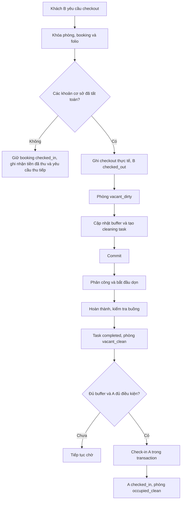

# Tái cấu trúc logic nghiệp vụ đặt phòng và quản lý thời gian dọn dẹp

> Dự án: QL_KhachSan
>
> Ngày lập: 22/10/2026
>
> Trạng thái: Đang triển khai; xem checklist để biết phần đã chạy và phần còn cần nghiệm thu trên database cô lập.
>
> Theo dõi phần đã làm và phần còn lại tại [checklist triển khai](booking-rental-policy-checklist.md). Migration mới: [v4_3_rental_types_dynamic_buffers.sql](../../../database/migrations/v4_3_rental_types_dynamic_buffers.sql).
>
> Nền tảng: Java 17, JDBC, MySQL/InnoDB.

## 1. Mục tiêu và phạm vi

Tài liệu tập hợp thiết kế nghiệp vụ, schema, thuật toán kiểm tra lịch, luồng buồng phòng, xử lý cạnh tranh và lộ trình tái cấu trúc đã thảo luận.

Mục tiêu:

1. Cho phép nhiều booking không trùng thời gian trên cùng một phòng, kể cả chèn vào khoảng trống trước một booking đã có.
2. Tính buffer dọn phòng trong mọi phép kiểm tra lịch.
3. Checkout tự động chuyển phòng sang bẩn và tạo cleaning task.
4. Chỉ check-in khi khách trước đã rời phòng, phòng đã được xác nhận sạch và đủ buffer.
5. Chống overbooking khi nhiều người đặt đồng thời.
6. Hợp nhất các luồng web, cổng khách hàng và lễ tân về một nghiệp vụ cấp phòng.
7. Giữ tính nguyên tử của booking, giá, voucher, folio, ledger và idempotency hiện có.

Tài liệu là thiết kế đích, không phải hướng dẫn chạy nguyên khối SQL trên database đang vận hành. Các ví dụ schema cần chuyển thành migration sau khi kiểm tra phiên bản MySQL và dữ liệu thực tế.

## 2. Phân biệt lịch bán phòng và khả năng bàn giao

Hai câu hỏi cần được xử lý riêng:

| Câu hỏi | Nguồn quyết định |
|---|---|
| Có thể bán phòng cho khoảng thời gian này không? | Lịch booking, buffer, các khoảng chặn khai thác và ràng buộc vận hành đã biết |
| Có thể giao phòng ngay lúc này không? | Checkout thực tế, trạng thái sạch, cleaning task, buffer và điều kiện check-in |

Một phòng đang có khách hoặc đang bẩn hôm nay vẫn có thể nhận booking cho khoảng trống trong tương lai. Ngược lại, không có booking xung đột trên lịch chưa chứng minh phòng có thể bàn giao ngay.

Không dùng một trạng thái `reserved` để thay thế toàn bộ lịch đặt phòng. Trạng thái hiện tại của phòng không biểu diễn được nhiều booking theo thời gian.

## 3. Đối chiếu mã nguồn hiện có

Các liên kết tương đối dưới đây xuất phát từ thư mục chứa tài liệu này.

| Thành phần | Hiện trạng khi khảo sát | Hướng cải thiện |
|---|---|---|
| [RoomAllocationService](../../../src/quanlykhachsan/backend/room/RoomAllocationService.java) | Khóa phòng, chọn buffer theo loại hình, so interval với `room_release_at` | Đã nối vào đặt mới; cần rà trên dữ liệu database thật |
| [PublicBookingService](../../../src/quanlykhachsan/backend/booking/PublicBookingService.java) | Tạo booking, giá, folio, ledger và idempotency trong transaction; lưu snapshot loại hình/buffer | Đơn giá riêng phải được cấu hình trước khi nhận booking theo giờ/qua đêm |
| [RoomAvailabilityController](../../../src/quanlykhachsan/backend/room/RoomAvailabilityController.java) | Hai nhánh availability dùng cùng khoảng buffer động | Cần rà lại khi hoàn thiện UI housekeeping |
| [BookingService](../../../src/quanlykhachsan/backend/booking/BookingService.java) | Kiểm tra đọc dùng buffer; tạo booking chốt lại trong transaction cấp phòng | API đổi lịch legacy chưa có; cập nhật trực tiếp bị khóa |
| [BookingDAOImpl](../../../src/quanlykhachsan/backend/booking/BookingDAOImpl.java) | Insert legacy dùng policy chung với `DAILY`; không cho sửa lịch/trạng thái trực tiếp | Cần chuyển các thao tác còn lại sang API nghiệp vụ |
| [FolioService](../../../src/quanlykhachsan/backend/booking/FolioService.java) và [FolioDao](../../../src/quanlykhachsan/backend/booking/FolioDao.java) | Checkout ghi thời điểm thực, cập nhật `room_release_at`, tạo task và đặt `due_at`; overdue Web counter được giữ lưu trú và báo nhân viên | Cần nghiệm thu migration và tính phí trên MariaDB kiểm thử |
| [RoomStateService](../../../src/quanlykhachsan/backend/room/RoomStateService.java) | Khóa phòng, chặn xác nhận sạch trước buffer, hoàn tất task khi đánh dấu sạch | Màn hình task cho nhân viên còn lại |
| [RoomStateMachine](../../../src/quanlykhachsan/backend/room/RoomStateMachine.java) | Kiểm soát chuyển trạng thái theo vai trò | Giữ làm hàng rào chuyển trạng thái vật lý |
| [HousekeepingController](../../../src/quanlykhachsan/backend/room/HousekeepingController.java) | Có API danh sách task, cập nhật trạng thái sạch và ghi inspection | UI phân công/ưu tiên task chưa làm |
| [AdminBookingStatusService](../../../src/quanlykhachsan/backend/booking/AdminBookingStatusService.java) | Check-in kiểm tra giờ, buffer, task và trạng thái phòng | Quy tắc checkout trễ/early check-in còn cần hoàn thiện |
| [PendingBookingExpiryJob](../../../src/quanlykhachsan/backend/booking/PendingBookingExpiryJob.java) | Hủy giữ phòng chưa thanh toán và xử lý ledger | Đồng bộ thứ tự khóa, expiry và thanh toán |
| [DatabaseConnection](../../../src/quanlykhachsan/backend/utils/DatabaseConnection.java) | HikariCP/JDBC | Chuẩn hóa timezone và isolation cho transaction |

Schema gốc: [database/hotel.sql](../../../database/hotel.sql). Audit buồng phòng hiện có: [v2_0_week7_housekeeping_minibar.sql](../../../database/migrations/v2_0_week7_housekeeping_minibar.sql).

### 3.1. Điểm cần hợp nhất

- `RoomAllocationService.reserve()` cũ yêu cầu phòng `vacant_clean` rồi chuyển sang `reserved`. Không dùng cách này để khóa mọi ngày của một phòng.
- `BookingService.checkAvailable()` nằm ngoài transaction ghi không đủ để chống race condition.
- `reserveForStay()` là nền tảng phù hợp hơn, nhưng cần mở rộng `rental_type`, buffer động và thời điểm.
- Các thao tác cập nhật lịch, đổi phòng, gia hạn và sửa trạng thái không được trở thành đường tắt vượt kiểm tra chung.

## 4. Quy ước nghiệp vụ và thời gian

### 4.1. Loại hình lưu trú và quy tắc thời gian

Mỗi booking có một `rental_type` để chọn khung giờ, cách tính giá và chính sách turnaround. Loại hình được chốt phía server; client không tự quyết định tổng giá hoặc buffer.

| `rental_type` | Quy tắc lưu trú và tính giá | Chuyển đổi / giới hạn |
|---|---|---|
| `HOURLY` | Block đầu gồm 2 giờ; phụ thu cho từng giờ tiếp theo. Chính sách phải quy định rõ cách làm tròn phần giờ lẻ. | Khi thời gian thực tế vượt 6 giờ, tự chuyển giá sang `DAILY` hoặc `OVERNIGHT` theo khung giờ khách sạn. Nếu dự báo chuyển đổi khi gia hạn, cập nhật giá và buffer rồi kiểm tra lại lịch dưới khóa phòng. |
| `OVERNIGHT` | Khung đêm chuẩn, ví dụ 22:00–06:00 sáng hôm sau. | Nhận phòng sớm hoặc trả phòng muộn ngoài khung đêm được tính thêm theo giờ (`HOURLY`). |
| `DAILY` | Check-in tiêu chuẩn từ 14:00, check-out trước 12:00 hôm sau; tính theo số đêm. | Early check-in và late checkout cần chính sách giá riêng; không tự thay đổi thời gian cam kết. |

Khung giờ chuẩn là cấu hình nghiệp vụ theo khách sạn. Ví dụ 22:00–06:00 minh họa loại `OVERNIGHT`, không phải hằng số timezone hay giới hạn bắt buộc của schema. Khi thời gian thực tế của `HOURLY` vượt 6 giờ, cập nhật `rental_type`, giá và snapshot buffer trong cùng transaction; nếu buffer mới ảnh hưởng booking kế tiếp thì phát hiện xung đột và chuyển sang quy trình xử lý vận hành, không âm thầm giữ lịch cũ.

### 4.2. Chính sách buffer động

Buffer turnaround được chọn theo loại hình lưu trú của booking vừa kết thúc. Giá trị ban đầu:

| Loại hình | Buffer mặc định | Ước tính tác vụ dọn phòng |
|---|---:|---:|
| `HOURLY` | 30 phút | 30–45 phút, dọn nhanh, thay khăn và thu rác |
| `OVERNIGHT` | 60 phút | Khoảng 60 phút, dọn phòng tiêu chuẩn |
| `DAILY` | 120 phút | 90–120 phút, dọn kỹ, giặt là và kiểm tra minibar |

Các giá trị buffer có thể cấu hình theo phòng (hoặc chuyển lên `room_types` nếu chính sách áp dụng theo hạng phòng). `buffer_minutes` trên booking là snapshot của loại hình tại lúc chốt booking; thay đổi cấu hình chỉ tác động booking mới. Nếu booking đổi loại hình do vượt ngưỡng 6 giờ, phải cập nhật snapshot và đánh giá lại lịch dưới khóa.

Khoảng giữ lịch ban đầu là `[check_in, room_release_at)`, với `room_release_at = check_out_date + buffer_minutes`. Khi checkout thực tế, mốc sẵn sàng vật lý được tính lại theo công thức `room_release_at = check_out_actual + buffer_minutes`. Mốc này chỉ cho biết hết buffer; phòng vẫn cần hoàn thành cleaning task và được xác nhận sạch trước khi bàn giao.

ETA dọn phòng là ước tính riêng, không thay cho buffer. Nếu khách còn ở hoặc tiến độ dọn thực tế/dự báo khiến phòng chưa thể sẵn sàng sau `room_release_at`, hệ thống được kéo dài mốc giải phóng và xử lý booking kế tiếp theo quy trình xung đột vận hành.

### 4.3. Khoảng nửa kín và buffer

Khoảng lưu trú:

```text
[check_in, check_out)
```

Khoảng phòng bị giữ cho lưu trú và turnaround:

```text
[check_in, room_release_at)

room_release_at ban đầu = check_out + buffer_minutes
```

Ví dụ yêu cầu, theo giờ địa phương khách sạn:

```text
B: 28/10/2026 14:00 → 31/10/2026 12:00
   Dọn phòng:          31/10/2026 12:00 → 14:00

A:                                          31/10/2026 14:00
                                            → 04/11/2026 12:00
```

B được đặt trước A vì buffer của B kết thúc đúng giờ A nhận phòng.

Buffer phải được xét ở cả hai phía của booking mới: booking mới phải nằm sau buffer của lượt trước và buffer của booking mới không được lấn lượt sau.

### 4.4. Nguyên tắc áp dụng buffer

- Chọn cấu hình buffer theo `rental_type` từ phòng hoặc hạng phòng; giá trị mặc định là 30/60/120 phút cho `HOURLY`/`OVERNIGHT`/`DAILY`.
- Lưu cả `rental_type` và snapshot `buffer_minutes` trên từng booking.
- Không tự tính lại booking cũ khi cấu hình mặc định thay đổi.
- Buffer là thời gian tối thiểu bắt buộc trong thiết kế này; chậm checkout hoặc dọn phòng có thể kéo dài `room_release_at`.
- Dọn xong sớm không tự cho phép check-in trước mốc buffer.
- Nếu muốn buffer chỉ là dự báo và cho phép bàn giao sớm khi sạch, phải bổ sung policy riêng, quyền duyệt và kiểm tra ảnh hưởng lịch.

### 4.5. Timezone

- Dùng `DATETIME(6)` theo quy ước UTC trong MySQL.
- `DATETIME` không lưu timezone; ứng dụng và connection phải thống nhất quy ước.
- Dùng `Instant` cho thời điểm trong Java; chuyển giờ khách sạn bằng `ZoneId.of("Asia/Ho_Chi_Minh")`.
- API nhận ISO 8601 có offset, ví dụ `2026-10-31T14:00:00+07:00`.
- Connection DB dùng UTC; đồng hồ nghiệp vụ lấy từ server, không tin thời gian client.
- Không chuyển đổi dữ liệu cũ sang UTC trước khi xác định cách các giá trị hiện tại đã được ghi.
- Không thay tùy tiện `LocalDateTime` bằng `Instant` mà giữ nguyên các lệnh JDBC và giả định timezone cũ.

`PublicBookingService.Request` hiện dùng `LocalDate`; bước ghi booking cố định 14:00/12:00. Để hỗ trợ giờ linh hoạt phải sửa DTO, validation, SQL và chính sách tính giá. Việc thêm bộ chọn giờ ở giao diện chưa đủ.

## 5. Schema đích đề xuất

### 5.1. Ý nghĩa các bảng

- `room_statuses`: danh mục trạng thái vật lý hiện tại, giữ mã tương thích dự án.
- `rooms`: thông tin phòng, cấu hình buffer theo loại hình, version và giới hạn bàn giao thực tế.
- `bookings`: lịch cam kết, loại hình lưu trú, thời điểm thực tế, buffer snapshot và khoảng giữ lịch.
- `cleaning_tasks`: tác vụ turnover gắn với lượt checkout cụ thể; ETA được ước tính theo loại hình booking.

Trong nghiệp vụ, `DIRTY` tương ứng `vacant_dirty`; `CLEAN` để bàn giao tương ứng `vacant_clean`. Dọn trong kỳ lưu trú (`occupied_dirty → occupied_clean`) là loại công việc khác, không được biến phòng thành trống.

### 5.2. SQL tạo bảng tham chiếu

Các bảng `room_types`, `customers`, `users` được giả định đã tồn tại, với khóa `INT` tương thích schema hiện có. SQL là schema đích cho MySQL 8.0.16+; không phải migration chạy lại trên database hiện hữu.

```sql
SET time_zone = '+00:00';

CREATE TABLE room_statuses (
    code VARCHAR(30) PRIMARY KEY,
    display_name VARCHAR(100) NOT NULL,
    is_occupied BOOLEAN NOT NULL DEFAULT FALSE,
    is_clean BOOLEAN NOT NULL DEFAULT FALSE,
    is_operational BOOLEAN NOT NULL DEFAULT TRUE
) ENGINE=InnoDB;

INSERT INTO room_statuses
    (code, display_name, is_occupied, is_clean, is_operational)
VALUES
    ('vacant_clean',   'Trống, đã sạch',        FALSE, TRUE,  TRUE),
    ('vacant_dirty',   'Trống, cần dọn',        FALSE, FALSE, TRUE),
    ('occupied_clean', 'Có khách, đã sạch',    TRUE,  TRUE,  TRUE),
    ('occupied_dirty', 'Có khách, cần dọn',    TRUE,  FALSE, TRUE),
    ('reserved',       'Trạng thái giữ cũ',    FALSE, FALSE, TRUE),
    ('out_of_order',   'Hỏng, ngừng khai thác',FALSE, FALSE, FALSE),
    ('out_of_service', 'Tạm ngừng phục vụ',    FALSE, FALSE, FALSE);

CREATE TABLE rooms (
    id INT AUTO_INCREMENT PRIMARY KEY,
    room_number VARCHAR(20) NOT NULL UNIQUE,
    room_type_id INT NOT NULL,
    price DECIMAL(10,2) NOT NULL,
    status VARCHAR(30) NOT NULL DEFAULT 'vacant_clean',
    buffer_hourly SMALLINT UNSIGNED NOT NULL DEFAULT 30,
    buffer_overnight SMALLINT UNSIGNED NOT NULL DEFAULT 60,
    buffer_daily SMALLINT UNSIGNED NOT NULL DEFAULT 120,
    ready_not_before DATETIME(6) NULL,
    maintenance_until DATETIME(6) NULL,
    version INT NOT NULL DEFAULT 0,
    created_at DATETIME(6) NOT NULL DEFAULT CURRENT_TIMESTAMP(6),
    updated_at DATETIME(6) NOT NULL DEFAULT CURRENT_TIMESTAMP(6)
        ON UPDATE CURRENT_TIMESTAMP(6),
    CONSTRAINT fk_room_type
        FOREIGN KEY (room_type_id) REFERENCES room_types(id),
    CONSTRAINT fk_room_status
        FOREIGN KEY (status) REFERENCES room_statuses(code),
    CONSTRAINT chk_room_price CHECK (price >= 0),
    CONSTRAINT chk_room_buffer_hourly CHECK (buffer_hourly BETWEEN 0 AND 1440),
    CONSTRAINT chk_room_buffer_overnight CHECK (buffer_overnight BETWEEN 0 AND 1440),
    CONSTRAINT chk_room_buffer_daily CHECK (buffer_daily BETWEEN 0 AND 1440),
    INDEX idx_room_type_status (room_type_id, status)
) ENGINE=InnoDB;

CREATE TABLE bookings (
    id INT AUTO_INCREMENT PRIMARY KEY,
    customer_id INT NOT NULL,
    room_id INT NOT NULL,
    rental_type ENUM('HOURLY', 'OVERNIGHT', 'DAILY') NOT NULL DEFAULT 'DAILY',
    check_in_date DATETIME(6) NOT NULL,
    check_out_date DATETIME(6) NOT NULL,
    check_in_actual DATETIME(6) NULL,
    check_out_actual DATETIME(6) NULL,
    buffer_minutes SMALLINT UNSIGNED NOT NULL DEFAULT 120,
    room_release_at DATETIME(6) NOT NULL,
    status ENUM(
        'pending', 'confirmed', 'checked_in',
        'checked_out', 'cancelled', 'no_show'
    ) NOT NULL DEFAULT 'pending',
    hold_expires_at DATETIME(6) NULL,
    total_price DECIMAL(10,2) NOT NULL DEFAULT 0,
    version INT NOT NULL DEFAULT 0,
    occupied_room_id INT GENERATED ALWAYS AS (
        CASE WHEN status = 'checked_in' THEN room_id ELSE NULL END
    ) STORED,
    created_at DATETIME(6) NOT NULL DEFAULT CURRENT_TIMESTAMP(6),
    updated_at DATETIME(6) NOT NULL DEFAULT CURRENT_TIMESTAMP(6)
        ON UPDATE CURRENT_TIMESTAMP(6),
    CONSTRAINT fk_booking_customer
        FOREIGN KEY (customer_id) REFERENCES customers(id),
    CONSTRAINT fk_booking_room
        FOREIGN KEY (room_id) REFERENCES rooms(id),
    CONSTRAINT chk_booking_range
        CHECK (check_out_date > check_in_date),
    CONSTRAINT chk_booking_release
        CHECK (room_release_at >= check_out_date),
    CONSTRAINT chk_booking_buffer
        CHECK (buffer_minutes BETWEEN 0 AND 1440),
    UNIQUE KEY uq_one_occupied_booking (occupied_room_id),
    UNIQUE KEY uq_booking_room (id, room_id),
    INDEX idx_booking_calendar
        (room_id, status, check_in_date, room_release_at),
    INDEX idx_booking_hold (status, hold_expires_at)
) ENGINE=InnoDB;

CREATE TABLE cleaning_tasks (
    id BIGINT AUTO_INCREMENT PRIMARY KEY,
    room_id INT NOT NULL,
    checkout_booking_id INT NOT NULL,
    status ENUM(
        'open', 'assigned', 'in_progress',
        'awaiting_inspection', 'completed', 'cancelled'
    ) NOT NULL DEFAULT 'open',
    assigned_to_user_id INT NULL,
    inspected_by_user_id INT NULL,
    available_from DATETIME(6) NOT NULL,
    expected_finish_at DATETIME(6) NULL,
    due_at DATETIME(6) NULL,
    started_at DATETIME(6) NULL,
    completed_at DATETIME(6) NULL,
    inspected_at DATETIME(6) NULL,
    estimated_duration_minutes SMALLINT UNSIGNED NOT NULL,
    priority TINYINT UNSIGNED NOT NULL DEFAULT 0,
    version INT NOT NULL DEFAULT 0,
    notes VARCHAR(1000) NULL,
    created_at DATETIME(6) NOT NULL DEFAULT CURRENT_TIMESTAMP(6),
    updated_at DATETIME(6) NOT NULL DEFAULT CURRENT_TIMESTAMP(6)
        ON UPDATE CURRENT_TIMESTAMP(6),
    UNIQUE KEY uq_turnover_task (checkout_booking_id),
    CONSTRAINT fk_task_booking_room
        FOREIGN KEY (checkout_booking_id, room_id)
        REFERENCES bookings(id, room_id),
    CONSTRAINT fk_task_assignee
        FOREIGN KEY (assigned_to_user_id) REFERENCES users(id),
    CONSTRAINT fk_task_inspector
        FOREIGN KEY (inspected_by_user_id) REFERENCES users(id),
    CONSTRAINT chk_task_expected_finish CHECK (
        expected_finish_at IS NULL OR expected_finish_at >= available_from
    ),
    CONSTRAINT chk_task_completed CHECK (
        status <> 'completed'
        OR (completed_at IS NOT NULL AND inspected_at IS NOT NULL)
    ),
    INDEX idx_cleaning_dispatch (status, priority, due_at),
    INDEX idx_cleaning_room (room_id, status)
) ENGINE=InnoDB;
```

`uq_one_occupied_booking` chỉ ngăn hai booking đồng thời ở trạng thái `checked_in` trên cùng phòng. Nó không ngăn hai booking tương lai chồng lịch; kiểm tra interval và transaction vẫn bắt buộc.

`CHECK room_release_at >= check_out_date` là hàng rào cơ bản. Service phải duy trì invariant mạnh hơn: thời điểm giải phóng không được sớm hơn checkout cộng buffer theo chính sách đã chốt.

### 5.3. Ý nghĩa thời điểm

| Trường | Ý nghĩa |
|---|---|
| `check_out_date` | Giờ checkout cam kết; chỉ sửa qua nghiệp vụ thay đổi lịch có audit |
| `check_out_actual` | Giờ checkout thực tế; không ghi đè lịch cam kết |
| `rental_type` | Loại hình chốt phía server; quyết định khung giờ, giá và buffer |
| `buffer_minutes` | Snapshot buffer đã chọn theo loại hình tại thời điểm đặt |
| `room_release_at` | Kết thúc khoảng giữ lịch; có thể kéo dài khi có chậm trễ |
| `ready_not_before` | Giới hạn sớm nhất được bàn giao theo checkout thực tế và buffer |
| `expected_finish_at` | Dự báo kết thúc dọn; không xác nhận phòng sạch |
| `due_at` | Giờ check-in của booking kế tiếp cần phục vụ, nếu có; task phải ưu tiên hoàn tất trước mốc này |

Giữ bảng `room_status_audits` đang có. Không dùng `room_statuses` thay cho lịch sử chuyển trạng thái.

Đối với bảo trì có lịch tương lai, bổ sung sau bảng `room_blocks(room_id, start_at, end_at, reason, status)`. Trạng thái phòng hiện tại và `maintenance_until` không đủ biểu diễn mọi khoảng bảo trì tương lai.

## 6. Thuật toán kiểm tra lịch trống

### 6.1. Điều kiện overlap chính xác

```text
N.start = check_in_new
N.end   = check_out_new + buffer_new

E.start = check_in_existing
E.end   = room_release_at_existing

Xung đột khi:
    E.start < N.end AND E.end > N.start

Không xung đột khi:
    N.end <= E.start OR E.end <= N.start
```

Dùng dấu `<` và `>` nghiêm ngặt để cho phép hai khoảng tiếp giáp đúng ranh giới. Không cộng buffer vào cả đầu và cuối mỗi lượt vì sẽ tính gấp đôi thời gian đệm giữa hai lượt.

Ví dụ A nhận lúc 31/10/2026 14:00, buffer B bằng 120 phút:

| Checkout B | Kết thúc buffer B | Kết quả |
|---|---|---|
| 31/10 11:00 | 31/10 13:00 | Hợp lệ |
| 31/10 12:00 | 31/10 14:00 | Hợp lệ |
| 31/10 12:01 | 31/10 14:01 | Xung đột |
| 31/10 13:00 | 31/10 15:00 | Xung đột |

### 6.2. Truy vấn kiểm tra một phòng

Tham số đặt tên là ký hiệu minh họa. JDBC dùng `?` và bind kiểu thời gian thống nhất UTC.

```sql
SELECT b.id
FROM bookings b
WHERE b.room_id = :room_id
  AND b.status IN ('pending', 'confirmed', 'checked_in', 'checked_out')
  AND b.check_in_date < :new_release_at
  AND b.room_release_at > :new_check_in
  AND (:excluded_booking_id IS NULL OR b.id <> :excluded_booking_id)
LIMIT 1;
```

- `new_buffer_minutes` được chọn từ cấu hình phòng theo `rental_type` của booking mới; `new_release_at = new_check_out + new_buffer_minutes`.
- Khi sửa booking, loại chính booking đó bằng `excluded_booking_id`.
- Vẫn xét `checked_out` vì buffer sau checkout có thể chưa kết thúc.
- Không xét `cancelled`, `no_show`.
- Booking cũ tự hết ảnh hưởng khi khoảng thời gian không còn giao nhau.

Giữ `pending` chặn lịch đến khi worker hoặc nghiệp vụ hết hạn thật sự hủy và xử lý folio. Không chỉ bỏ qua hold hết giờ trong truy vấn nếu luồng thanh toán vẫn có thể xác nhận nó. Hết hạn và thanh toán phải được phân xử dưới khóa.

### 6.3. Truy vấn tìm phòng theo lịch

```sql
SELECT r.id, r.room_number, r.room_type_id, r.version
FROM rooms r
WHERE r.status NOT IN ('out_of_order', 'out_of_service')
  AND NOT EXISTS (
      SELECT 1
      FROM bookings b
      WHERE b.room_id = r.id
        AND b.status IN ('pending', 'confirmed', 'checked_in', 'checked_out')
        AND b.check_in_date < TIMESTAMPADD(
            MINUTE,
            CASE :rental_type
                WHEN 'HOURLY' THEN r.buffer_hourly
                WHEN 'OVERNIGHT' THEN r.buffer_overnight
                WHEN 'DAILY' THEN r.buffer_daily
            END,
            :new_check_out
        )
        AND b.room_release_at > :new_check_in
  );
```

Đây là kiểm tra lịch, không phải toàn bộ quyết định sẵn sàng bàn giao. Bổ sung bộ đánh giá vận hành:

- Không nhận khách ngay nếu phòng còn người ở, bẩn hoặc chưa đủ buffer.
- Task đang dọn phải có dự báo; không bán lượt bắt đầu trước mốc dự kiến sẵn sàng.
- Task quá hạn hoặc dự báo chưa đáng tin cậy phải được cập nhật hoặc chuyển lễ tân xác nhận. Không coi thời điểm dự báo đã qua là bằng chứng đã sạch.
- Khách quá giờ checkout nhưng còn `checked_in` vẫn đang chiếm phòng trên thực tế. Không coi phòng trống ngay chỉ vì lịch dự kiến đã kết thúc.
- Với tương lai, trạng thái bẩn hiện tại không khóa mọi ngày về sau nếu có kế hoạch hoàn thành phù hợp.
- Lịch bảo trì tương lai phải được xét như một khoảng chặn khi bổ sung `room_blocks`.

### 6.4. Pseudocode policy

```java
int resolveBufferMinutes(Room room, StayRequest request) {
    return switch (request.rentalType()) {
        case HOURLY -> room.bufferHourly();
        case OVERNIGHT -> room.bufferOvernight();
        case DAILY -> room.bufferDaily();
    };
}

AvailabilityDecision evaluate(
    Room room,
    StayRequest request,
    List<BookingInterval> intervals,
    OperationalReadiness readiness
) {
    require(request.checkOut().isAfter(request.checkIn()));
    requireValidGuestCount(room, request.guestCount());

    int bufferMinutes = resolveBufferMinutes(room, request);
    Instant newRelease = request.checkOut().plus(Duration.ofMinutes(bufferMinutes));

    for (BookingInterval existing : intervals) {
        boolean conflict = existing.checkIn().isBefore(newRelease)
            && existing.releaseAt().isAfter(request.checkIn());
        if (conflict) {
            return AvailabilityDecision.conflict(existing.bookingId());
        }
    }

    return evaluateOperationalReadiness(room, request, readiness);
}
```

Pseudocode mô tả quy tắc; triển khai dùng SQL lọc theo phòng và interval, không tải tất cả booking toàn hệ thống lên Java. GET availability chỉ là dự báo. POST booking phải kiểm tra lại dưới khóa.

## 7. Luồng checkout, dọn phòng và check-in



### 7.1. Checkout nguyên tử

Mở rộng transaction hiện có trong `FolioService` và `FolioDao.checkout()`:

```text
BEGIN
  Khóa phòng → booking B → các folio theo thứ tự thống nhất.
  Xác minh B còn checked_in; tính phụ thu thực tế và xác nhận các khoản cơ sở đã tất toán.
  Phụ thu late checkout/chuyển gói còn dư nợ được giữ mở để thu sau checkout.

  B.status = checked_out
  B.check_out_actual = thời điểm server

  ready_not_before = check_out_actual + B.buffer_minutes
  B.room_release_at = ready_not_before

  room.status = vacant_dirty
  room.ready_not_before = ready_not_before
  room.version += 1

  Tạo task:
    checkout_booking_id = B.id
    available_from = check_out_actual
    estimated_duration_minutes = ước tính theo B.rental_type
      HOURLY: mặc định 45; OVERNIGHT: 60; DAILY: 120
    expected_finish_at = check_out_actual + ETA theo khối lượng và nhân sự
    due_at = check_in_date của booking kế tiếp, nếu có

  Ghi audit và sự kiện thông báo.
COMMIT
```

- Nếu insert task thất bại, rollback cả checkout. Không để booking đã checkout nhưng thiếu tác vụ.
- Nếu khoản cơ sở còn nợ, chưa đóng booking; khoản thu đã nhận vẫn được commit cùng số dư còn lại. Nếu chỉ còn phụ thu thời gian thực tế/chuyển gói, vẫn ghi checkout và tạo task; invoice hoàn tất sau khi folio về 0.
- Unique `checkout_booking_id` ngăn tạo task trùng; idempotency checkout vẫn phải trả lại kết quả cũ khi retry.
- ETA chỉ là dự báo, không thay cho `buffer_minutes` hoặc xác nhận sạch. Nếu thời gian dọn thực tế/dự báo muộn hơn khoảng đã giữ, cập nhật mốc giữ lịch và phát hiện booking bị ảnh hưởng trong transaction có khóa.
- Không gọi dịch vụ thông báo bên ngoài trong lúc giữ khóa. Phát sau commit; nếu cần chống mất thông báo, ghi transactional outbox trong cùng transaction.

### 7.2. Phân công task

```text
open → assigned → in_progress → awaiting_inspection → completed
```

Phòng vẫn `vacant_dirty` trong quá trình dọn. Task thể hiện tiến độ, không cần thêm trạng thái vật lý phòng chỉ để lặp lại tiến độ task.

```sql
UPDATE cleaning_tasks
SET status = 'assigned',
    assigned_to_user_id = :staff_id,
    version = version + 1
WHERE id = :task_id
  AND status = 'open'
  AND assigned_to_user_id IS NULL;
```

Chỉ nhận task thành công khi số dòng cập nhật bằng 1. Chuyển bước tiếp theo cũng kiểm tra trạng thái, người được phân công và version.

### 7.3. Hoàn thành và xác nhận sạch

Trong một transaction:

1. Khóa phòng, sau đó task.
2. Kiểm tra quyền, trạng thái và version của task.
3. Xác minh task thuộc lượt checkout cần xử lý và không phải yêu cầu cũ của kỳ lưu trú trước.
4. Xác minh không có khách mới đang ở phòng.
5. Ghi `completed_at`, `inspected_at`, người xác nhận.
6. Chuyển task sang `completed`.
7. Chuyển `vacant_dirty → vacant_clean` qua `RoomStateService`, tăng version và ghi audit.
8. Commit.

Không cho task cũ đổi phòng của một kỳ lưu trú mới thành trống sạch. Với quy trình không có kiểm tra riêng, thao tác được cấp quyền có thể là “Hoàn tất dọn và xác nhận sạch”, ghi cả hai mốc cùng lúc.

Task `cancelled` không mặc nhiên chứng minh phòng sạch; nếu hủy task, phải có luồng xử lý phòng và lý do phù hợp.

### 7.4. Điều kiện check-in

Kiểm tra lại dưới khóa:

```text
booking.status == confirmed
AND thời điểm nhận phòng được phép đã đến
AND now < booking.check_out_date
AND room.status == vacant_clean
AND không có booking khác checked_in trên phòng
AND không có turnover task bắt buộc chưa hoàn tất
AND (room.ready_not_before IS NULL OR now >= room.ready_not_before)
```

Sau đó ghi cùng transaction:

```text
booking.status = checked_in
booking.check_in_actual = now
room.status = occupied_clean
room.version += 1
```

Không chỉ so sánh ngày: 31/10 lúc 09:00 vẫn sớm hơn lịch nhận phòng 31/10 lúc 14:00. Early check-in phải có policy riêng, kiểm tra buffer, lịch và giá phát sinh.

## 8. Late checkout và ngoại lệ

### 8.1. Xin late checkout trước khi được duyệt

Ví dụ B xin trả 31/10 lúc 13:00, buffer 120 phút, A nhận 14:00. Mốc giải phóng mới 15:00 xung đột với A.

Luồng duyệt:

1. Khóa phòng.
2. Tính checkout và release mới, loại chính B khi kiểm tra xung đột.
3. Nếu không xung đột, cập nhật lịch, giá/folio và audit theo chính sách.
4. Nếu xung đột, từ chối duyệt tự động hoặc chuyển quản lý giải quyết đổi phòng.
5. Không duyệt rồi mới tìm booking bị ảnh hưởng.

### 8.2. Khách thực tế trả trễ dù chưa được duyệt

Không từ chối ghi nhận sự kiện thực tế chỉ vì nó làm lộ xung đột lịch đã bán.

```text
B thực tế checkout: 31/10 13:15
Buffer:            120 phút
Sớm nhất bàn giao: 31/10 15:15
A dự kiến nhận:    31/10 14:00
Chậm tối thiểu:    75 phút
```

Hệ thống phải:

- Ghi đúng thời điểm thực tế và chuyển phòng bẩn.
- Tăng mốc giải phóng, đánh dấu xung đột vận hành với A.
- Tăng ưu tiên task và thông báo lễ tân/quản lý.
- Đề xuất phòng thay thế cùng hạng hoặc nâng hạng theo chính sách.
- Không tự sửa giờ check-in đã cam kết của A.
- Không giảm buffer hoặc ghi CLEAN giả để làm lịch có vẻ hợp lệ.

Đổi phòng cho A phải khóa cả phòng cũ và phòng mới theo ID tăng dần, kiểm tra lịch phòng đích rồi mới cập nhật booking, giá và audit nếu có ảnh hưởng.

### 8.3. Ngoại lệ khác

| Tình huống | Quy tắc |
|---|---|
| Dọn xong trước buffer | Sạch nhưng vẫn chờ mốc tối thiểu |
| Dọn quá dự báo | Cập nhật ETA, mốc giữ và cảnh báo; không tự CLEAN theo đồng hồ |
| Phát hiện hỏng | Chuyển bảo trì; không hoàn tất như phòng sẵn sàng |
| Checkout sớm | Tính lại `room_release_at` theo thời điểm checkout thực tế cộng snapshot buffer; không bàn giao trước khi buffer và cleaning task hoàn tất |
| Không có người nhận task | Escalation theo deadline, không tự hoàn thành |
| Nhiều công việc bắt buộc | Chỉ bàn giao khi mọi công việc bắt buộc đã hoàn tất |
| Khách còn ở sau checkout dự kiến | Không xác nhận giao ngay; cập nhật dự báo và xử lý với lễ tân |
| Hold hết hạn cùng lúc thanh toán | Phân xử dưới khóa; không để vừa hủy vừa xác nhận |

### 8.4. Định giá thời gian thực tế

- Nhận phòng thực tế trước giờ đã đặt tính theo `hourly_extra_hour_price`, làm tròn lên từng giờ bắt đầu. Trả muộn được miễn 30 phút đầu; sau đó mỗi giờ bắt đầu cộng một giờ phụ thu, và quá 6 giờ cộng một lần phụ thu bằng một giờ. Retry của worker và checkout dùng reference folio ổn định để không ghi trùng. Trả sớm không tự hoàn tiền.
- Nếu thời lượng thực của booking `HOURLY` vượt 6 giờ, checkout xác định gói đích theo khung thực tế: ưu tiên `OVERNIGHT` nếu bao phủ 22:00–06:00 và nằm trong biên giờ cho phép; nếu không thì dùng `DAILY`.
- Giá gói đích được so với các thành phần giá ban đầu (`room_rate`, `service_charge`, `vat`); chỉ ghi phần chênh dương, không tự phát sinh refund khi giá gói đích thấp hơn. `rental_type` và snapshot buffer đổi theo gói cuối khi checkout commit.
- Phụ thu được ghi vào folio với reference ổn định để retry chỉ ghi phần còn thiếu. Nếu còn nợ các khoản cơ sở, booking ở `checked_in`; nếu chỉ còn khoản phụ thu thời gian thực tế, checkout và cleaning task vẫn được ghi nhận, folio tiếp tục nhận thanh toán sau checkout.
- Hàng đợi housekeeping sắp task xung đột (ETA hoàn tất trễ hơn check-in kế tiếp) trước, sau đó task đang làm và deadline gần nhất; task trễ được đánh dấu `overdue`.

## 9. Chống race condition và overbooking

### 9.1. Phương án chính

Dùng transaction MySQL, khóa dòng `rooms` bằng `SELECT ... FOR UPDATE`, rồi kiểm tra lịch và insert booking trong cùng transaction.

Dòng phòng luôn tồn tại ngay cả khi chưa có booking. Không dựa riêng vào khóa các booking xung đột vì kết quả có thể rỗng. Mọi đường ghi thay đổi lịch trên phòng phải tuân theo cùng giao thức khóa.

### 9.2. Transaction mẫu

```sql
SET TRANSACTION ISOLATION LEVEL READ COMMITTED;
START TRANSACTION;

SELECT id, status, version,
       buffer_hourly, buffer_overnight, buffer_daily,
       ready_not_before
FROM rooms
WHERE id = :room_id
FOR UPDATE;

-- Service xác minh phòng, sức chứa, thời gian và readiness.
-- Chọn :buffer_minutes theo :rental_type từ cấu hình vừa đọc dưới khóa.
-- Tính new_release_at = :new_check_out + :buffer_minutes.

SELECT id
FROM bookings
WHERE room_id = :room_id
  AND status IN ('pending', 'confirmed', 'checked_in', 'checked_out')
  AND check_in_date < :new_release_at
  AND room_release_at > :new_check_in
LIMIT 1
FOR UPDATE;

-- Có xung đột: ROLLBACK và trả 409.

INSERT INTO bookings (
    customer_id, room_id,
    rental_type,
    check_in_date, check_out_date,
    buffer_minutes, room_release_at,
    status, hold_expires_at, total_price
) VALUES (
    :customer_id, :room_id,
    :rental_type,
    :new_check_in, :new_check_out,
    :buffer_minutes, :new_release_at,
    'pending', :hold_expires_at, :server_calculated_total
);

-- Tạo folio, ghi ledger, voucher và replay idempotency
-- trong cùng transaction như PublicBookingService hiện có.

UPDATE rooms
SET version = version + 1
WHERE id = :room_id;

COMMIT;
```

Không chuyển trạng thái vật lý thành `reserved` chỉ vì tạo booking tương lai.

Khi X và Y cùng đặt:

```text
X lấy khóa phòng → kiểm tra trống → insert → commit.
Y chờ khóa.
Y lấy khóa → đọc được booking X → trả 409 nếu trùng.
Nếu hai khoảng không giao nhau, Y vẫn có thể được chấp nhận.
```

### 9.3. Phân biệt các cơ chế bảo vệ

| Cơ chế | Mục đích |
|---|---|
| `Idempotency-Key` | Retry cùng request không tạo booking/thanh toán lần hai |
| Khóa dòng phòng | Hai request khác nhau không đặt trùng lịch |
| `rooms.version` | Phát hiện giao diện hoặc request dựa trên dữ liệu cũ |
| Unique `occupied_room_id` | Ngăn hai booking cùng mang trạng thái đang ở một phòng |
| Unique task theo checkout booking | Retry không tạo turnover task thứ hai |

`GET_LOCK` theo idempotency key hiện có không thay khóa phòng: hai khách có hai key khác nhau.

Version khác nhau không tự chứng minh lịch trùng; một booking không liên quan thời gian cũng làm version tăng. Có thể giữ cách trả conflict yêu cầu tải lại, hoặc đánh giá lại toàn bộ điều kiện dưới khóa. Quyết định cần được chốt nhất quán với kiểm tra giá và room state.

### 9.4. Thứ tự khóa và retry

Thống nhất trên tất cả luồng:

```text
Idempotency lock
→ các phòng theo ID tăng dần
→ các booking theo ID tăng dần
→ các folio theo ID tăng dần
→ các cleaning task theo ID tăng dần
```

Voucher và tài nguyên dùng chung khác cũng phải có vị trí khóa thống nhất. Kiểm tra lại các luồng payment/expiry đang khóa booking hoặc folio trước phòng để tránh đảo thứ tự.

Nếu cần biết phòng từ booking, đọc sơ bộ room ID, sau đó khóa phòng, khóa booking và xác minh lại booking vẫn thuộc phòng đó. Nếu đã đổi phòng thì rollback/retry theo đúng tài nguyên.

- Rollback toàn bộ khi deadlock hoặc lỗi transaction.
- Retry có giới hạn và backoff cho lỗi DB tạm thời; không retry mù lỗi nghiệp vụ.
- Giữ nguyên idempotency key qua các lần retry.
- Khóa được giữ đến commit/rollback; không chờ người dùng hoặc gọi API ngoài trong transaction.
- Không cần Redis lock ở giai đoạn này. MySQL vẫn là nguồn quyết định và hàng rào toàn vẹn cuối cùng.

## 10. Kiến trúc service đích

```text
StayPricingPolicy
  Chọn giá theo rental_type, thời lượng và ngưỡng chuyển đổi sau 6 giờ

RoomAvailabilityPolicy
  Quy tắc interval, snapshot buffer động và readiness

RoomAvailabilityRepository
  SQL kiểm tra lịch dùng chung, hỗ trợ loại booking khi chỉnh sửa

RoomAllocationService
  Khóa phòng, đọc cấu hình, kiểm tra quyết định và cấp lịch

PublicBookingService / BookingCommandService
  Điều phối booking + giá + voucher + folio + idempotency

CheckoutService / FolioService
  Checkout + DIRTY + cleaning task cùng transaction

HousekeepingService
  Phân công, bắt đầu dọn, kiểm tra và xác nhận sạch

CheckInService
  Giờ nhận phòng + confirmed + CLEAN + buffer + không có khách khác
```

Controller chỉ xác thực, phân quyền, parse/validate đầu vào và ánh xạ lỗi. Không đặt công thức overlap riêng ở từng controller, UI hoặc DAO cũ.

Phân biệt kết quả nghiệp vụ để giao diện giải thích được lý do, ví dụ:

- `BOOKING_INTERVAL_CONFLICT`: trùng lịch hoặc buffer.
- `ROOM_NOT_CLEAN`: chưa được xác nhận sạch.
- `TURNAROUND_NOT_FINISHED`: chưa đủ buffer.
- `ROOM_STILL_OCCUPIED`: khách trước còn lưu trú.
- `CLEANING_DELAYED`: việc dọn chậm hoặc chưa có ETA đáng tin cậy.
- `ROOM_VERSION_CHANGED`: dữ liệu thay đổi cần đánh giá lại.
- `IDEMPOTENCY_KEY_REUSED`: cùng key nhưng payload khác.

Các mã là đề xuất, cần thống nhất hợp đồng API trước khi triển khai. Với xung đột nghiệp vụ dùng HTTP 409; không trả thành công khi transaction chưa commit.

## 11. Lộ trình migration và triển khai

### Giai đoạn 1 — Khảo sát và quyết định policy

- [ ] Xác định phiên bản MySQL và các migration đã thực sự áp dụng.
- [ ] Liệt kê mọi đường tạo/sửa/gia hạn/hủy/đổi phòng/check-in/checkout.
- [ ] Xác nhận buffer là tối thiểu bắt buộc hay chỉ thời gian dự kiến.
- [ ] Chốt timezone lưu dữ liệu cũ và kế hoạch chuẩn hóa UTC.
- [ ] Chốt giá `HOURLY`/`OVERNIGHT`/`DAILY`, quy tắc làm tròn giờ lẻ và ngưỡng chuyển `HOURLY` sau 6 giờ.
- [ ] Chốt khung giờ overnight, phụ thu early/late và cấu hình buffer theo phòng hoặc hạng phòng.
- [ ] Chốt quy trình kiểm tra phòng và ai được xác nhận sạch.

### Giai đoạn 2 — Schema mở rộng và backfill

- [ ] Tạo migration có version; không chạy lại schema đích lên bảng hiện có.
- [ ] Thêm `rental_type`, cấu hình buffer động, snapshot buffer, release, readiness, actual timestamps còn thiếu và hold expiry.
- [ ] Tạo `cleaning_tasks`, danh mục trạng thái, index và ràng buộc phù hợp.
- [ ] Backfill loại hình cũ theo policy đã duyệt (mặc định `DAILY` nếu dữ liệu không phân biệt được), chọn snapshot buffer và tính `room_release_at = check_out_date + buffer_snapshot`.
- [ ] Rà lịch hiện có: buffer bổ sung có thể làm những booking trước đây hợp lệ trở thành xung đột.
- [ ] Rà các phòng có nhiều booking `checked_in` trước khi thêm unique constraint.
- [ ] Rà phòng bẩn nhưng không có nguồn checkout/task; lập task có kiểm soát thay vì suy diễn dữ liệu lịch sử.
- [ ] Chỉ bật NOT NULL/constraint sau khi backfill và đối soát thành công.
- [ ] Giữ audit và schema tương thích trong thời gian chuyển tiếp.

### Giai đoạn 3 — Hợp nhất nghiệp vụ cấp phòng

- [ ] Đưa overlap và buffer về policy/repository chung.
- [ ] Resolve buffer theo `rental_type` cho cả availability và tạo booking; tái kiểm tra lịch khi tự chuyển loại hình sau 6 giờ.
- [ ] Mở rộng `reserveForStay()` nhận thời điểm đầy đủ.
- [ ] Chuyển luồng DAO/service cũ sang cấp lịch dưới khóa.
- [ ] Sửa cả hai nhánh availability để cùng kết quả với POST booking.
- [ ] Không giữ phòng tương lai bằng trạng thái vật lý `reserved`.
- [ ] Kiểm tra sửa lịch, gia hạn, đổi phòng cũng tuân thủ giao thức khóa.

### Giai đoạn 4 — Checkout và housekeeping

- [ ] Tạo task cùng transaction checkout.
- [ ] Chọn `estimated_duration_minutes` theo loại hình checkout; đặt `due_at` bằng giờ nhận phòng của booking kế tiếp.
- [ ] Bổ sung API phân công/bắt đầu/kiểm tra/hoàn tất task.
- [ ] Liên kết `HousekeepingController` với task; không cho đổi CLEAN rời rạc vượt nghiệp vụ.
- [ ] Ghi readiness, audit và outbox nếu cần.
- [ ] Thêm cảnh báo task chậm và booking bị ảnh hưởng.

### Giai đoạn 5 — Check-in, payment và expiry

- [ ] Check-in theo giờ thực, CLEAN, task và buffer.
- [ ] Chuẩn hóa thứ tự khóa giữa cấp phòng, checkout, payment, hủy và expiry.
- [ ] Kiểm thử thanh toán đến cùng lúc hold hết hạn.
- [ ] Giữ nguyên idempotency và bút toán cân bằng/hoàn tác hiện có.

### Giai đoạn 6 — Triển khai có kiểm soát

- [ ] Chạy trên database kiểm thử với dữ liệu đại diện.
- [ ] So sánh availability giữa logic cũ và mới, phân loại chênh lệch.
- [ ] Có kế hoạch rollback ứng dụng và tương thích schema; không xóa cột cũ ngay.
- [ ] Bật logic mới theo cấu hình và theo dõi conflict, lock wait, task trễ.
- [ ] Loại bỏ nhánh cũ sau khi xác nhận không còn caller.

## 12. Kiểm thử nghiệm thu

| ID | Kịch bản | Kết quả mong đợi |
|---|---|---|
| BK-01 | B checkout 31/10 12:00, A nhận 14:00, buffer 120 phút | Đặt được |
| BK-02 | B checkout 12:01, A nhận 14:00 | Chặn vì thiếu một phút |
| BK-03 | Chèn B trước một booking A đã tồn tại | Được nếu cả buffer B không lấn A |
| BK-04 | Đặt sau B, giờ nhận nằm trong buffer B | Chặn |
| BK-05 | Hai request khác key cùng phòng, cùng giờ | Chỉ một request thành công |
| BK-06 | Hai request cùng phòng, khoảng không trùng | Cả hai có thể thành công |
| BK-07 | Retry cùng idempotency key và payload | Kết quả cũ, không thêm booking/folio |
| BK-08 | Cùng key, payload khác | Conflict, không ghi thêm |
| BK-09 | Sửa lịch booking | Loại chính booking đó nhưng vẫn kiểm tra các booking khác |
| BK-10 | Đổi cấu hình buffer theo loại hình | Không âm thầm sửa snapshot booking đã chốt |
| BK-11 | Lưu trú `HOURLY` đúng 2 giờ, rồi phát sinh từng giờ tiếp theo | Tính block cơ sở và phụ thu theo quy tắc làm tròn đã cấu hình |
| BK-12 | `HOURLY` vượt 6 giờ | Tự chuyển sang `DAILY` hoặc `OVERNIGHT`, cập nhật giá/buffer và kiểm tra lại lịch dưới khóa |
| BK-13 | `OVERNIGHT` nhận sớm hoặc trả muộn ngoài khung đêm | Tính phần thời gian ngoài khung theo giá `HOURLY` |
| BK-14 | `DAILY` lưu trú nhiều ngày | Tính giá theo số đêm, không theo số block 24 giờ từ giờ nhận thực tế |
| HK-01 | Checkout lỗi khi tạo task | Booking, phòng và folio rollback |
| HK-02 | Retry checkout | Chỉ một turnover task |
| HK-03 | Hai nhân viên cùng nhận task | Chỉ một người nhận thành công |
| HK-04 | Quá ETA nhưng task chưa xong | Không tự CLEAN, cảnh báo trễ |
| HK-05 | Phòng CLEAN nhưng chưa đủ buffer | Không check-in theo policy tối thiểu |
| HK-06 | Hoàn tất task cũ sau khi có kỳ lưu trú mới | Không biến phòng thành trống sạch |
| HK-07 | Phòng tương lai đang bẩn hôm nay nhưng có ETA phù hợp | Không khóa mọi ngày tương lai |
| HK-08 | B checkout thực tế trễ ảnh hưởng A | Ghi thực tế, cảnh báo, chặn bàn giao chưa sẵn sàng |
| HK-09 | Checkout theo từng `rental_type` | Buffer và ETA task lấy đúng loại; `due_at` là check-in của booking kế tiếp |
| CI-01 | A nhận cùng ngày nhưng sớm hơn giờ cam kết | Chặn nếu chưa được early check-in |
| CI-02 | Phòng báo sạch nhưng còn booking khác checked_in | Chặn |
| TX-01 | Hết hold cùng lúc thanh toán | Chỉ một chuyển trạng thái hợp lệ commit |
| TX-02 | Đổi phòng chéo đồng thời | Tuân thủ thứ tự khóa; rollback/retry nếu deadlock |
| TZ-01 | API có offset và JVM/DB khác timezone | Giữ đúng thời điểm, không lệch giờ |
| MG-01 | Backfill buffer làm lịch cũ xung đột | Có báo cáo và xử lý trước khi bật logic mới |

Kiểm thử concurrency phải dùng tối thiểu hai connection thật tới MySQL, đồng bộ bằng latch/barrier để hai transaction tranh cùng phòng. Mock DAO không chứng minh được cơ chế khóa hoặc isolation hoạt động đúng.

## 13. Chỉ số theo dõi sau triển khai

- Số conflict đặt phòng, phân biệt trùng lịch với dữ liệu cũ.
- Thời gian chờ khóa phòng, deadlock và số lần retry.
- Số task quá hạn, thời gian từ checkout đến bắt đầu dọn và đến xác nhận sạch.
- Chênh lệch ETA với thời gian hoàn thành thực tế.
- Số booking chậm bàn giao do late checkout hoặc housekeeping.
- Số phòng bẩn không có task, task hoàn tất nhưng phòng chưa sạch và các sai lệch cần đối soát.

## 14. Tiêu chí hoàn thành tái cấu trúc

- Mọi đường ghi lịch phòng dùng cùng công thức interval và cùng giao thức khóa.
- Mọi booking lưu `rental_type`; giá, buffer snapshot và chuyển đổi sau 6 giờ tuân theo cùng policy server.
- Availability, checkout và cleaning task dùng buffer/ETA phù hợp với loại hình lưu trú.
- Availability và tạo booking nhất quán khi không có thay đổi đồng thời.
- Không có booking mới được chấp nhận chỉ dựa trên kết quả tìm kiếm cũ.
- Checkout, DIRTY và tạo task commit hoặc rollback cùng nhau.
- CLEAN là xác nhận nghiệp vụ có thẩm quyền, không phải suy đoán theo thời gian.
- Check-in kiểm tra đủ giờ thực tế, buffer, trạng thái sạch và khách đang ở.
- Luồng payment, ledger, expiry, idempotency và audit không bị mất tính toàn vẹn.
- Các kiểm thử ranh giới thời gian, rollback và cạnh tranh MySQL đã đạt.

## 15. Tài liệu tham khảo

- [MySQL InnoDB Locking Reads](https://dev.mysql.com/doc/refman/8.4/en/innodb-locking-reads.html): `FOR UPDATE`, transaction và vòng đời khóa.
- [MySQL Transaction Isolation Levels](https://dev.mysql.com/doc/refman/8.4/en/innodb-transaction-isolation-levels.html): isolation và hành vi đọc.
- [MySQL Server Time Zone Support](https://dev.mysql.com/doc/refman/8.4/en/time-zone-support.html): timezone của connection và kiểu thời gian.

Tài liệu mô tả đích nghiệp vụ đầy đủ. Một phần đã được hiện thực trong mã và migration `v4_3`; các phần còn lại và trạng thái kiểm tra được ghi tại [checklist triển khai](booking-rental-policy-checklist.md). Chưa xác nhận migration trên database đang vận hành và chưa chạy kiểm thử tích hợp.
