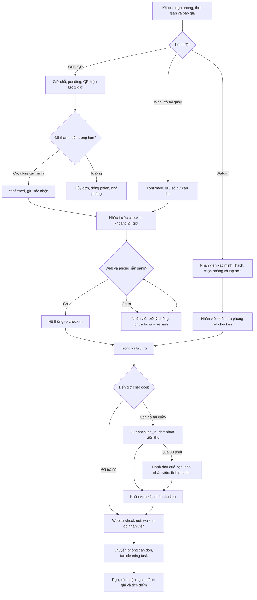

# Luồng nghiệp vụ đặt phòng và nhận phòng

> Tài liệu mô tả vai trò của khách hàng, hệ thống và nhân viên từ lúc chọn phòng đến check-in; phần cuối tóm tắt check-out và bàn giao buồng phòng. Quy tắc là chính sách đã thống nhất trong quá trình làm việc. Mục đối chiếu nêu rõ điểm mã nguồn chưa đồng nhất.

## 1. Nguyên tắc chung

- Booking qua web tự động xử lý các mốc thanh toán, nhắc lịch, check-in và check-out. Nhân viên xử lý ngoại lệ và khoản thu tại quầy.
- Booking walk-in do nhân viên thực hiện: kiểm tra phòng, lập đơn, nhận khách và trả phòng.
- Máy chủ phải kiểm tra lại lịch, giá, thời gian đệm, tình trạng phòng và số dư ở mỗi lần xác nhận. Không sửa trạng thái trực tiếp để bỏ qua nghiệp vụ.
- Trạng thái booking khác với trạng thái vật lý của phòng. Booking đã xác nhận chưa có nghĩa là phòng sẵn sàng bàn giao; phòng phải sạch, hết buffer và không còn việc dọn đang mở.

## 2. Loại hình lưu trú và giá

| Loại hình | Thời gian khách chọn | Giá |
|---|---|---|
| Theo ngày | Nhận 14:00, trả 12:00 theo ngày đã chọn; khách không sửa giờ chuẩn. | Tính theo số đêm và giá ngày đã cấu hình. |
| Qua đêm | Theo quy ước đã trao đổi: 18:00 ngày đầu đến 08:00 ngày hôm sau. | Tính theo gói qua đêm; phần ngoài gói tính thêm nếu chính sách cho phép. |
| Theo giờ | Khách chọn giờ nhận/trả, tối đa 6 tiếng. | Giá gói gồm 2 giờ đầu; mỗi giờ bắt đầu tiếp theo tính một giờ, phần lẻ làm tròn lên. Giá giờ cấu hình riêng theo hạng phòng. |

Máy chủ báo tổng tiền gồm tiền phòng, phí dịch vụ, thuế và giảm giá hợp lệ. Máy chủ báo giá lại và kiểm tra lịch khi khách xác nhận để tránh giữ trùng phòng hoặc dùng báo giá cũ. Mã ưu đãi hiện chỉ áp dụng cho lưu trú theo ngày.

Buffer dọn phòng mặc định theo checklist hiện tại: 30 phút cho theo giờ, 60 phút cho qua đêm, 120 phút cho theo ngày. Lịch đặt và buffer đều được tính khi tìm/cấp phòng. Nhân viên vẫn phải kiểm tra phòng đã sẵn sàng thực tế trước khi bàn giao.

> **Điểm cần đồng bộ:** nghiệp vụ đã thống nhất gói qua đêm 18:00–08:00, nhưng [StayWindow.java](../../src/quanlykhachsan/backend/room/StayWindow.java) hiện vẫn kiểm tra 22:00–06:00. Cần cập nhật và nghiệm thu quy tắc này trước khi xem gói 18:00–08:00 là đã được hỗ trợ nhất quán.

## 3. Đặt phòng qua web

### 3.1. Chọn phòng và gửi yêu cầu

1. Khách chọn loại hình, ngày/giờ, số khách và xem phòng phù hợp.
2. Hệ thống kiểm tra sức chứa, giá, lịch booking giao nhau, buffer và trạng thái sẵn sàng theo lịch.
3. Khách nhập thông tin liên hệ, xem lại chi tiết, rồi chọn thanh toán QR hoặc trả tại quầy khi check-out.

### 3.2. Thanh toán QR

1. Khi gửi đặt phòng, hệ thống tạo booking `pending`, giữ chỗ và tạo phiên QR hiệu lực một giờ.
2. Nếu khách đóng màn hình hoặc quay lại sau, khách có thể mở **Lịch sử đặt phòng** và tiếp tục phiên/liên kết hiện còn hiệu lực; không cần tạo đơn mới.
3. Khi máy chủ xác minh cổng đã nhận đủ tiền, booking chuyển `confirmed`, ghi nhận thanh toán và xếp thông báo/email xác nhận.
4. Khách có thể hủy trước check-in. Hệ thống đóng phiên QR và giải phóng chỗ; nếu đã thu tiền, ghi nhận trạng thái hoàn tiền theo kết quả cổng.
5. Nếu QR hết hạn sau một giờ mà chưa trả, hệ thống tự hủy booking, đóng phiên và giải phóng chỗ. Khoảng đệm kỹ thuật ngắn để nhận webhook giao dịch phát sinh đúng hạn không kéo dài thời hạn hiển thị cho khách.

Chỉ xác nhận từ cổng thanh toán đã được máy chủ kiểm tra mới được xem là đã thanh toán. Ảnh QR hoặc trạng thái do trình duyệt gửi lên không đủ để xác nhận.

### 3.3. Trả tại quầy khi check-out

Booking web được xác nhận giữ chỗ và số dư còn phải thu được lưu trên folio. Hệ thống vẫn tự gửi nhắc lịch và tự check-in như booking web trả trước. Nhân viên không cần bấm **Nhận phòng** chỉ vì booking chọn trả tại quầy; giao diện nhân viên cần có thao tác **Thu tiền tại quầy** khi booking đến check-out.

Đến giờ check-out, nếu còn nợ, hệ thống giữ đơn ở trạng thái đang lưu trú. Nhân viên xác nhận đã thu tiền; chỉ sau khi số dư cần thu tại quầy được xử lý, check-out mới hoàn tất. Nếu khách chưa thanh toán quá giờ check-out 30 phút, hệ thống đánh dấu quá hạn và gửi thông báo vào trung tâm thông báo nhân viên để lễ tân liên hệ khách.

### 3.4. Hủy trước check-in

Khách tự hủy được booking web ở trạng thái `pending` hoặc `confirmed` trước giờ check-in. Việc hủy dừng các nhắc lịch và thao tác tự động của đơn. Nếu chưa thu tiền thì không có khoản hoàn; nếu đã trả, hệ thống ghi nhận kết quả hoàn tiền riêng. Khi booking đã `checked_in`, khách cần liên hệ hỗ trợ để được trợ giúp thay vì tự hủy trên lịch sử.

## 4. Nhắc lịch và check-in booking web

1. Khoảng 24 giờ trước giờ nhận phòng, hệ thống nhắc khách và nêu thời điểm dự kiến tự động ghi nhận check-in.
2. Đến giờ nhận phòng, hệ thống tự chuyển booking web `confirmed` sang `checked_in` nếu phòng đã sạch/sẵn sàng, hết buffer và không có cleaning task đang mở.
3. Nếu phòng chưa sẵn sàng, hệ thống không bỏ qua điều kiện vệ sinh. Nhân viên xử lý ngoại lệ/phòng; hệ thống chỉ ghi nhận check-in sau khi điều kiện phòng đạt.
4. Nhân viên theo dõi booking web và hỗ trợ khách, nhưng không nhận phòng thủ công cho booking web thông thường.

> Tự động check-in là chuyển trạng thái nghiệp vụ. Mở khóa cửa hoặc phát khóa điện tử chỉ tự động nếu hệ thống kiểm soát cửa được tích hợp và cấu hình.

## 5. Walk-in và check-in do nhân viên thực hiện

Với khách đến trực tiếp không có booking web, lễ tân:

1. Kiểm tra phòng còn trống, sạch, đủ sức chứa và sẵn sàng bàn giao; xác nhận thời gian/loại hình/số khách.
2. Nhập thông tin khách, chọn phòng và tạo booking qua luồng walk-in. Máy chủ kiểm tra lại lịch trong lúc ghi đơn để tránh cấp trùng phòng.
3. Đối chiếu thông tin, xác nhận thời gian, giá và cách thanh toán theo quy định tại quầy.
4. Khi booking hợp lệ và phòng sẵn sàng, nhân viên bấm **Nhận phòng**, giao phòng/chìa khóa và hướng dẫn khách.

Màn hình walk-in hiện yêu cầu họ tên, giấy tờ, số điện thoại, phòng sạch và số đêm; giờ đang dùng là 14:00–12:00. Muốn nhận walk-in theo giờ/qua đêm, cần mở rộng biểu mẫu và áp dụng cùng chính sách giá/thời gian ở mục 2.

Nhân viên chỉ nhận phòng cho đơn `confirmed` khi đúng thời gian và phòng đạt điều kiện sẵn sàng. Nhận sớm phải đi qua chính sách/phí nhận sớm; không sửa giờ trực tiếp trên dữ liệu.

## 6. Check-out, thu tiền và dọn phòng

- Booking web đã thanh toán đủ được hệ thống tự ghi nhận check-out tại giờ dự kiến. Booking walk-in do nhân viên thao tác check-out.
- Booking web trả tại quầy còn nợ vẫn `checked_in` cho tới khi nhân viên ghi nhận thu tiền. Miễn phụ thu 30 phút đầu sau giờ check-out; sau đó mỗi giờ bắt đầu tính một giờ theo giá phụ thu hạng phòng. Quá 6 giờ tính thêm một lần phí phạt bằng một giờ phụ thu.
- Sau 30 phút quá giờ mà còn nợ, hệ thống đánh dấu quá hạn và tạo thông báo cho nhân viên với chi tiết đơn/phòng/khách/số tiền còn phải thu và lối tắt xử lý thu tiền. Nhân viên liên hệ khách và thu tại quầy.
- Khi check-out hoàn tất, hệ thống ghi giờ trả thực tế, chuyển phòng sang cần dọn và tạo cleaning task. Buồng phòng nhận/dọn sau khi hết buffer; sau khi dọn và kiểm tra, nhân viên xác nhận phòng sạch.
- Khoảng 10% cuối thời lượng lưu trú, hệ thống gửi nhắc check-out. Sau khi lưu trú hoàn tất, khách có thể đánh giá; đánh giá hợp lệ được cộng điểm theo chính sách thành viên.

## 7. Trạng thái cần phân biệt

| Trạng thái/đánh dấu | Ý nghĩa |
|---|---|
| `pending` | Booking web chờ thanh toán QR trong thời hạn một giờ. |
| `confirmed` | Đã xác minh QR thanh toán hoặc booking web chọn trả tại quầy đã được giữ chỗ. Booking trả tại quầy vẫn có thể còn dư nợ. |
| `checked_in` | Đã bắt đầu kỳ lưu trú theo nghiệp vụ, do hệ thống (web) hoặc nhân viên (walk-in) ghi nhận. |
| `checked_out` | Kỳ lưu trú kết thúc; phòng được bàn giao sang dọn phòng. |
| `cancelled` | Khách hủy hợp lệ hoặc booking QR hết hạn. |
| Dấu quá hạn check-out | Cảnh báo khoản thu đã trễ. Nếu còn nợ, booking vẫn `checked_in`; dấu này không có nghĩa khách đã trả phòng. |

## 8. Sơ đồ tóm tắt

## 9. Điểm triển khai cần đối chiếu

- Đặt web, báo giá và giữ phòng: [PublicBookingService.java](../../src/quanlykhachsan/backend/booking/PublicBookingService.java), [StayWindow.java](../../src/quanlykhachsan/backend/room/StayWindow.java).
- Hết hạn QR: [PendingBookingExpiryJob.java](../../src/quanlykhachsan/backend/booking/PendingBookingExpiryJob.java).
- Tự check-in/check-out và nhắc lịch: [WebBookingLifecycleEngine.java](../../src/quanlykhachsan/backend/booking/WebBookingLifecycleEngine.java), [NotificationWorker.java](../../src/quanlykhachsan/backend/notification/NotificationWorker.java).
- Khách hủy và hồ sơ hoàn tiền: [CustomerBookingCancellationService.java](../../src/quanlykhachsan/backend/booking/CustomerBookingCancellationService.java).
- Check-in nhân viên và walk-in: [AdminBookingStatusService.java](../../src/quanlykhachsan/backend/booking/AdminBookingStatusService.java), [WalkInWizardDialog.java](../../src/quanlykhachsan/frontend/view/WalkInWizardDialog.java).
- Thu tiền, check-out và dọn phòng: [FolioService.java](../../src/quanlykhachsan/backend/booking/FolioService.java), [OverstayChargeService.java](../../src/quanlykhachsan/backend/booking/OverstayChargeService.java), [HousekeepingController.java](../../src/quanlykhachsan/backend/room/HousekeepingController.java).

Thông báo email được xếp hàng; việc gửi thực tế phụ thuộc cấu hình SMTP và `NOTIFICATION_EMAIL_ENABLED`. Trung tâm thông báo trong ứng dụng là kênh cảnh báo nhân viên quá hạn.
